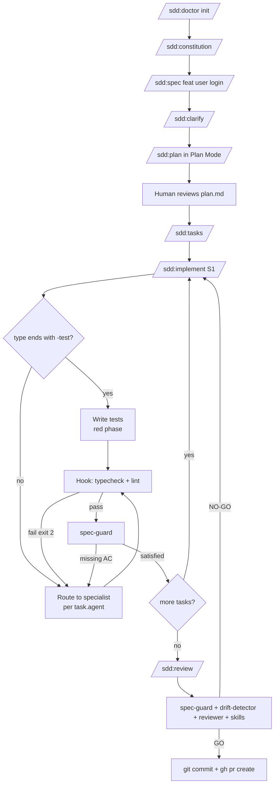

<div align="center">

# 🧩 SDD Framework for Claude Code

[](LICENSE)
[](https://claude.com/claude-code)
[](CHANGELOG.md)
[](https://github.com/JanSzewczyk/spec-driven-development/stargazers)

**Spec-Driven Development for Claude Code — spec is the source of truth, code is its consequence.**

[Features](#-features) • [Quick Start](#-quick-start) • [Architecture](#-architecture) • [Documentation](#-table-of-contents)

</div>

---

## 👋 Why SDD

Vibe coding (loose prompt → AI guesses → iterate by trial and error) works for demos but produces spaghetti in production: every fix breaks something else, security gaps multiply, the codebase becomes unmaintainable.

SDD fixes this by enforcing **canonical phases**: `constitution → spec → clarify → plan → tasks → implement → review`. AI is forced to read and confirm a plan before writing a single line of code. Verification agents and blocking hooks make the feedback loop tight enough that the model **cannot skip** validation steps.

> SDD inverts traditional AI-assisted coding. Instead of "vibe coding" (vague prompt → AI guesses → fix loop), the **specification is the source of truth** and code is its mechanical consequence.

This framework is the synthesis of:

- GitHub Spec Kit (canonical phases)
- BMAD Method (sharding, role-based sub-agents)
- Amazon Kiro (hooks, Mermaid generation)
- OpenSpec (lightweight CLI for legacy code)
- Custom Claude Code workflows (slash commands, plan mode, custom agents)

The unique contribution of this framework: **per-task routing to your existing specialist sub-agents** (storybook-tester, nextjs-backend-engineer, testing-strategist, etc.) so SDD orchestrates your stack instead of duplicating it.

---

## ✨ Features

- 📋 **Canonical SDD phases**: `constitution → spec → clarify → plan → tasks → implement → review`
- 🏥 **`/sdd:doctor`** — preflight audit + one-command init
- 🎭 **Orchestration of existing sub-agents** (does not duplicate — invokes specialist agents from the plugin marketplace via the Task tool)
- 🏷️ **Tagged tasks** — every task in `tasks.md` has `project`, `type`, `agent`, `skills`, `depends_on` → auto-routing to the right specialist, and parallel waves for everything that does not block
- 🧱 **Any layout, any app** — single app, monorepo (Nx, Turborepo, workspaces) or several repositories; web, backend and mobile projects side by side, each with its own commands, hooks and specialists
- 🪝 **Auto-feedback hooks** — typecheck + lint block Claude via exit code 2
- 🌿 **Conventional Commits branches** — `/sdd:spec feat user login` → branch `feat/user-login`
- 📐 **TDD-first** — tests always before implementation
- 🧠 **Context discipline** — sub-agents receive only their scope, skills load on demand
- 🔍 **Drift detection** — built-in `drift-detector` and `/sdd:analyze` keep spec, plan, tasks, and code consistent

---

## 📖 Table of Contents

- [👋 Why SDD](#-why-sdd)
- [✨ Features](#-features)
- [🚀 Quick Start](#-quick-start)
- [📦 Plugins](#-plugins)
- [🔄 The SDD Flow](#-the-sdd-flow)
- [🏗️ Architecture](#-architecture)
  - [🧱 Three-tier agent hierarchy](#-three-tier-agent-hierarchy)
  - [🏷️ Per-task routing](#-per-task-routing)
  - [🧠 Context management](#-context-management)
  - [🪝 Verification hooks](#-verification-hooks)
  - [📇 Capabilities registry — hybrid mode](#-capabilities-registry--hybrid-mode)
- [⌨️ Slash Commands Reference](#-slash-commands-reference)
- [🤖 Sub-agents Reference](#-sub-agents-reference)
- [📋 End-to-end Example](#-end-to-end-example)
- [📁 File Structure](#-file-structure)
- [⭐ Best Practices](#-best-practices)
- [🚫 Anti-patterns](#-anti-patterns)
- [🧩 Design Decisions](#-design-decisions)
- [🔧 Troubleshooting](#-troubleshooting)
- [🤝 Contributing](#-contributing)
- [📝 Changelog](#-changelog)
- [📜 License](#-license)
- [🙏 Acknowledgments](#-acknowledgments)
- [📧 Contact & Support](#-contact--support)

---

## 🚀 Quick Start

### 1. Install the plugin (one-time, per machine)

Inside Claude Code (2.1.275 or later):

```
/plugin marketplace add JanSzewczyk/spec-driven-development
/plugin install sdd@spec-driven-development
```

Or from the shell:

```bash
claude plugin marketplace add JanSzewczyk/spec-driven-development
claude plugin install sdd@spec-driven-development
```

Then enable it in your user settings (`~/.claude/settings.json`):

```json
{
  "enabledPlugins": {
    "sdd@spec-driven-development": true
  }
}
```

(Depending on your Claude Code version, the `claude plugin install` command may handle this for you.)

Verify the install:

```bash
claude plugin list | grep sdd
```

You should see `sdd@0.7.0`. Once installed, the plugin's 9 slash commands, 4 verification sub-agents, and the `doctor` skill are available in **every** project — no per-project copy required. Hook scripts are NOT shipped by the plugin; doctor generates them per-project during init based on the detected stack.

### 2. Initialize a project

Open the target project in Claude Code and run:

```text
/sdd:doctor init      # bootstraps specs/constitution.md, specs/template.md, specs/capabilities.md, .claude/settings.json
/sdd:doctor check     # confirms 10/10 — plugin + per-project files present, constitution valid
/sdd:constitution     # edit specs/constitution.md (long-form, no token limit)
```

What `init` does:

- Bootstraps `specs/constitution.md` from the bundled template (skipped if already present — never overwrites).
- Copies `specs/template.md` (the base for new feature specs) into the project.
- Generates `specs/capabilities.md` by scanning your installed plugin marketplace (so it reflects the specialist agents and skills you actually have).
- Generates project-local hook scripts at `.claude/hooks/typecheck.sh` and `.claude/hooks/lint.sh` containing ONLY the tools your project actually uses — discovered from its scripts/tasks, CI and pre-commit config, and tool configs, for any language (no fixed stack list). Existing hook files are never overwritten — once you customise one, it's yours.
- Safe-merges `.claude/settings.json` with PostToolUse entries pointing at those project-local hooks. Existing keys (permissions, MCP config, your own hooks) are preserved verbatim.

> **`CLAUDE.md` is not touched.** The project-root `CLAUDE.md` (if you keep one as a Claude Code session loader) is fully owned by you — the SDD framework never reads or writes it. The source of truth is `specs/constitution.md`, edited via `/sdd:constitution`.

### 3. Build your first feature

```text
/sdd:spec feat user can reset password via email
/sdd:clarify
/sdd:plan                 # run in Plan Mode (Shift+Tab)
/sdd:tasks
/sdd:implement S1         # a whole Story per session (recommended); /sdd:implement S2 ...
...
/sdd:review
```

### Forking the plugin for your own organization

If you want a customized copy (e.g. with org-specific routing rules in `capabilities.md.template`):

1. Fork this repo to your GitHub org and update the `homepage` field in `plugins/sdd/.claude-plugin/plugin.json`.
2. (Optional) Edit `plugins/sdd/skills/doctor/templates/capabilities.md.template` to pre-populate task-type routing for your stack.
3. (Optional) Edit `plugins/sdd/skills/doctor/templates/constitution.md.template` to seed your standard "WHAT NOT TO DO" rules and rationale.
4. Bump the `version` in `plugins/sdd/.claude-plugin/plugin.json` and in the `sdd` entry of `.claude-plugin/marketplace.json`, and tag a release.
5. Users add your fork with `/plugin marketplace add <your-org>/<your-repo>` and install with `/plugin install sdd@spec-driven-development`.

---

## 📦 Plugins

| Plugin | Description | Commands | Agents | Skills |
| --- | --- | --- | --- | --- |
| [**sdd**](./plugins/sdd/.claude-plugin/plugin.json) | Spec-Driven Development flow — spec → clarify → plan → tasks → implement → review, with TDD and per-task routing to your specialist agents | 9 | 4 | 1 |
| [**sdd-board**](./plugins/sdd-board/.claude-plugin/plugin.json) | Claude Code Desktop side panel (a mod): current spec with phase, next command and tasks, plus an overview of all specs | | | |

See [Slash Commands Reference](#-slash-commands-reference) and [Sub-agents Reference](#-sub-agents-reference) for each one.

### sdd-board — SDD panel for Claude Code Desktop

An optional companion mod (needs Claude Code 2.1.287+). It docks a panel beside the transcript that reads your project's `specs/` folder, so you can see where each feature stands without opening the markdown files:

- **Current** tab — the active spec (from the git branch, or the one you pinned): title and status, a pipeline stepper (Spec → Clarify → Plan → Tasks → Implement → Review), the suggested next `/sdd:*` command with a button that puts it in the prompt (it never runs it), task progress, Stories with their tasks, and a viewer for `spec` / `plan` / `tasks` / `review`.
- **All** tab — every spec with its phase and task progress, filterable; **Show** pins one as current.
- Refreshes by itself: after Claude writes a file under `specs/`, after each turn, and on a 4 s poll for edits made elsewhere. Drawings use SVG in Desktop and VS Code and fall back to text in the terminal.

```
/plugin install sdd-board@spec-driven-development
/sdd-board        # open or focus the panel (it also opens by itself when the project has specs/)
```

Try it from a checkout without installing: `claude --plugin-dir plugins/sdd-board`.

---

## 🔄 The SDD Flow



| Phase | Command | What happens |
|-------|---------|--------------|
| **Constitution** | `/sdd:constitution` | Edit `specs/constitution.md` — the long-form source of truth (tech stack, conventions, **WHAT NOT TO DO** with rationale, testing philosophy, out-of-scope). No token limit. The only file this command touches. |
| **Specify** | `/sdd:spec <type> <description>` | Validate clean git, create branch `<type>/<slug>`, generate `specs/<slug>/spec.md` (business only — no code) |
| **Clarify** | `/sdd:clarify` | AI reads spec.md and asks 5-10 targeted gap questions; updates spec with answers |
| **Plan** | `/sdd:plan` | Generate `plan.md` with Mermaid diagrams, data model, API surface, file-by-file change list. **Run in Plan Mode.** |
| **Tasks** | `/sdd:tasks` | Decompose plan into YAML tasks with `project`, `type`, `agent`, `skills`, `depends_on`, auto-routed via `capabilities.md`; waves + Mermaid flow per Story |
| **Implement** | `/sdd:implement <story-id>` | A whole Story wave by wave — unblocked tasks in parallel on their specialist agents, each with its own TDD loop; hooks enforce typecheck + lint per project |
| **Review** | `/sdd:review` | spec-guard + drift-detector + reviewer + domain skills → verdict GO/NO-GO → commit + PR |
| **Analyze** | `/sdd:analyze` | Diagnostic — find drift between spec ↔ plan ↔ tasks ↔ code (run anytime) |

---

## 🏗️ Architecture

### 🧱 Three-tier agent hierarchy

```text
┌─────────────────────────────────────────────────────────────┐
│  ORCHESTRATOR (main Claude session)                         │
│  • Reads specs/constitution.md, capabilities.md, spec/plan/tasks │
│  • Routes work to specialist agents via Task tool           │
│  • Runs verification agents at review time                  │
└─────────────────────────────────────────────────────────────┘
              ↓ Task tool                  ↓ Task tool
┌───────────────────────────┐  ┌──────────────────────────────┐
│  SPECIALIST AGENTS         │  │  VERIFICATION AGENTS         │
│  (plugin-based, YOUR stack)│  │  (generic SDD, 4 agents)     │
│  • storybook-tester         │  │  • spec-guard            │
│  • nextjs-backend-engineer  │  │  • drift-detector        │
│  • testing-strategist       │  │  • reviewer              │
│  • (other from marketplace) │  │  • ui-critic             │
└───────────────────────────┘  └──────────────────────────────┘
              ↓ "Use skill: X"
┌─────────────────────────────────────────────────────────────┐
│  SKILLS (in-context references, loaded on demand)           │
│  • @szum-tech/server-actions, design-system, ...            │
│  • react-doctor, accessibility-audit                        │
│  • find-skills (dynamic discovery)                          │
└─────────────────────────────────────────────────────────────┘
```

This framework adds:

- 1 skill (`doctor`)
- 9 slash commands (`/sdd:doctor`, `/sdd:constitution`, `/sdd:spec`, `/sdd:clarify`, `/sdd:plan`, `/sdd:tasks`, `/sdd:implement`, `/sdd:review`, `/sdd:analyze`)
- 4 verification agents (`spec-guard`, `drift-detector`, `reviewer`, `ui-critic`)
- 2 hook scripts (`.claude/hooks/typecheck.sh`, `.claude/hooks/lint.sh`) generated per-project by `/sdd:doctor init` from the detected stack

All **specialist agents and skills already exist** in the plugin marketplace — SDD orchestrates them, it does not duplicate them.

### 🏷️ Per-task routing

Every task in `tasks.md` carries a YAML block — it names the **project** it belongs to, the agent
that runs it, and the tasks it waits for:

```yaml
- id: T1.2
  title: Password reset endpoints
  project: api                    # from capabilities.md "Projects"; `root` in a single-app repo
  type: implementation
  tdd: test-first                 # the red→green cycle happens inside the task
  agent: python-developer         # routed by type + the project's stack
  skills: [fastapi-rules]
  model: sonnet
  depends_on: [T1.1]              # what blocks this task
  acceptance: AC1, AC2
  tests: [apps/api/tests/test_reset.py]
  files: [apps/api/app/auth/reset.py]
```

When the user runs `/sdd:implement S1`:

1. **Orchestrator** parses the Story's tasks and builds **waves** from `depends_on`.
2. **Each wave runs in parallel** — one `Task`-tool call per task in a single message:
   `subagent_type` = the task's `agent` (`general-purpose` for `orchestrator`), `model` = its tier.
   Each subagent gets only its task, the spec and plan slices it serves, its project's test command,
   and the rule to edit only its own `files`/`tests`.
3. **Inside each task**: failing tests first (meaningful red), then the implementation to green.
4. **Hooks** (PostToolUse) run the edited file's *project's* typecheck + lint after every Write.
5. **After each wave**: the wave's tests run per project; the next wave starts only when they pass.
6. **Spec-guard** verifies the Story's combined diff once, at the end.
7. **Status** in `tasks.md`: `draft` → `in-progress` → `review`.

### 🧠 Context management

Three techniques prevent context bloat:

1. **Per-task delegation** — specialists receive only their scope (spec + plan sections, never the whole feature)
2. **Skills on-demand** — `Use skill: X` only loads when needed
3. **Fresh chat per Story** — open a new Claude session between stories; `tasks.md` status is the handover document

### 🧱 Monorepos, several repositories, any kind of app

SDD reasons about **projects**, not about one stack. `/sdd:doctor init` finds them — an Nx or Turborepo workspace, pnpm/yarn/uv/Cargo/Go workspaces, Gradle includes, or stray manifests such as `apps/api/pyproject.toml` — and asks which sibling repositories belong to the product when the code is spread over several repos.

- **`capabilities.md` → `## Projects`** lists each one with its kind (web, backend, mobile, library, e2e …), path and stack; the routing table's `Stack` column sends the same task type to a different specialist per project.
- **Constitution §2** has one command row per project (`test`, `coverage`, `typecheck`, `lint`, `dev / ui-preview`), so a Python API runs `uv run --project apps/api pytest`, the web app `pnpm nx run web:test`, a Flutter app `flutter test`.
- **Hooks route by path**: an edit in `apps/api/` runs that project's `ruff`/`mypy` from its own directory and virtualenv; an edit in `apps/web/` runs the web project's typecheck target — never a repo-wide `tsc` from the root.
- **Several repositories**: assumes everyone checks the sibling repos out next to the spec repo under the same names (the relative paths are committed). `specs/` lives in one spec repo; `/sdd:implement` opens the same feature branch in each sibling repo it touches, and `/sdd:review` commits and opens a linked PR in every one of them. `init` adds the sibling repos to `permissions.additionalDirectories`.
- **UI review** (`ui-critic`) covers web projects; mobile and desktop UI is skipped unless a screenshot skill or MCP server for that platform is installed.

If you keep a Claude Code session loader (`CLAUDE.md` at the project root or per-module), keep it lean — Claude starts ignoring content past the first couple of thousand tokens. A useful convention is to point it at `specs/constitution.md` for detail and shard per module when the root file grows:

- `CLAUDE.md` (root, cross-cutting concerns)
- `apps/web/CLAUDE.md` (frontend-specific)
- `apps/api/CLAUDE.md` (backend-specific)
- `packages/ui/CLAUDE.md` (component library)

The SDD framework itself does not read, write, or enforce any structure on these files — they are entirely yours.

### 🪝 Verification hooks

Hook scripts are **not shipped by the plugin** — they're technology-specific, so the plugin would have to bake in assumptions about every possible stack. Instead, because the doctor skill is LLM-driven, `/sdd:doctor init` **inspects how your project actually checks its code** — its declared scripts/tasks (`package.json`, `Makefile`, Gradle/Maven, etc.), CI and pre-commit config, and tool config files — then generates minimal hooks that reproduce *those* commands, for **only the tools your project uses**:

```text
<project>/.claude/hooks/typecheck.sh   # e.g. just `tsc` for a Next.js + TS project
<project>/.claude/hooks/lint.sh        # e.g. just `biome` if Biome is detected
```

**There is no fixed list of supported stacks.** New languages and code-quality tools appear constantly; the skill detects and reproduces whatever your project uses — TypeScript, Python, Rust, Go, Deno, Java/Kotlin, Ruby, PHP, C#/.NET, Swift, Elixir, or a tool released last month. A few worked examples, to show the shape:

- **TypeScript / JavaScript** — `tsc --noEmit` for typecheck; the linter the project depends on (Biome / ESLint / oxlint)
- **Python** — `mypy`/`pyright` for typecheck; `ruff check` for lint
- **Rust** — `cargo check` for typecheck; `cargo clippy` for lint &nbsp;·&nbsp; **Go** — `go vet` / `golangci-lint`
- **Java** — the build tool's compile task as typecheck (`./gradlew compileJava` → `mvn compile`); Checkstyle/PMD/SpotBugs for lint when configured
- **…anything else** — the skill reuses the exact command your project already runs to verify code

The plugin ships a handful of these as starter patterns in `templates/hooks/`; the skill extends them by analogy for tools they don't cover. PostToolUse entries in `.claude/settings.json` run the generated scripts after every `Edit`/`Write`/`MultiEdit`. Exit code **2** blocks Claude until the diagnostic is fixed; missing tools exit 0 (safe no-op).

**Stack-aware, non-destructive, idempotent.** `/sdd:doctor init`:

- Generates hook scripts only when they don't exist — your customisations are sacred.
- Safe-merges `.claude/settings.json`, preserving every non-SDD key (permissions, MCP config, your own hooks, model overrides).
- On re-init, strips stale SDD-managed entries (including legacy v0.4 plugin-path entries) and re-adds fresh ones built from current detection.

### 📇 Capabilities registry — hybrid mode

`specs/capabilities.md` has two kinds of sections:

- **`<!-- auto-generated -->`** — overwritten by `/sdd:doctor init` on every run (it scans `~/.claude/plugins/cache/`)
- **`<!-- user-override -->`** — preserved untouched, the safe place to keep customizations

This lets you re-run `init` (e.g., after installing a new plugin) without losing your custom task-type routing rules.

Example schema:

```markdown
## Specialist agents (delegate implementation work)
<!-- auto-generated -->
- **storybook-tester** (szum-tech) — Storybook stories + interaction tests
- **nextjs-backend-engineer** (szum-tech) — Server Actions, route handlers
- **testing-strategist** (szum-tech) — test strategy planning

## Skills (load into context on demand)
<!-- auto-generated -->
- `@szum-tech/server-actions` — Server Action patterns
- `@szum-tech/design-system` — components, design tokens, OKLCH palette
- ...

## Projects
<!-- auto-generated -->
- **web** — web · apps/web · TypeScript, Next.js 15; pnpm + nx
- **api** — backend · apps/api · Python 3.13, FastAPI; uv
- **mobile** — mobile · ../mobile-app (repo) · Flutter 3, Dart

## Task type → routing rules
<!-- user-override -->
| Task type           | Stack   | Specialist agent          | Skills to load                    | Model  |
|---------------------|---------|---------------------------|-----------------------------------|--------|
| implementation      | *       | (orchestrator)            | —                                 | sonnet |
| implementation      | python  | python-developer          | fastapi-rules, pytest-rules       | sonnet |
| implementation      | nextjs  | nextjs-backend-engineer   | server-actions, error-handling    | sonnet |
| ...                 | ...     | ...                       | ...                               | ...    |
```

---

## ⌨️ Slash Commands Reference

### 🏥 `/sdd:doctor [check|init]`

Preflight audit and auto-setup. **10 checks**: specs/constitution.md, specs/template.md, plugin installed, plugin enabled (looked up across user / project / local settings layers), specs/capabilities.md valid, .claude/settings.json hooks, git + gh, tooling, specialist agents discoverable, project type detected.

- `check` (default) — report only, statuses ✅/⚠️/❌
- `init` — bootstrap missing files (constitution, template, capabilities, settings.json hook entries) and auto-detect installed plugins + project stack. Idempotent: re-running it preserves `<!-- user-override -->` sections in `capabilities.md` and every non-SDD key in `settings.json`. Never touches the project-root `CLAUDE.md`.

### 📜 `/sdd:constitution`

Edit `specs/constitution.md` — the long-form project constitution (no token limit). This is the source of truth where every "WHAT NOT TO DO" rule carries its rationale, every architectural decision its trade-off. This is also the ONLY file the command modifies. If the constitution file is missing, the command directs the user to run `/sdd:doctor init` first (which bootstraps it from the bundled template).

### 🌿 `/sdd:spec <type> <description>`

Phase 1 — Specify. Requires `<type>` ∈ {`feat`, `fix`, `chore`, `refactor`, `docs`} (Conventional Commits).

Steps:

1. Verify clean git tree (`git status --porcelain`) — STOP if dirty
2. Parse `<type>` and generate `feature_slug` (kebab-case) and `feature_title` (Title Case)
3. Create branch `<type>/<feature_slug>`
4. Generate `specs/<feature_slug>/spec.md` from `specs/template.md`

⛔ The spec file is **business-only** — no code, no tech stack details.

### ❓ `/sdd:clarify`

Phase 2 — Clarify. AI reads the current spec.md and asks 5-10 targeted questions about gaps (ambiguous requirements, missing edge cases, vague acceptance criteria). When the user answers, the spec is updated automatically.

### 🗺️ `/sdd:plan`

Phase 3 — Plan. **Run in Plan Mode** (Shift+Tab): Claude reads and analyzes, drafts the plan in the session's plan file, and calls ExitPlanMode — approving that dialog is your review of the plan, and only then is it saved to `specs/<slug>/plan.md`. Without Plan Mode the plan is written directly and the command stops for you to read it.

Generates `plan.md` with:

- High-level approach
- Data model (Mermaid ER diagram)
- Component diagram (Mermaid flowchart)
- API surface table
- File-by-file change list
- Reused utilities (citing existing code paths)
- Risks & mitigations

After generation, **human review of plan.md is mandatory** before proceeding to `/sdd:tasks`.

### 🧩 `/sdd:tasks`

Phase 4 — Tasks. Decompose `plan.md` into a tagged task list (fields as in [Per-task routing](#-per-task-routing)):

- **One Epic per feature, Stories are user stories.** A Story like "user resets their password" may span the API, the web app and the mobile app; each task names its `project`.
- **One task = one unit of behaviour with its tests**, in one project. The TDD shape is a field, not extra tasks:
  - **`tdd: test-first`** (default) — failing test first, then the implementation. A missing export doesn't force contract-first; stub it trivially so the test fails on a **real assertion**.
  - **`tdd: contract-first`** (narrow exception) — the unit's deliverable *is itself a public interface/contract* other code references by shape (a UI component's props, a typed service interface, an API/RPC schema): contract → failing tests → implementation, all inside the task.
- **A contract shared between projects is its own task** (an OpenAPI/pydantic schema the web and mobile clients are generated from, shared types, a migration). Its consumers depend on it — and can then be built in parallel.
- **`depends_on`** says what blocks what: a task depends on another only when it needs its result or touches the same files. No dependency just because of list order.
- **Waves + flow diagram.** Under every Story, `/sdd:tasks` writes the execution waves (`1: T1.1 · 2: T1.2 ∥ T1.3 ∥ T1.4 · 3: T1.5`) and a Mermaid flowchart — one subgraph per wave, one colour per project — so you see the order and what runs in parallel before anything is built.

### 🔨 `/sdd:implement <story-id or task-id>`

Phase 5 — Implement a **whole Story** (recommended), or a single task. Pipeline:

1. Resolve scope and build the **waves** from `depends_on`; mark the tasks `in-progress`. A dependency that is not done yet stops the run (single-task mode names the blocking tasks).
2. **Polyrepo:** before the first edit in a sibling repository, create the same feature branch there.
3. **Run the waves.** A wave with several tasks runs them **in parallel** — one subagent per task, each on its own agent and `model` tier, each editing only its own `files`/`tests` and doing its own red → green.
4. Hooks run automatically after every edit, for the edited file's project (typecheck + lint, exit 2 on failure).
5. After each wave the wave's tests run with each project's own `test` command; the next wave starts only when they pass. Tasks flip to `review`.
6. `spec-guard` verifies the Story's combined diff — **once, at the Story boundary** (per repository when the Story touched several).

✅ Parallel where the work allows it, sequential where it must be: the order comes from real dependencies, not from list position. A `tasks.md` written before this format (separate test and implementation tasks, no `depends_on`) still runs, sequentially, in listed order.

### 🔍 `/sdd:review`

Phase 6 — Final audit before PR. Runs in sequence:

1. Full test suite — once (the `test` / `coverage` command from `specs/constitution.md` §2)
2. `spec-guard` over the entire feature diff (committed + uncommitted + untracked files, against the merge base with `main`)
3. `drift-detector` over spec ↔ plan ↔ tasks ↔ code
4. `ui-critic` when UI files changed (soft check)
5. `reviewer` agent receives all of the above, invokes the domain skills from `capabilities.md` relevant to the diff and writes `specs/<slug>/review.md` with verdict GO / NO-GO
6. On GO: shows the commit title, PR title and file list and asks before committing; then stages exactly those files, `git commit` (Conventional Commits format) + `gh pr create` with body linking to `spec.md`
7. On NO-GO: list concrete blockers

### 📊 `/sdd:analyze`

Diagnostic tool — run anytime to detect drift between spec ↔ plan ↔ tasks ↔ code. Useful before `/sdd:review` to avoid a NO-GO verdict.

Outputs a markdown matrix:

- ✅ **Aligned** items (spec AC → plan → task → commits)
- ⚠️ **Drift** items (with file paths and suggested fixes)
- 🔴 **Critical** conflicts (spec says X, code does contradictory Y)

⛔ Read-only — never edits files.

---

## 🤖 Sub-agents Reference

This framework introduces **only 4 new generic agents**. Everything else is your existing plugin specialists, invoked via `Task` tool with `subagent_type`.

### 🛡️ `spec-guard`

**Purpose:** Verify that a code diff satisfies all Acceptance Criteria from `spec.md` and does not introduce out-of-scope changes.

**Called by:** `/sdd:implement` (once per Story) and `/sdd:review` (whole feature).

**Output:** JSON

```json
{
  "satisfied": true | false,
  "ac_satisfied": ["AC1", "AC2"],
  "ac_missing": [
    {"id": "AC3", "description": "...", "reason": "no implementation in diff"}
  ],
  "out_of_scope": [
    {"file": "src/Header.tsx", "summary": "logo change unrelated to auth flow"}
  ],
  "non_goal_violations": []
}
```

Strict constraints: **never** writes code, **never** suggests fixes (only reports gaps), **never** judges code quality (that's `reviewer`'s job).

### 🔀 `drift-detector`

**Purpose:** Find inconsistencies between documentation layers (`spec.md`, `plan.md`, `tasks.md`) and the current code state.

**Called by:** `/sdd:review` and `/sdd:analyze`.

Cross-checks performed:

- **Spec → Plan**: every AC has a corresponding entry in plan.md
- **Plan → Tasks**: every file in plan.md's "File-by-file" list has a covering task
- **Tasks → Code**: tasks marked `done`/`review` actually changed their declared `files`
- **Spec → Code**: AC coverage in test files; `TODO`/`FIXME` in code matches Open Questions in spec

**Output:** Markdown report with severity tiers (✅ Aligned / ⚠️ Drift / 🔴 Critical) and a suggested fix per drift item.

### 🧐 `reviewer`

**Purpose:** Final quality audit before PR. Orchestrates domain-specific audits and decides GO/NO-GO.

**Called by:** `/sdd:review`, which passes it the test results and the spec-guard, drift-detector and ui-critic results — it does not re-run the suite or start sub-agents itself.

Pipeline:

1. Read the test results from the prompt (any failure → NO-GO)
2. Check coverage against the targets in `specs/constitution.md` §6
3. Invoke the audit skills from `capabilities.md` relevant to the diff, e.g. for a React project:
   - `react-doctor` skill if `.tsx`/`.jsx` files changed
   - `accessibility-audit` skill if UI components touched
   - `@szum-tech/server-actions` skill if server actions added
4. Verify commit messages follow Conventional Commits (when the branch has commits)
5. Generate `specs/<slug>/review.md` with verdict, including the spec-guard, drift and visual-review sections
6. Block GO if any test fails, spec-guard is not satisfied, or any critical a11y/security violation exists

**Output:** JSON `{verdict: "GO" | "NO_GO", blockers: [...], warnings: [...]}`

### 🎨 `ui-critic`

**Purpose:** Visual review of changed UI components — captures Storybook screenshots via a browser MCP and evaluates them for design-system adherence, layout regressions, and rendering issues.

**Called by:** `/sdd:review` when the diff contains UI component files (e.g. `.tsx`/`.stories.tsx`). Storybook URL and start command come from the `ui-preview` row of `specs/constitution.md` §2.

**Requirements:** A browser MCP server connected (e.g. `Claude_in_Chrome`, `Claude_Preview`, or Playwright MCP) plus a running Storybook (default `http://localhost:6006`). If either is missing, the agent returns verdict `SKIPPED` and the review continues without blocking.

**Output:** JSON

```json
{
  "verdict": "OK" | "WARNINGS" | "ISSUES" | "SKIPPED",
  "skip_reason": "no_mcp | storybook_unreachable | null",
  "components_reviewed": ["LoginForm", "Header"],
  "findings": [
    {
      "component": "LoginForm",
      "severity": "issue",
      "category": "design-system",
      "detail": "Submit button uses raw #3B82F6 — should use --color-primary-500",
      "screenshot": "./.sdd-screenshots/LoginForm.png"
    }
  ]
}
```

Severity classification: `issue` (visible bug, blocks GO), `warning` (suboptimal but functional), `info` (observation). `SKIPPED` never blocks `/sdd:review` — it surfaces an infrastructure note instead.

Screenshots are saved under `./.sdd-screenshots/` — add this path to `.gitignore`.

---

## 📋 End-to-end Example

Feature: **"User can reset password via email"**.

### Install + initialize

Install the plugin once per machine, then in any project:

```bash
cd ~/Projects/my-app && git init
```

In Claude Code:

```text
/sdd:doctor init       # auto-detects Next.js 15 + TS + Vitest + Storybook
/sdd:doctor check      # ✅ READY (10/10)
/sdd:constitution      # fill specs/constitution.md: Tech stack, Run/build, WHAT NOT TO DO with rationale
```

### Spec phase

```text
/sdd:spec feat user can reset password via email
```

Effects:

- ✅ Clean git verified
- ✅ Branch `feat/user-can-reset-password-via-email` created
- ✅ `specs/user-can-reset-password-via-email/spec.md` generated

You open the spec, fill in:

- User stories (Reset via email, optional MFA)
- Acceptance criteria (AC1: token valid for 1h, AC2: rate-limited to 3 attempts, …)
- Edge cases (unknown email — silent success per security best practice)

### Clarify

```text
/sdd:clarify
```

Claude asks:

1. **AC1**: should expired tokens return 410 or 401?
2. **AC2**: is the rate limit per IP, per email, or both?
3. **Edge case**: what if SMTP delivery fails — retry or fail loud?
4. ...

You answer in chat. Spec is updated.

### Plan

Enable Plan Mode (Shift+Tab):

```text
/sdd:plan
```

Generates `specs/.../plan.md`:

- Data model (Mermaid ER): `User`, `PasswordResetToken`
- Component diagram (Mermaid): `ResetForm → Action → Service → DB + Mailer`
- API surface: `POST /actions/resetPassword`
- File-by-file change list (8 files)
- Reused: `packages/errors/AuthError`, `packages/db/prismaClient`

**Read plan.md manually**, correct anything wrong.

### Tasks

```text
/sdd:tasks
```

Generates one Story with tasks across three projects — the shared contract first, then the API, web and mobile work in parallel, then the end-to-end test:

```yaml
# Story S1: User resets their password

- id: T1.1
  title: Password reset API contract (request + confirm schemas, OpenAPI)
  project: api
  type: contract
  tdd: contract-first
  agent: orchestrator
  depends_on: []
  acceptance: OpenAPI exposes POST /auth/reset and /auth/reset/confirm per AC1–AC3; schema tests pass
  tests: [apps/api/tests/test_reset_schema.py]
  files: [apps/api/app/auth/schemas.py, apps/api/openapi.json]

- id: T1.2
  title: Password reset endpoints
  project: api
  type: implementation
  tdd: test-first
  agent: python-developer
  depends_on: [T1.1]
  acceptance: AC1, AC2, AC3
  tests: [apps/api/tests/test_reset.py]
  files: [apps/api/app/auth/reset.py]

- id: T1.3
  title: Reset password form
  project: web
  type: implementation
  tdd: test-first
  agent: nextjs-backend-engineer
  depends_on: [T1.1]
  acceptance: AC1, AC4 against the generated API client
  tests: [apps/web/src/features/reset/reset-form.test.tsx]
  files: [apps/web/src/features/reset/reset-form.tsx]

- id: T1.4
  title: Reset password screen
  project: mobile
  type: implementation
  tdd: test-first
  agent: orchestrator
  depends_on: [T1.1]
  acceptance: AC1, AC4 on the mobile screen
  tests: [../mobile-app/test/reset_screen_test.dart]
  files: [../mobile-app/lib/features/reset/reset_screen.dart]

- id: T1.5
  title: Password reset end-to-end flow
  project: e2e
  type: e2e-test
  tdd: test-first
  agent: orchestrator
  depends_on: [T1.2, T1.3]
  acceptance: a user requests a reset on the web, follows the link and sets a new password
  tests: [apps/web-e2e/src/reset.spec.ts]
```

**Waves:** 1: T1.1 · 2: T1.2 ∥ T1.3 ∥ T1.4 · 3: T1.5 — plus the Mermaid flow diagram of the same graph.

### Implement

```text
/sdd:implement S1
```

- **Wave 1:** `T1.1` declares the reset schemas and their tests (contract-first).
- **Wave 2:** three subagents in parallel — `python-developer` on the API endpoints, `nextjs-backend-engineer` on the web form, a general-purpose agent on the Flutter screen. Each writes failing tests first, then the code, touching only its own files; the hooks check each file with its own project's tools.
- **Wave 3:** the end-to-end test, once the API and web tasks are green.

One `spec-guard` at the Story boundary; every task flips to `review`.

> Need to re-run just one task after a fix? A task ID still works: `/sdd:implement T1.3` (it checks that `T1.1` is done first).

### Review

```text
/sdd:review
```

Pipeline executes:

1. Tests: 23/23 passed
2. `spec-guard`: all 4 AC satisfied
3. `drift-detector`: no drift
4. `ui-critic` sub-agent: verdict `OK` — screenshots saved to `.sdd-screenshots/` (or `SKIPPED` if no browser MCP / Storybook available)
5. `reviewer`: orchestrates skills
   - `react-doctor` skill: 89/100
   - `accessibility-audit` skill: 0 critical
   - Conventions: OK
6. Verdict: **GO** — you confirm the commit and PR
7. Commit: `feat(reset-password): add email-based reset flow`
8. PR opened with body referencing `specs/user-can-reset-password-via-email/spec.md`

### Typical timeline

| Step | Time |
|------|------|
| `/sdd:doctor init` | 30 s |
| `/sdd:spec` | 1 min (Claude generates, you edit business spec) |
| `/sdd:clarify` × 2 | 5 min (Q&A) |
| `/sdd:plan` (Plan Mode) | 3 min (analysis + generation) |
| Human review of plan.md | 5-10 min |
| `/sdd:tasks` | 1 min |
| `/sdd:implement` × 1-3 Stories (waves run in parallel) | 1-3 h (most of the time here) |
| `/sdd:review` | 5 min |
| **Total** | **~2-4 h** for a medium feature |

Without SDD a similar feature is 4-6 h with frequent rework. With SDD: 2-4 h, deterministic.

---

## 📁 File Structure

### In your project (after `/sdd:doctor init`)

Only per-project artifacts. Commands / agents / verification skills live in the installed plugin, not in your project.

```text
your-project/
├── specs/
│   ├── constitution.md                    # source of truth — created by `/sdd:doctor init` if missing, edited by `/sdd:constitution`
│   ├── template.md                        # base template for new feature specs
│   ├── capabilities.md                    # hybrid: auto-generated agents/skills/projects + user-override routing rules
│   └── <feature-slug>/
│       ├── spec.md                        # business specification
│       ├── plan.md                        # architecture + Mermaid diagrams
│       ├── tasks.md                       # YAML tasks with routing tags, dependencies, waves + Mermaid flow
│       └── review.md                      # generated by /sdd:review
├── .claude/
│   ├── settings.json                      # PostToolUse hook entries → project-local scripts (safe-merged; user keys preserved)
│   └── hooks/
│       ├── typecheck.sh                   # generated from detected stack; existing files never overwritten
│       └── lint.sh                        # generated from detected stack; existing files never overwritten
└── CLAUDE.md                              # (optional, user-owned) Claude Code session loader — never touched by SDD
```

> **Files SDD creates / edits:** `specs/constitution.md`, `specs/template.md`, `specs/capabilities.md`, SDD-tagged hook entries inside `.claude/settings.json`, and (if missing) the generated `.claude/hooks/typecheck.sh` + `.claude/hooks/lint.sh`. Per-feature artifacts under `specs/<slug>/` are produced by the SDD flow commands. Everything else — including the root `CLAUDE.md`, any non-SDD keys in `.claude/settings.json`, and any hook script that already exists — is owned by you and is never modified.

### In the repository (installed once per machine)

```text
spec-driven-development/                    # or your own forked plugin path
├── .claude-plugin/
│   └── marketplace.json                   # marketplace: sdd + sdd-board
├── README.md / LICENSE / CHANGELOG.md / CONTRIBUTING.md / .github/
└── plugins/
    ├── sdd-board/                         # Desktop side panel (mod)
    │   ├── .claude-plugin/plugin.json
    │   ├── hooks/                         # hooks.json + register.ts (hooks), parse/model/view/svg (pure modules)
    │   └── tests/                         # run with `claude plugin test`
    └── sdd/                               # the SDD plugin
        ├── .claude-plugin/plugin.json     # plugin manifest
        ├── skills/
        │   └── doctor/                    # LLM-driven skill — no Python helpers
        │       ├── SKILL.md               # the full procedure for `check` + `init`
        │       ├── reference/
        │       │   └── settings-merge.md  # mechanical safe-merge procedure for settings.json
        │       └── templates/             # bundled seed files read by `init`
        │           ├── constitution.md.template   # long-form project constitution
        │           ├── capabilities.md.template   # auto-generated + user-override hybrid
        │           ├── specs/template.md          # base for new feature specs
        │           └── hooks/                     # per-tool shell snippets composed into project hooks
        │               ├── typecheck.sh.template
        │               └── lint.sh.template
        │       # settings.json is NOT a template — init builds hook entries from detected
        │       # tools and safely merges them into any existing file.
        ├── commands/                      # 9 slash commands (auto-discovered)
        │   ├── doctor.md
        │   ├── constitution.md / spec.md / clarify.md / plan.md
        │   └── tasks.md / implement.md / review.md / analyze.md
        └── agents/                        # 4 verification sub-agents
            ├── spec-guard.md
            ├── drift-detector.md
            ├── reviewer.md
            └── ui-critic.md               # optional — needs browser MCP
```

> **No `hooks/` in the plugin.** Hook scripts are technology-specific and are generated per-project by `/sdd:doctor init` under `<project>/.claude/hooks/`. The plugin only carries the per-tool shell snippets (`templates/hooks/`) that doctor composes into those scripts, keeping only the blocks for the tools your project actually has.

---

## ⭐ Best Practices

Thirteen actionable rules drawn from the source materials (Spec Kit, BMAD, Kiro, OpenSpec, Anthropic guidance):

1. **🧪 Force AI to validate its own work.** Every task's `acceptance` field must be measurable. Hooks make typecheck/lint non-skippable. Default to **test-first** TDD (failing test first, then implementation; trivially stub a missing symbol so the test fails on a real assertion). Use **contract-first** TDD only when the unit's deliverable is itself a public interface/contract other code references by shape: declare the contract first, then the tests (which now fail with meaningful assertion errors), then the implementation — following the project's own conventions for where interfaces live.
2. **📜 The constitution is the WHY.** Every "WHAT NOT TO DO" rule in `specs/constitution.md` should have a `**Why:**` line (and an incident reference when applicable). After every Claude mistake, append the lesson — with its rationale — to the constitution. Without rationale, rules become folklore and get re-broken. If you also maintain a Claude Code session loader (`CLAUDE.md`), use it to surface the most-broken rules and point at the constitution for detail — but that file is yours to shape, not the framework's.
3. **✂️ Shard large specs.** Never hand a giant PRD to an implementer agent. Break it into Epic → Story → Task. Each specialist receives only its slice.
4. **📁 Separate `CLAUDE.md` per module.** Root for cross-cutting, `apps/web/CLAUDE.md` for frontend, `apps/api/CLAUDE.md` for backend. Frontend code shouldn't burn tokens reading database rules.
5. **🔒 Use Plan Mode before edits.** `/sdd:plan` and `/sdd:clarify` ideally run in Plan Mode (Shift+Tab) so Claude cannot accidentally modify files during exploration.
6. **👤 Human-in-the-loop on `plan.md`.** Always read the generated plan before `/sdd:tasks`. This is the cheapest moment to correct course.
7. **🌿 One branch per feature.** `/sdd:spec` enforces it. Conventional Commits naming (`feat/...`, `fix/...`).
8. **🤝 Use sub-agents for large reads.** Don't grep 50 files in the main session — invoke a `Task` tool sub-agent and receive only a summary.
9. **🔄 Keep spec ↔ code in sync.** When you change code manually, update the spec. Use `/sdd:analyze` to detect drift periodically.
10. **💬 Fresh chat per Story — and `/clear` between phases.** Open a new Claude session when switching to a new Story, and `/clear` between `plan → tasks → implement → review`. Every phase command re-reads its inputs from disk (`spec.md` / `plan.md` / `tasks.md` / `capabilities.md`), so clearing loses no context — each phase starts from a small, cheap context. `tasks.md` status is your handover document.
11. **❓ Embrace the Clarify phase.** Letting AI ask questions before planning surfaces gaps that would otherwise burn implementation cycles.
12. **💰 Tier your models.** Run judgement-heavy phases (`/sdd:constitution`, `/sdd:spec`, `/sdd:clarify`, `/sdd:plan`, `/sdd:review`) on Opus; run mechanical phases (`/sdd:tasks`, `/sdd:implement`, `/sdd:analyze`) on Sonnet (Haiku for trivial work). See "Cost & model tiering" below.
13. **📦 Batch human feedback.** Collect visual/QA tweaks and NO-GO fixes into one message per round instead of many small turns — each turn reprocesses the full context and multiplies cost.

---

## 🚫 Anti-patterns

What to avoid — common failure modes when adopting SDD:

- ❌ **Skipping `/sdd:clarify`** "because I know what I want." Open questions almost always surface real gaps.
- ❌ **Skipping human review of `plan.md`.** Claude can hallucinate architecture, especially on unusual stacks.
- ❌ **Running unrelated Stories in one chat.** Context bloats, hallucinations rise. One **Story** per session is the ideal — its tasks share scope and a single red→green cycle; don't chain Story after Story in the same chat.
- ❌ **Manual `git commit` instead of `/sdd:review`.** You bypass `spec-guard` / `drift-detector` / `reviewer`.
- ❌ **Code or tech details in `spec.md`.** The spec is a business document. Implementation belongs in plan.md and code.
- ❌ **Bloated `CLAUDE.md`.** Above ~2,500 tokens, Claude starts ignoring the bottom. Shard per module.
- ❌ **`--dangerously-skip-permissions` in production.** A hallucinated bash command can destroy your system.
- ❌ **Implementing without a spec.** SDD only works if every feature has its `specs/<slug>/spec.md` first.
- ❌ **Running Opus for mechanical phases.** Decomposition, TDD edits, and drift checks don't need the top tier — you pay Opus rates for Sonnet work.
- ❌ **Drip-feeding feedback.** Ten small "move this 2px" turns each reprocess the whole context. Batch them into one message per round.
- ❌ **Pulling generated diffs into the loop.** Regenerated clients/mocks/schemas (`*.msw.ts`, `*.schemas.ts`, …) balloon context and trigger false out-of-scope/drift findings. Declare them in `capabilities.md` → `Generated / out-of-band paths`.

---

## 💰 Cost & model tiering

The single biggest cost lever is **which model runs which phase**. A slash command can't switch the session model itself, so this is operating guidance the framework encodes as recommendations:

| Phase | Recommended model | Why |
|---|---|---|
| `/sdd:constitution`, `/sdd:spec`, `/sdd:clarify`, `/sdd:plan`, `/sdd:review` | **Opus** | Judgement-heavy — framing, architecture, and the final gate. Cheap to get right here, expensive to get wrong downstream. |
| `/sdd:tasks`, `/sdd:analyze` | **Sonnet** | Mechanical decomposition / cross-check. |
| `/sdd:implement` | **Sonnet** (Haiku for trivial Stories) | Mechanical TDD + edits. |

Two supporting mechanisms:

- **Per-task tier.** `capabilities.md`'s routing table carries a `Model` column; `/sdd:tasks` stamps each task with a `model:` tier, and `/sdd:implement` passes it as the `model` of the subagent that runs the task. Defaults: `sonnet` for test/implementation types, `haiku` for `refactor`/`generic`.
- **Per-agent tier.** The verification sub-agents carry their own `model:` frontmatter — `reviewer` on Opus (last line of defense), `spec-guard` / `drift-detector` / `ui-critic` on Sonnet — so they run at their own tier regardless of the session model.

Keep large and generated output **out of the main loop**: verification agents exclude the `Generated / out-of-band paths` globs from every diff, `/sdd:plan` extracts a design source (Figma/MCP) **once** inside a sub-agent and caches the distilled style spec into `plan.md`, and large codebase scans return only a summary via a sub-agent.

---

## 🧩 Design Decisions

Why this framework looks the way it does:

| Decision | Rationale |
|----------|-----------|
| **Per-project, not global** | Different projects have different stacks, different specialist agents, different routing rules. A global framework would force homogeneity. |
| **Only 4 new agents** | The rest already exists in the plugin marketplace (storybook-tester, nextjs-backend-engineer, …). Duplicating them would be wasted effort and version drift. |
| **YAML tags in tasks.md** | Explicit > heuristic. The user knows exactly which agent will be invoked for each task. |
| **Conventional Commits in `/sdd:spec`** | Branch names and commit messages aligned with industry standard. Compatible with semantic-release, changeset, etc. |
| **Hook exit code 2** | The strongest possible feedback signal for Claude. Cannot be ignored or skipped — Claude must fix the failure before continuing. |
| **Skills loaded on demand** | No global pre-loading means smaller context per task. Skills are referenced from `capabilities.md` and loaded only when the task type requires them. |
| **Plan Mode before `/sdd:implement`** | Forces human review and blocks destructive changes before a plan exists. |
| **Hybrid capabilities.md** | `<!-- auto-generated -->` sections reflect installed plugins. `<!-- user-override -->` sections preserve customizations. Re-running `init` is safe. |
| **Constitution lives under `specs/`, not in `CLAUDE.md`** | Two separate concerns. `specs/constitution.md` is the long-form source of truth — no token budget, rationale-rich, edited via `/sdd:constitution`. The project root `CLAUDE.md`, if you keep one, is a Claude Code session loader fully owned by you; the framework never reads, writes, or enforces its structure. |
| **Framework lives in the plugin, project owns its specs** | Commands, agents, hooks, and the doctor skill ship with the plugin (installed once per machine). The project keeps only what is genuinely project-specific: `specs/`, `.claude/settings.json`, and whatever `CLAUDE.md` you choose to maintain. Plugin updates roll out by reinstalling; project data is never overwritten. |

---

## 🔧 Troubleshooting

| Symptom | Likely cause | Fix |
|---------|--------------|-----|
| `/sdd:doctor check` shows ❌ on check #9 (specialist agents) | No plugins installed | Install relevant plugins (e.g., `@szum-tech` marketplace) and re-run `/sdd:doctor init` |
| Hooks not firing after Edit | `settings.json` not loaded, hook entries missing, or hook files not executable | Verify `.claude/settings.json` exists and its `hooks.PostToolUse` array contains entries pointing at `.claude/hooks/typecheck.sh` / `lint.sh`. Confirm the script files are executable (`chmod +x .claude/hooks/*.sh`). Re-run `/sdd:doctor init` to regenerate hook entries and any missing scripts from the detected stack. |
| `/sdd:spec` fails with "uncommitted changes" | Working tree dirty | `git stash` or commit current changes first |
| `/sdd:implement` keeps producing the same code despite hook failures | typecheck error not propagating | Run `bash .claude/hooks/typecheck.sh < /dev/null` manually and check it exits 2 on a real failure. Verify the toolchain (`tsc`, `mypy`, etc.) is installed and reachable on `$PATH`. |
| `/sdd:tasks` produces tasks with `agent: orchestrator` for everything | `capabilities.md` routing rules don't match task descriptions | Edit the `<!-- user-override -->` routing rules section in `capabilities.md` |
| `spec-guard` always returns `satisfied: true` even for incomplete code | Acceptance criteria in spec.md are too vague | Rewrite AC to be measurable (`input X → output Y`) |
| Plan Mode disabled but `/sdd:plan` still works | Plan Mode is recommended but not required | For correctness this is fine; for safety enable Plan Mode (Shift+Tab) |
| New specialist agent installed but not appearing in `capabilities.md` | `init` not re-run | `/sdd:doctor init` to rescan plugins |

---

## 🤝 Contributing

Contributions are welcome! See [CONTRIBUTING.md](CONTRIBUTING.md) for the development setup, the local smoke-test loop, style guidelines, and the PR checklist.

In short:

1. Fork the repository and create a feature branch (`git checkout -b feat/new-skill`)
2. Make changes inside the plugin (`plugins/sdd/commands/`, `plugins/sdd/agents/`, `plugins/sdd/skills/`, `plugins/sdd/skills/doctor/templates/`, `plugins/sdd/skills/doctor/reference/`, or the per-tool blocks in `plugins/sdd/skills/doctor/templates/hooks/*.sh.template`)
3. Exercise the doctor skill against a fresh project (`/sdd:doctor check` → `init` → `check`) and verify the artifacts by hand
4. Update the README's File Structure / reference sections and bump the version (`plugin.json`, `marketplace.json`, README badge) with a matching `CHANGELOG.md` section
5. Open a Pull Request

---

## 📝 Changelog

See [CHANGELOG.md](CHANGELOG.md) for the full version history. This project follows [Keep a Changelog](https://keepachangelog.com/en/1.1.0/) and [Semantic Versioning](https://semver.org/spec/v2.0.0.html).

---

## 📜 License

This project is licensed under the **MIT License**. See the [LICENSE](LICENSE) file for details. © 2026 Jan Szewczyk.

---

## 🙏 Acknowledgments

SDD is a synthesis of ideas from the spec-driven and agentic-coding ecosystem:

- [GitHub Spec Kit](https://github.com/github/spec-kit) — canonical phases
- BMAD Method — sharding and role-based sub-agents
- Amazon Kiro — hooks and Mermaid generation
- OpenSpec — lightweight CLI for legacy code
- [Anthropic Claude Code](https://claude.com/claude-code) — slash commands, plan mode, custom agents, and the plugin system this framework is built on

---

## 📧 Contact & Support

- 🐛 [Open an issue](https://github.com/JanSzewczyk/spec-driven-development/issues)
- ⭐ [Star this repository](https://github.com/JanSzewczyk/spec-driven-development)
- 👨‍💻 Check out the maintainer's [GitHub profile](https://github.com/JanSzewczyk)

---

<div align="center">

**Made with ❤️ by [Jan Szewczyk](https://github.com/JanSzewczyk)**

If this framework helped you, please consider giving it a ⭐ on GitHub!

[⬆ Back to Top](#-sdd-framework-for-claude-code)

</div>
