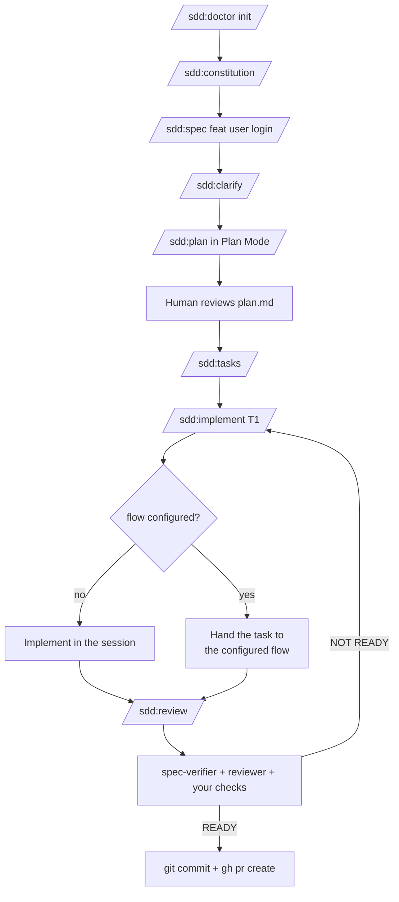

<div align="center">

# 🧩 SDD Framework for Claude Code

[](LICENSE)
[](https://claude.com/claude-code)
[](CHANGELOG.md)
[](https://github.com/JanSzewczyk/spec-driven-development/stargazers)

**Spec-Driven Development for Claude Code — spec is the source of truth, code is its consequence.**

[Features](#-features) • [Quick Start](#-quick-start) • [Architecture](#-architecture) • [Documentation](#-table-of-contents)

</div>

---

## 👋 Why SDD

Vibe coding (loose prompt → AI guesses → iterate by trial and error) works for demos but produces spaghetti in production: every fix breaks something else, security gaps multiply, the codebase becomes unmaintainable.

SDD fixes this by enforcing **canonical phases**: `constitution → spec → clarify → plan → tasks → implement → review`. AI is forced to read and confirm a plan before writing a single line of code. Verification agents make the feedback loop tight enough that the model **cannot skip** validation steps.

> SDD inverts traditional AI-assisted coding. Instead of "vibe coding" (vague prompt → AI guesses → fix loop), the **specification is the source of truth** and code is its mechanical consequence.

This framework is the synthesis of:

- GitHub Spec Kit (canonical phases)
- BMAD Method (sharding, role-based sub-agents)
- Amazon Kiro (hooks, Mermaid generation)
- OpenSpec (lightweight CLI for legacy code)
- Custom Claude Code workflows (slash commands, plan mode, custom agents)

The unique contribution of this framework: it **manages the thinking and the verification** — research, spec, plan, self-contained tasks, a hand-off to *your* implementation flow, and a final audit against the acceptance criteria — and leaves the implementation itself to the flow or agents you already use.

---

## ✨ Features

- 📋 **Canonical SDD phases**: `constitution → spec → clarify → plan → tasks → implement → review`
- 🏥 **`/sdd:doctor`** — preflight audit + one-command init
- 🎭 **Bring your own implementer** — `/sdd:implement` hands each task to a skill, agent or command you configure in `capabilities.md`, or implements it in the session when none is set
- 🏷️ **Jira-like tasks** — each task in `tasks.md` is a self-contained ticket (project, scope, acceptance criteria, dependencies) you can hand to an implementer as it is
- 🧱 **Any layout, any app** — single app, monorepo (Nx, Turborepo, workspaces) or several repositories; web, backend and mobile projects side by side, each with its own commands
- 🌿 **Conventional Commits branches** — `/sdd:spec feat user login` → branch `feat/user-login`
- ✅ **Verified against the spec** — `/sdd:review` audits the result against the acceptance criteria with `spec-verifier` and `reviewer`, plus any extra check you add (e.g. a QA agent that runs the app)
- 🧠 **Context discipline** — tasks and plans carry decisions and references, not copies; large reads go to sub-agents
- 🔍 **Drift detection** — `spec-verifier` and `/sdd:analyze` keep spec, plan, tasks, and code consistent

---

## 📖 Table of Contents

- [👋 Why SDD](#-why-sdd)
- [✨ Features](#-features)
- [🚀 Quick Start](#-quick-start)
- [📦 Plugins](#-plugins)
- [🔄 The SDD Flow](#-the-sdd-flow)
- [🏗️ Architecture](#-architecture)
  - [🧱 Three-tier agent hierarchy](#-three-tier-agent-hierarchy)
  - [🏷️ Tasks and the implementation hand-off](#-tasks-and-the-implementation-hand-off)
  - [🧠 Context management](#-context-management)
  - [📇 Capabilities registry — hybrid mode](#-capabilities-registry--hybrid-mode)
- [⌨️ Slash Commands Reference](#-slash-commands-reference)
- [🤖 Sub-agents Reference](#-sub-agents-reference)
- [📋 End-to-end Example](#-end-to-end-example)
- [📁 File Structure](#-file-structure)
- [⭐ Best Practices](#-best-practices)
- [🚫 Anti-patterns](#-anti-patterns)
- [🧩 Design Decisions](#-design-decisions)
- [🔧 Troubleshooting](#-troubleshooting)
- [🤝 Contributing](#-contributing)
- [📝 Changelog](#-changelog)
- [📜 License](#-license)
- [🙏 Acknowledgments](#-acknowledgments)
- [📧 Contact & Support](#-contact--support)

---

## 🚀 Quick Start

### 1. Install the plugin (one-time, per machine)

Inside Claude Code (2.1.275 or later):

```
/plugin marketplace add JanSzewczyk/spec-driven-development
/plugin install sdd@spec-driven-development
```

Or from the shell:

```bash
claude plugin marketplace add JanSzewczyk/spec-driven-development
claude plugin install sdd@spec-driven-development
```

Then enable it in your user settings (`~/.claude/settings.json`):

```json
{
  "enabledPlugins": {
    "sdd@spec-driven-development": true
  }
}
```

(Depending on your Claude Code version, the `claude plugin install` command may handle this for you.)

Verify the install:

```bash
claude plugin list | grep sdd
```

You should see `sdd@0.7.0`. Once installed, the plugin's 8 slash commands, 3 verification sub-agents, and the `doctor` skill (`/sdd:doctor`) are available in **every** project — no per-project copy required.

### 2. Initialize a project

Open the target project in Claude Code and run:

```text
/sdd:doctor init      # bootstraps specs/constitution.md, specs/template.md, specs/capabilities.md
/sdd:doctor check     # confirms 5/5 — per-project files present, constitution valid
/sdd:constitution     # edit specs/constitution.md (long-form, no token limit)
```

What `init` does:

- Bootstraps `specs/constitution.md` from the bundled template (skipped if already present — never overwrites).
- Copies `specs/template.md` (the base for new feature specs) into the project.
- Generates `specs/capabilities.md`: the detected projects and the `## Implementation` section where you choose who implements the tasks.
- With projects in sibling repositories, adds their paths to `permissions.additionalDirectories` in `.claude/settings.json` (other keys preserved; malformed JSON is left untouched).

> **`CLAUDE.md` is not touched.** The project-root `CLAUDE.md` (if you keep one as a Claude Code session loader) is fully owned by you — the SDD framework never reads or writes it. The source of truth is `specs/constitution.md`, edited via `/sdd:constitution`.

### 3. Build your first feature

```text
/sdd:spec feat user can reset password via email
/sdd:clarify
/sdd:plan                 # run in Plan Mode (Shift+Tab)
/sdd:tasks
/sdd:implement T1         # one task, or `all`
...
/sdd:review
```

### Forking the plugin for your own organization

If you want a customized copy (e.g. with org-specific defaults in `capabilities.md.template`):

1. Fork this repo to your GitHub org and update the `homepage` field in `plugins/sdd/.claude-plugin/plugin.json`.
2. (Optional) Edit `plugins/sdd/skills/doctor/templates/capabilities.md.template` to pre-set the implementation flow for your org.
3. (Optional) Edit `plugins/sdd/skills/doctor/templates/constitution.md.template` to seed your standard "WHAT NOT TO DO" rules and rationale.
4. Bump the `version` in `plugins/sdd/.claude-plugin/plugin.json` and in the `sdd` entry of `.claude-plugin/marketplace.json`, and tag a release.
5. Users add your fork with `/plugin marketplace add <your-org>/<your-repo>` and install with `/plugin install sdd@spec-driven-development`.

---

## 📦 Plugins

| Plugin | Description | Commands | Agents | Skills |
| --- | --- | --- | --- | --- |
| [**sdd**](./plugins/sdd/.claude-plugin/plugin.json) | Spec-Driven Development flow — spec → clarify → plan → tasks → implement → review, with self-contained tasks handed to your own implementation flow, verified against the spec | 8 | 3 | 1 |
| [**sdd-board**](./plugins/sdd-board/.claude-plugin/plugin.json) | Claude Code Desktop side panel (a mod): current spec with phase, next command and tasks, plus an overview of all specs | | | |

See [Slash Commands Reference](#-slash-commands-reference) and [Sub-agents Reference](#-sub-agents-reference) for each one.

### sdd-board — SDD panel for Claude Code Desktop

An optional companion mod (needs Claude Code 2.1.287+). It docks a panel beside the transcript that reads your project's `specs/` folder, so you can see where each feature stands without opening the markdown files:

- **Current** tab — the active spec (from the git branch, or the one you pinned): title and status, a pipeline stepper (Spec → Clarify → Plan → Tasks → Implement → Review), the suggested next `/sdd:*` command with a button that puts it in the prompt (it never runs it), task progress, the task list, and a viewer for `spec` / `plan` / `tasks` / `review`.
- **All** tab — every spec with its phase and task progress, filterable; **Show** pins one as current.
- Refreshes by itself: after Claude writes a file under `specs/`, after each turn, and on a 4 s poll for edits made elsewhere. Drawings use SVG in Desktop and VS Code and fall back to text in the terminal.

```
/plugin install sdd-board@spec-driven-development
/sdd-board        # open or focus the panel (it also opens by itself when the project has specs/)
```

Try it from a checkout without installing: `claude --plugin-dir plugins/sdd-board`.

---

## 🔄 The SDD Flow



| Phase | Command | What happens |
|-------|---------|--------------|
| **Constitution** | `/sdd:constitution` | Edit `specs/constitution.md` — the long-form source of truth (tech stack, conventions, **WHAT NOT TO DO** with rationale, testing philosophy, out-of-scope). No token limit. The only file this command touches. |
| **Specify** | `/sdd:spec <type> <description>` | Validate clean git, create branch `<type>/<slug>`, generate `specs/<slug>/spec.md` (business only — no code) |
| **Clarify** | `/sdd:clarify` | AI finds the gaps in spec.md, asks up to 5 questions (with proposed answers) and writes the answers into the spec in one run |
| **Plan** | `/sdd:plan` | Generate `plan.md` with Mermaid diagrams, data model, API surface, file-by-file change list. **Run in Plan Mode.** |
| **Tasks** | `/sdd:tasks` | Split the plan into self-contained, Jira-like tasks (project, scope, acceptance criteria, dependencies) under one Epic |
| **Implement** | `/sdd:implement <task-id or all>` | Build a brief from the task and hand it to the flow configured in `capabilities.md` (or implement in the session). Does not verify on its own |
| **Review** | `/sdd:review` | Tests once, `spec-verifier` + `reviewer` + your extra checks in parallel → verdict READY/NOT READY → AC ticked in the spec → commit + PR |
| **Analyze** | `/sdd:analyze` | Diagnostic — find drift between spec ↔ plan ↔ tasks ↔ code (run anytime) |

---

## 🏗️ Architecture

### 🧱 How the pieces fit

```text
┌──────────────────────────────────────────────────────────────┐
│  THE FRAMEWORK (main Claude session)                         │
│  constitution → spec → clarify → plan → tasks → hand-off     │
│  → review                                                    │
└──────────────────────────────────────────────────────────────┘
        ↓ brief per task                    ↓ Task tool
┌───────────────────────────────┐  ┌───────────────────────────┐
│  IMPLEMENTATION FLOW          │  │  VERIFICATION AGENTS      │
│  your skill / agent / command │  │  • spec-verifier          │
│  or the session itself        │  │  • reviewer               │
│  (writes code and tests,      │  │  • ui-critic              │
│   runs the project's checks)  │  │  • your own checks (QA)   │
└───────────────────────────────┘  └───────────────────────────┘
```

This framework adds:

- 1 skill (`doctor`)
- 8 slash commands (`/sdd:constitution`, `/sdd:spec`, `/sdd:clarify`, `/sdd:plan`, `/sdd:tasks`, `/sdd:implement`, `/sdd:review`, `/sdd:analyze`)
- 3 verification agents (`spec-verifier`, `reviewer`, `ui-critic`)

Implementation is deliberately not part of it: you point `/sdd:implement` at the flow you already use.

### 🏷️ Tasks and the implementation hand-off

`/sdd:tasks` writes one Epic (the feature) with **self-contained tasks** — tickets you could give an implementer as they are. A task is a coherent slice of behaviour in one project (a whole screen, a set of endpoints with their logic and storage), not a layer or a micro-step:

```markdown
### T2: Reset password screen
project: web
status: draft
depends_on: [T1]
acceptance: AC1, AC4
plan: Contracts › reset API; File-by-file › web
scope:
- request form and new-password form with inline validation
- generated API client from T1
- states: loading, network error, expired token
files: apps/web/src/features/reset/*
```

The file keeps references (AC ids, plan sections) instead of copies. When you run `/sdd:implement T2`:

1. Dependencies must be `review|done`, otherwise it stops and names the blockers.
2. It reads `## Implementation` in `specs/capabilities.md` — the line for the task's project wins over `default`:
   ```markdown
   ## Implementation
   default: in-session
   api: agent:python-developer
   web: skill:my-web-flow
   ```
   Values: `skill:<name>`, `agent:<name>`, `command:<shell>` (brief on stdin) or `in-session`.
3. It builds the **brief**: the task, the text of its acceptance criteria, the plan sections, the project's commands and the constitution rules that apply, and a definition of done.
4. It hands the brief to the flow. The implementer writes tests and code and runs the project's checks. `in-session` means the session itself does that, loading the skills and docs it has for the stack.
5. Status: `draft` → `in-progress` → `review`. Nothing is committed.

Verification is a separate step: `/sdd:review` judges the outcome against the spec.


### 🧠 Context management

Three techniques prevent context bloat:

1. **Per-task briefs** — the implementer receives only its task, the acceptance criteria and plan sections it names, never the whole feature
2. **Skills on-demand** — `Use skill: X` only loads when needed
3. **Fresh chat per task** — open a new Claude session between tasks; `tasks.md` status is the handover document

### 🧱 Monorepos, several repositories, any kind of app

SDD reasons about **projects**, not about one stack. `/sdd:doctor init` finds them — an Nx or Turborepo workspace, pnpm/yarn/uv/Cargo/Go workspaces, Gradle includes, or stray manifests such as `apps/api/pyproject.toml` — and asks which sibling repositories belong to the product when the code is spread over several repos.

- **`capabilities.md` → `## Projects`** lists each one with its kind (web, backend, mobile, library, e2e …), path and stack; `## Implementation` can name a different flow per project.
- **Constitution §2** has one command row per project (`test`, `coverage`, `typecheck`, `lint`, `dev / ui-preview`), so a Python API runs `cd apps/api && uv run pytest`, the web app `pnpm nx run web:test`, a Flutter app `flutter test`.
- **Several repositories**: assumes everyone checks the sibling repos out next to the spec repo under the same names (the relative paths are committed). `specs/` lives in one spec repo; `/sdd:implement` makes sure the same feature branch exists in each sibling repo before the flow edits it, and `/sdd:review` commits and opens a linked PR in every one of them. `init` adds the sibling repos to `permissions.additionalDirectories`.
- **UI review** (`ui-critic`) covers web projects; mobile and desktop UI is skipped unless a screenshot skill or MCP server for that platform is installed.

If you keep a Claude Code session loader (`CLAUDE.md` at the project root or per-module), keep it lean — Claude starts ignoring content past the first couple of thousand tokens. A useful convention is to point it at `specs/constitution.md` for detail and shard per module when the root file grows:

- `CLAUDE.md` (root, cross-cutting concerns)
- `apps/web/CLAUDE.md` (frontend-specific)
- `apps/api/CLAUDE.md` (backend-specific)
- `packages/ui/CLAUDE.md` (component library)

The SDD framework itself does not read, write, or enforce any structure on these files — they are entirely yours.

### 📇 Capabilities registry — hybrid mode

`specs/capabilities.md` has two kinds of sections:

- **`<!-- auto-generated -->`** — `## Projects`, rewritten by `/sdd:doctor init` on every run
- **`<!-- user-override -->`** — `## Implementation` and `## Generated / out-of-band paths`, preserved untouched

Example schema:

```markdown
## Projects
<!-- auto-generated -->
- **web** — web · apps/web · TypeScript, Next.js 15; pnpm + nx
- **api** — backend · apps/api · Python 3.13, FastAPI; uv
- **mobile** — mobile · ../mobile-app (repo) · Flutter 3, Dart

## Implementation
<!-- user-override -->
default: in-session
api: agent:python-developer

## Generated / out-of-band paths
<!-- user-override -->
- `**/*.generated.*`
- `**/uv.lock`
```

---


## ⌨️ Slash Commands Reference

### 🏥 `/sdd:doctor [check|init]`

Preflight audit and auto-setup. **5 checks**: specs/constitution.md, specs/template.md, specs/capabilities.md valid, git + gh, tooling per project.

- `check` (default) — report only, statuses ✅/⚠️/❌
- `init` — bootstrap missing files (constitution, template, capabilities) and auto-detect the session's agents/skills + project stack. Idempotent: re-running it preserves `<!-- user-override -->` sections in `capabilities.md`. Never touches the project-root `CLAUDE.md`.

### 📜 `/sdd:constitution`

Edit `specs/constitution.md` — the long-form project constitution (no token limit). This is the source of truth where every "WHAT NOT TO DO" rule carries its rationale, every architectural decision its trade-off. This is also the ONLY file the command modifies. If the constitution file is missing, the command directs the user to run `/sdd:doctor init` first (which bootstraps it from the bundled template).

### 🌿 `/sdd:spec <type> <description>`

Phase 1 — Specify. Requires `<type>` ∈ {`feat`, `fix`, `chore`, `refactor`, `docs`} (Conventional Commits).

Steps:

1. Verify clean git tree (`git status --porcelain`) — STOP if dirty
2. Parse `<type>` and generate `feature_slug` (kebab-case) and `feature_title` (Title Case)
3. Create branch `<type>/<feature_slug>`
4. Generate `specs/<feature_slug>/spec.md` from `specs/template.md`

⛔ The spec file is **business-only** — no code, no tech stack details.

### ❓ `/sdd:clarify`

Phase 2 — Clarify. Fills the skeleton `/sdd:spec` created, so manual editing is optional. AI reads spec.md, finds the gaps (empty sections, ambiguous requirements, untestable acceptance criteria) and asks up to 5 questions, each with a proposed answer you can accept. Answers go straight into the spec; anything unanswered stays in *Open questions*. Run it again if gaps remain.

### 🗺️ `/sdd:plan`

Phase 3 — Plan. **Run in Plan Mode** (Shift+Tab): Claude reads and analyzes, drafts the plan in the session's plan file, and calls ExitPlanMode — approving that dialog is your review of the plan, and only then is it saved to `specs/<slug>/plan.md`. Without Plan Mode the plan is written directly and the command stops for you to read it.

Generates `plan.md` — the architectural and technical **decisions** and the **scope** of the change, not a description of it:

- High-level approach (key decisions, reasons, rejected alternatives)
- Contracts shared between projects or layers (when any)
- File-by-file change list, grouped per project, one line per file (with the code it reuses)
- Risks & mitigations and open questions
- Only when they help: data model, component diagram, API surface, reference sources

Real forks are put to you as questions (with a recommendation) before the draft.

After generation, **human review of plan.md is mandatory** before proceeding to `/sdd:tasks`.

### 🧩 `/sdd:tasks`

Phase 4 — Tasks. Split `plan.md` into a list of **self-contained tasks** (format in [Tasks and the implementation hand-off](#-tasks-and-the-implementation-hand-off)):

- **One Epic per feature.** Tasks are tickets: one project, a coherent slice of behaviour, typically a few hours to a day — never a layer or a micro-step. Tests belong to the task that delivers the behaviour.
- **Every acceptance criterion is covered by a task, and every task serves at least one criterion.**
- **A contract shared between projects is its own task** (a schema the web and mobile clients are generated from, shared types, a migration); consumers depend on it.
- **`depends_on`** only where a task needs another's result or touches the same files.
- **No copies of the plan or the spec** — tasks refer to AC ids and plan sections.
- Does not choose agents or models and writes no code; ends with a one-line `Order:` such as `T1 → T2 ∥ T3 → T4`.

### 🔨 `/sdd:implement <task-id | all>`

Phase 5 — Implement. A dispatcher, not an implementer: it checks `depends_on`, builds the brief, hands the task to the flow configured in `capabilities.md` (`skill:`, `agent:`, `command:` or `in-session`) and tracks the status. Independent tasks may go to a background flow together; otherwise one after another. In a sibling repository it makes sure the feature branch exists first. It runs no tests itself — the implementer does, and `/sdd:review` verifies.


### 🔍 `/sdd:review`

Phase 6 — the only verification gate, judging the result against the acceptance criteria and the project's rules:

1. In parallel: the test suite once (`test`/`coverage` from `specs/constitution.md` §2), `spec-verifier` over the whole feature diff (committed, uncommitted and untracked, against the merge base), `ui-critic` when web UI files changed, and every extra check you configured (see below)
2. `reviewer` gets all results, checks the diff against each **WHAT NOT TO DO** rule of the constitution, runs the domain audits and writes `specs/<slug>/review.md` with the verdict READY / NOT READY
3. Whatever the verdict: acceptance criteria are ticked `[x]` / unticked in `spec.md`, and tasks with unmet criteria go back to `in-progress`
4. READY: shows the commit title, PR title and file list and asks (`publish: ask`); then commits and opens the PR with the `commit` / `pr` actions from `capabilities.md`, or with git and `gh` when none is set
5. NOT READY: concrete blockers, each unmet criterion with the task to re-run (`/sdd:implement T3`)

Configure it in `specs/capabilities.md`:

```markdown
## Review
tests: run          # run | skip
ui: auto            # auto | off
publish: ask        # ask | off
default: auto       # audit flow: auto (skills by stack) | skill:<name> | agent:<name>
api: agent:python-reviewer
checks: agent:qa    # extra agents/skills on every review, e.g. QA that starts the app and tests the functionality

## Actions
branch: skill:create-branch
commit: skill:create-commit
pr: skill:create-pull-request
```

`## Actions` is shared with `/sdd:spec` (the `branch` action). A check returns `PASS | FAIL | SKIPPED`; `FAIL` blocks READY, `SKIPPED` never does.


### 📊 `/sdd:analyze`

Diagnostic — run anytime to find where spec ↔ plan ↔ tasks ↔ code disagree. It runs `spec-verifier` once over the feature diff and reports, in a few lines, acceptance criteria that are met, **pending** (their task is not implemented yet) or a **gap** (implemented, not covered), plus the findings with `file:line` and the next command for each. Useful mid-feature, after changing the spec, and before `/sdd:review`.

⛔ Read-only — never edits files and runs no tests.

---

## 🤖 Sub-agents Reference

This framework introduces **only 3 new generic agents**, all for verification. Implementation is whatever flow you configure.

### 🛡️ `spec-verifier`

**Purpose:** One read of the feature diff against the documentation: every acceptance criterion (met / unmet with evidence), non-goal violations, out-of-scope changes, drift between `spec.md`, `plan.md`, `tasks.md` and the code, and the completeness of each task.

**Called by:** `/sdd:review`.

**Output:** JSON

```json
{
  "satisfied": true,
  "ac": [{"id": "AC1", "status": "met", "evidence": "src/auth/reset.py:42"}],
  "non_goal_violations": [],
  "out_of_scope": [{"file": "src/Header.tsx", "summary": "unrelated logo change"}],
  "drift": [{"layer": "plan→tasks", "detail": "plan.md L67 names packages/sms/twilio.ts, no task creates it"}],
  "tasks": [{"id": "T1", "status": "complete", "unmet_ac": []}]
}
```

Strict constraints: **never** writes code, **never** suggests fixes, **never** judges code quality (that is `reviewer`'s job).


### 🧐 `reviewer`

**Purpose:** Final quality audit before PR; decides READY/NOT READY.

**Called by:** `/sdd:review`, which passes it the test results and the `spec-verifier`, `ui-critic` and extra-check results — it does not re-run the suite or start sub-agents itself.

Pipeline:

1. Read the test results from the prompt (any failure → NOT READY)
2. Check coverage against the targets in `specs/constitution.md` §6
3. Check the diff against every **WHAT NOT TO DO** rule in the constitution (one line per rule)
4. Run the audit skills configured for each touched project, or — with `auto` — pick the ones the session has for its stack
5. Write `specs/<slug>/review.md` with the verdict
6. Never return READY if a test fails, `spec-verifier` is not satisfied, an extra check failed, or a critical security/accessibility violation exists

**Output:** JSON `{verdict: "READY" | "NOT_READY", blockers: [...], warnings: [...]}`


### 🎨 `ui-critic`

**Purpose:** Visual review of changed UI components — captures Storybook screenshots via a browser MCP and evaluates them for design-system adherence, layout regressions, and rendering issues.

**Called by:** `/sdd:review` when the diff contains UI component files (e.g. `.tsx`/`.stories.tsx`). Storybook URL and start command come from the `ui-preview` row of `specs/constitution.md` §2.

**Requirements:** a browser tool (an MCP server, a built-in browser pane, Playwright …) plus a running Storybook (default `http://localhost:6006`). If either is missing, the agent returns verdict `SKIPPED` and `/sdd:review` carries on.

**Output:** JSON

```json
{
  "verdict": "OK" | "WARNINGS" | "ISSUES" | "SKIPPED",
  "skip_reason": "no_mcp | storybook_unreachable | null",
  "components_reviewed": ["LoginForm", "Header"],
  "findings": [
    {
      "component": "LoginForm",
      "severity": "issue",
      "category": "design-system",
      "detail": "Submit button uses raw #3B82F6 — should use --color-primary-500",
      "screenshot": "./.sdd-screenshots/LoginForm.png"
    }
  ]
}
```

Severity classification: `issue` (visible bug, blocks a READY verdict), `warning` (suboptimal but functional), `info` (observation). `SKIPPED` never blocks `/sdd:review` — it surfaces an infrastructure note instead.

Screenshots are saved under `./.sdd-screenshots/` — add this path to `.gitignore`.

---

## 📋 End-to-end Example

Feature: **"User can reset password via email"**.

### Install + initialize

Install the plugin once per machine, then in any project:

```bash
cd ~/Projects/my-app && git init
```

In Claude Code:

```text
/sdd:doctor init       # auto-detects Next.js 15 + TS + Vitest + Storybook
/sdd:doctor check      # ✅ READY (6/6)
/sdd:constitution      # fill specs/constitution.md: Tech stack, Run/build, WHAT NOT TO DO with rationale
```

### Spec phase

```text
/sdd:spec feat user can reset password via email
```

Effects:

- ✅ Clean git verified
- ✅ Branch `feat/user-can-reset-password-via-email` created
- ✅ `specs/user-can-reset-password-via-email/spec.md` generated

You open the spec, fill in:

- User stories (Reset via email, optional MFA)
- Acceptance criteria (AC1: token valid for 1h, AC2: rate-limited to 3 attempts, …)
- Edge cases (unknown email — silent success per security best practice)

### Clarify

```text
/sdd:clarify
```

Claude asks:

1. **AC1**: should expired tokens return 410 or 401?
2. **AC2**: is the rate limit per IP, per email, or both?
3. **Edge case**: what if SMTP delivery fails — retry or fail loud?
4. ...

You answer in chat. Spec is updated.

### Plan

Enable Plan Mode (Shift+Tab):

```text
/sdd:plan
```

Generates `specs/.../plan.md`:

- Data model (Mermaid ER): `User`, `PasswordResetToken`
- Component diagram (Mermaid): `ResetForm → Action → Service → DB + Mailer`
- API surface: `POST /actions/resetPassword`
- File-by-file change list (8 files)
- Reused: `packages/errors/AuthError`, `packages/db/prismaClient`

**Read plan.md manually**, correct anything wrong.

### Tasks

```text
/sdd:tasks
```

Generates one Epic with self-contained tasks across three projects — the shared contract first, then API, web and mobile:

```markdown
## Epic: Password reset

### T1: Reset API (contract + endpoints)
project: api · status: draft · depends_on: [] · acceptance: AC1, AC2, AC3
scope: request/confirm schemas exposed in OpenAPI; endpoints, token storage, expiry (30 min), same response for unknown e-mails
files: apps/api/app/auth/*

### T2: Reset password screen (web)
project: web · status: draft · depends_on: [T1] · acceptance: AC1, AC4
scope: both forms with inline validation, generated client, loading/network/expired-token states
files: apps/web/src/features/reset/*

### T3: Reset password screen (mobile)
project: mobile · status: draft · depends_on: [T1] · acceptance: AC1, AC4
files: ../mobile-app/lib/features/reset/*

### T4: Reset flow end to end
project: e2e · status: draft · depends_on: [T1, T2] · acceptance: AC1
files: apps/web-e2e/src/reset.spec.ts

Order: T1 → T2 ∥ T3 → T4
```

### Implement

```text
/sdd:implement all
```

- `T1` goes to the flow configured for `api` (here `agent:python-developer`).
- `T2` and `T3` start once `T1` is done: `web` uses `skill:my-web-flow`, `mobile` falls back to `in-session`.
- `T4` follows when `T1` and `T2` are done.

Each task flips to `review` when its implementer reports done; nothing is verified or committed here.


### Review

```text
/sdd:review
```

Pipeline executes:

1. In parallel: tests 23/23 passed; `spec-verifier`: all 4 AC met, no drift; `ui-critic`: `OK` (screenshots in `.sdd-screenshots/`, or `SKIPPED` without a browser tool / Storybook); your `qa` check: `PASS`
2. `reviewer`: constitution rules respected, audit skills for the stack pass (e.g. 0 critical findings)
3. The 4 AC are ticked in `spec.md`; verdict **READY** — you confirm the commit and PR
7. Commit: `feat(reset-password): add email-based reset flow`
8. PR opened with body referencing `specs/user-can-reset-password-via-email/spec.md`

### Typical timeline

| Step | Time |
|------|------|
| `/sdd:doctor init` | 30 s |
| `/sdd:spec` | 1 min (Claude generates, you edit business spec) |
| `/sdd:clarify` | 5 min (Q&A) |
| `/sdd:plan` (Plan Mode) | 3 min (analysis + generation) |
| Human review of plan.md | 5-10 min |
| `/sdd:tasks` | 1 min |
| `/sdd:implement` | depends on your flow (most of the time here) |
| `/sdd:review` | 5 min |
| **Total** | **~2-4 h** for a medium feature |

Without SDD a similar feature is 4-6 h with frequent rework. With SDD: 2-4 h, deterministic.

---

## 📁 File Structure

### In your project (after `/sdd:doctor init`)

Only per-project artifacts. Commands / agents / verification skills live in the installed plugin, not in your project.

```text
your-project/
├── specs/
│   ├── constitution.md                    # source of truth — created by `/sdd:doctor init` if missing, edited by `/sdd:constitution`
│   ├── template.md                        # base template for new feature specs
│   ├── capabilities.md                    # projects (auto-generated) + implementation flow and generated paths (yours)
│   └── <feature-slug>/
│       ├── spec.md                        # business specification
│       ├── plan.md                        # architecture + Mermaid diagrams
│       ├── tasks.md                       # self-contained tasks under one Epic
│       └── review.md                      # generated by /sdd:review
├── .claude/
└── CLAUDE.md                              # (optional, user-owned) Claude Code session loader — never touched by SDD
```

> **Files SDD creates / edits:** `specs/constitution.md`, `specs/template.md`, `specs/capabilities.md` and, only with sibling repositories, `permissions.additionalDirectories` in `.claude/settings.json`. Per-feature artifacts under `specs/<slug>/` are produced by the SDD flow commands. Everything else — including the root `CLAUDE.md` — is yours.

### In the repository (installed once per machine)

```text
spec-driven-development/                    # or your own forked plugin path
├── .claude-plugin/
│   └── marketplace.json                   # marketplace: sdd + sdd-board
├── README.md / LICENSE / CHANGELOG.md / CONTRIBUTING.md / .github/
└── plugins/
    ├── sdd-board/                         # Desktop side panel (mod)
    │   ├── .claude-plugin/plugin.json
    │   ├── hooks/                         # hooks.json + register.ts (hooks), parse/model/view/svg (pure modules)
    │   └── tests/                         # run with `claude plugin test`
    └── sdd/                               # the SDD plugin
        ├── .claude-plugin/plugin.json     # plugin manifest
        ├── skills/
        │   └── doctor/                    # LLM-driven skill — no Python helpers
        │       ├── SKILL.md               # `check` procedure
        │       ├── reference/
        │       │   ├── init.md            # `init` procedure (loaded only for init)
        │       │   └── settings-merge.md  # sibling-repo permissions edit for settings.json
        │       └── templates/             # bundled seed files read by `init`
        │           ├── constitution.md.template   # long-form project constitution
        │           ├── capabilities.md.template   # auto-generated + user-override hybrid
        │           └── specs/template.md          # base for new feature specs
        ├── commands/                      # 8 slash commands (auto-discovered)
        │   ├── constitution.md / spec.md / clarify.md / plan.md
        │   └── tasks.md / implement.md / review.md / analyze.md
        └── agents/                        # 3 verification sub-agents
            ├── spec-verifier.md
            ├── reviewer.md
            └── ui-critic.md               # optional — needs a browser tool
```


---

## ⭐ Best Practices

Thirteen actionable rules drawn from the source materials (Spec Kit, BMAD, Kiro, OpenSpec, Anthropic guidance):

1. **🧪 Make the work verifiable.** Every task's `acceptance` field points to measurable acceptance criteria; the implementer runs the project's checks and `/sdd:review` verifies the result against them. Default to **test-first** TDD in your implementation flow.
2. **📜 The constitution is the WHY.** Every "WHAT NOT TO DO" rule in `specs/constitution.md` should have a `**Why:**` line (and an incident reference when applicable). After every Claude mistake, append the lesson — with its rationale — to the constitution. Without rationale, rules become folklore and get re-broken. If you also maintain a Claude Code session loader (`CLAUDE.md`), use it to surface the most-broken rules and point at the constitution for detail — but that file is yours to shape, not the framework's.
3. **✂️ Shard large specs.** Never hand a giant PRD to an implementer. Break it into Epic → Task; each implementer receives only its task's brief.
4. **📁 Separate `CLAUDE.md` per module.** Root for cross-cutting, `apps/web/CLAUDE.md` for frontend, `apps/api/CLAUDE.md` for backend. Frontend code shouldn't burn tokens reading database rules.
5. **🔒 Use Plan Mode before edits.** `/sdd:plan` and `/sdd:clarify` ideally run in Plan Mode (Shift+Tab) so Claude cannot accidentally modify files during exploration.
6. **👤 Human-in-the-loop on `plan.md`.** Always read the generated plan before `/sdd:tasks`. This is the cheapest moment to correct course.
7. **🌿 One branch per feature.** `/sdd:spec` enforces it. Conventional Commits naming (`feat/...`, `fix/...`).
8. **🤝 Use sub-agents for large reads.** Don't grep 50 files in the main session — invoke a `Task` tool sub-agent and receive only a summary.
9. **🔄 Keep spec ↔ code in sync.** When you change code manually, update the spec. Use `/sdd:analyze` to detect drift periodically.
10. **💬 Fresh chat per task — and `/clear` between phases.** Open a new Claude session when switching to a new task, and `/clear` between `plan → tasks → implement → review`. Every phase command re-reads its inputs from disk (`spec.md` / `plan.md` / `tasks.md` / `capabilities.md`), so clearing loses no context — each phase starts from a small, cheap context. `tasks.md` status is your handover document.
11. **❓ Embrace the Clarify phase.** Letting AI ask questions before planning surfaces gaps that would otherwise burn implementation cycles.
12. **💰 Tier your models.** Run judgement-heavy phases (`/sdd:constitution`, `/sdd:spec`, `/sdd:clarify`, `/sdd:plan`, `/sdd:review`) on Opus; run mechanical phases (`/sdd:tasks`, `/sdd:analyze`) on Sonnet (Haiku for trivial work). See "Cost & model tiering" below.
13. **📦 Batch human feedback.** Collect visual/QA tweaks and NOT READY fixes into one message per round instead of many small turns — each turn reprocesses the full context and multiplies cost.

---

## 🚫 Anti-patterns

What to avoid — common failure modes when adopting SDD:

- ❌ **Skipping `/sdd:clarify`** "because I know what I want." Open questions almost always surface real gaps.
- ❌ **Skipping human review of `plan.md`.** Claude can hallucinate architecture, especially on unusual stacks.
- ❌ **Running unrelated tasks in one chat.** Context bloats, hallucinations rise. One task per session is the ideal — don't chain task after task in one transcript.
- ❌ **Manual `git commit` instead of `/sdd:review`.** You bypass `spec-verifier` / `reviewer` and the AC ticking.
- ❌ **Code or tech details in `spec.md`.** The spec is a business document. Implementation belongs in plan.md and code.
- ❌ **Bloated `CLAUDE.md`.** Above ~2,500 tokens, Claude starts ignoring the bottom. Shard per module.
- ❌ **`--dangerously-skip-permissions` in production.** A hallucinated bash command can destroy your system.
- ❌ **Implementing without a spec.** SDD only works if every feature has its `specs/<slug>/spec.md` first.
- ❌ **Running Opus for mechanical phases.** Decomposition and drift checks don't need the top tier — you pay Opus rates for Sonnet work.
- ❌ **Drip-feeding feedback.** Ten small "move this 2px" turns each reprocess the whole context. Batch them into one message per round.
- ❌ **Pulling generated diffs into the loop.** Regenerated clients/mocks/schemas (`*.msw.ts`, `*.schemas.ts`, …) balloon context and trigger false out-of-scope/drift findings. Declare them in `capabilities.md` → `Generated / out-of-band paths`.

---

## 💰 Cost & model tiering

The single biggest cost lever is **which model runs which phase**. A slash command can't switch the session model itself, so this is operating guidance the framework encodes as recommendations:

| Phase | Recommended model | Why |
|---|---|---|
| `/sdd:constitution`, `/sdd:spec`, `/sdd:clarify`, `/sdd:plan`, `/sdd:review` | **Opus** | Judgement-heavy — framing, architecture, and the final gate. Cheap to get right here, expensive to get wrong downstream. |
| `/sdd:tasks` | **Sonnet** | Mechanical decomposition. |
| `/sdd:analyze` | any | Delegates to `spec-verifier` (Sonnet). |
| `/sdd:implement` | your flow's choice | The framework only hands over; the flow or agent sets its own model. |

Two supporting mechanisms:

- **Per-agent tier.** The verification sub-agents carry their own `model:` frontmatter — `reviewer` on Opus (last line of defense), `spec-verifier` / `ui-critic` on Sonnet — so they run at their own tier regardless of the session model.

Keep large and generated output **out of the main loop**: verification agents exclude the `Generated / out-of-band paths` globs from every diff, `/sdd:plan` extracts reference sources (mockups, API specs, ADRs) **once** inside a sub-agent and caches what matters in `plan.md`, and large codebase scans return only a summary via a sub-agent.

---

## 🧩 Design Decisions

Why this framework looks the way it does:

| Decision | Rationale |
|----------|-----------|
| **Per-project, not global** | Different projects have different stacks, commands and implementation flows. A global framework would force homogeneity. |
| **Only 3 new agents** | Implementation is yours (a skill, agent or command you already have); the framework only verifies. Duplicating implementers would be wasted effort and version drift. |
| **Self-contained tasks** | A task carries scope, acceptance criteria and dependencies, so any implementer — or a person — can pick it up as a ticket. |
| **Conventional Commits in `/sdd:spec`** | Branch names and commit messages aligned with industry standard. Compatible with semantic-release, changeset, etc. |
| **Plan = decisions, tasks = tickets** | The plan holds architectural and technical decisions and the scope; tasks refer to it instead of copying it. |
| **Plan Mode before `/sdd:implement`** | Forces human review and blocks destructive changes before a plan exists. |
| **Hybrid capabilities.md** | `<!-- auto-generated -->` sections reflect installed plugins. `<!-- user-override -->` sections preserve customizations. Re-running `init` is safe. |
| **Constitution lives under `specs/`, not in `CLAUDE.md`** | Two separate concerns. `specs/constitution.md` is the long-form source of truth — no token budget, rationale-rich, edited via `/sdd:constitution`. The project root `CLAUDE.md`, if you keep one, is a Claude Code session loader fully owned by you; the framework never reads, writes, or enforces its structure. |
| **Framework lives in the plugin, project owns its specs** | Commands, agents and the doctor skill ship with the plugin (installed once per machine). The project keeps only what is genuinely project-specific: `specs/` and whatever `CLAUDE.md` you choose to maintain. Plugin updates roll out by reinstalling; project data is never overwritten. |

---

## 🔧 Troubleshooting

| Symptom | Likely cause | Fix |
|---------|--------------|-----|
| `/sdd:spec` fails with "uncommitted changes" | Working tree dirty | `git stash` or commit current changes first |
| `/sdd:implement` does not use my flow | no `## Implementation` line for the project, so it falls back to `in-session` | Add `<project>: skill:<name>`, `agent:<name>` or `command:<shell>` (or `default:`) under `## Implementation` in `capabilities.md` |
| `spec-verifier` always returns `satisfied: true` even for incomplete code | Acceptance criteria in spec.md are too vague | Rewrite AC to be measurable (`input X → output Y`) |
| Plan Mode disabled but `/sdd:plan` still works | Plan Mode is recommended but not required | For correctness this is fine; for safety enable Plan Mode (Shift+Tab) |
| `capabilities.md` lacks `## Implementation` | file written by an older version | `/sdd:doctor init` adds the section |

---

## 🤝 Contributing

Contributions are welcome! See [CONTRIBUTING.md](CONTRIBUTING.md) for the development setup, the local smoke-test loop, style guidelines, and the PR checklist.

In short:

1. Fork the repository and create a feature branch (`git checkout -b feat/new-skill`)
2. Make changes inside the plugin (`plugins/sdd/commands/`, `plugins/sdd/agents/`, `plugins/sdd/skills/`, `plugins/sdd/skills/doctor/templates/`, `plugins/sdd/skills/doctor/reference/`)
3. Exercise the doctor skill against a fresh project (`/sdd:doctor check` → `init` → `check`) and verify the artifacts by hand
4. Update the README's File Structure / reference sections and bump the version (`plugin.json`, `marketplace.json`, README badge) with a matching `CHANGELOG.md` section
5. Open a Pull Request

---

## 📝 Changelog

See [CHANGELOG.md](CHANGELOG.md) for the full version history. This project follows [Keep a Changelog](https://keepachangelog.com/en/1.1.0/) and [Semantic Versioning](https://semver.org/spec/v2.0.0.html).

---

## 📜 License

This project is licensed under the **MIT License**. See the [LICENSE](LICENSE) file for details. © 2026 Jan Szewczyk.

---

## 🙏 Acknowledgments

SDD is a synthesis of ideas from the spec-driven and agentic-coding ecosystem:

- [GitHub Spec Kit](https://github.com/github/spec-kit) — canonical phases
- BMAD Method — sharding and role-based sub-agents
- Amazon Kiro — hooks and Mermaid generation
- OpenSpec — lightweight CLI for legacy code
- [Anthropic Claude Code](https://claude.com/claude-code) — slash commands, plan mode, custom agents, and the plugin system this framework is built on

---

## 📧 Contact & Support

- 🐛 [Open an issue](https://github.com/JanSzewczyk/spec-driven-development/issues)
- ⭐ [Star this repository](https://github.com/JanSzewczyk/spec-driven-development)
- 👨‍💻 Check out the maintainer's [GitHub profile](https://github.com/JanSzewczyk)

---

<div align="center">

**Made with ❤️ by [Jan Szewczyk](https://github.com/JanSzewczyk)**

If this framework helped you, please consider giving it a ⭐ on GitHub!

[⬆ Back to Top](#-sdd-framework-for-claude-code)

</div>
