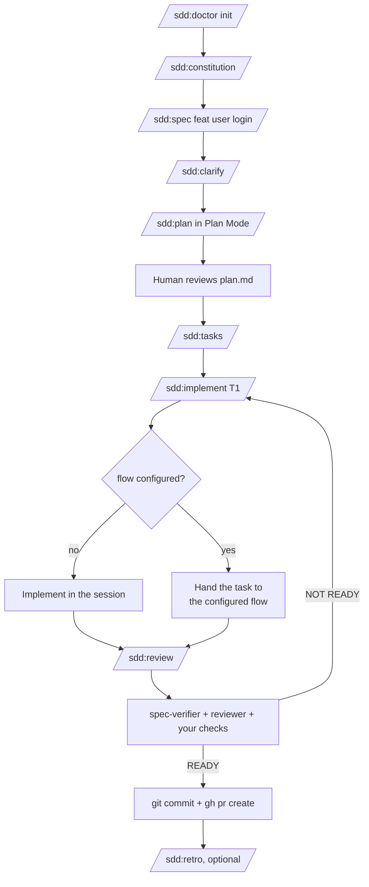

<div align="center">

# 🧩 SDD Framework for Claude Code

[](LICENSE)
[](https://claude.com/claude-code)
[](CHANGELOG.md)
[](https://github.com/JanSzewczyk/spec-driven-development/stargazers)

**Spec-Driven Development for Claude Code — spec is the source of truth, code is its consequence.**

[Features](#-features) • [Installation](#-installation) • [Usage](#-usage) • [Architecture](#-architecture) • [Documentation](https://janszewczyk.github.io/spec-driven-development/)

</div>

---

## 👋 Why SDD

Vibe coding (loose prompt → AI guesses → iterate by trial and error) works for demos but produces spaghetti in production: every fix breaks something else, security gaps multiply, the codebase becomes unmaintainable.

SDD fixes this by enforcing **canonical phases**: `constitution → spec → clarify → plan → tasks → implement → review`. AI reads and confirms a plan before a single line of code is written, and a final review checks the result against the acceptance criteria before anything is committed.

> SDD inverts traditional AI-assisted coding. Instead of "vibe coding" (vague prompt → AI guesses → fix loop), the **specification is the source of truth** and code is its mechanical consequence.

This framework is the synthesis of:

- GitHub Spec Kit (canonical phases)
- BMAD Method (sharding, role-based sub-agents)
- Amazon Kiro (Mermaid generation)
- OpenSpec (lightweight CLI for legacy code)
- Custom Claude Code workflows (slash commands, plan mode, custom agents)

The unique contribution of this framework: it **manages the thinking and the verification** — research, spec, plan, self-contained tasks, a hand-off to *your* implementation flow, and a final audit against the acceptance criteria — and leaves the implementation itself to the flow or agents you already use.

---

## ✨ Features

### 🔄 Workflow

- **📋 [Canonical SDD phases](#-the-sdd-flow)** — `constitution → spec → clarify → plan → tasks → implement → review`, one slash command per phase
- **🏥 [`/sdd:doctor`](plugins/sdd/skills/doctor/SKILL.md)** — 7-check readiness audit (run by the `doctor_check` tool) and an idempotent `init` that seeds `specs/` in one command
- **🌿 Conventional Commits branches** — `/sdd:spec feat user login` → branch `feat/user-login`, or the branch skill you configure
- **❓ Clarify before planning** — up to 5 gap questions per run, each with a proposed answer, written straight into the spec
- **🗺️ Plans that reuse code** — `codebase-surveyor` maps structure, conventions and code to reuse before `/sdd:plan` drafts

### 🎭 Implementation hand-off

- **🎫 [Jira-like tasks](#-tasks-and-the-implementation-hand-off)** — each task in `tasks.md` is a self-contained ticket (project, scope, acceptance criteria, dependencies) under one Epic
- **🔌 Bring your own implementer** — `/sdd:implement` hands each task to a skill, agent or command you configure in `specs/capabilities.yml`, or implements it in the session when none is set
- **🧠 Context discipline** — tasks and plans carry decisions and references, not copies; large reads go to sub-agents

### ✅ Verification

- **🛡️ [Verified against the spec](#-sddreview)** — `/sdd:review` runs the tests, `spec-verifier` and any extra check you add (e.g. a QA or UI agent that runs the app) in parallel, then `reviewer` returns READY / NOT READY
- **🔍 Drift detection** — `spec-verifier` and `/sdd:analyze` keep spec, plan, tasks, and code consistent
- **📝 Commit and PR only on READY** — after your confirmation, staging only the confirmed files, never `git add -A`
- **🔁 [Lessons become rules](#-sddretro)** — `/sdd:retro` turns repeatable review mistakes into WHAT NOT TO DO entries in the constitution

### 🧱 Any layout, any app

- **🗂️ [Projects, not one stack](#-monorepos-several-repositories-any-kind-of-app)** — single app, monorepo (Nx, Turborepo, workspaces) or several repositories; web, backend and mobile projects side by side, each with its own commands
- **🔧 No fixed list of supported stacks** — `/sdd:doctor init` reads each project's scripts, CI and tool config to find its test, coverage, typecheck and lint commands

### 🖥️ Side panel

- **📊 [Board](plugins/sdd/README.md#board)** — a side panel in the `sdd` plugin: the current spec's phase, next command and tasks, plus an overview of every spec

---

## 📖 Table of Contents

- [👋 Why SDD](#-why-sdd)
- [✨ Features](#-features)
- [🧩 Plugins](#-plugins)
- [📦 Installation](#-installation)
- [🚀 Usage](#-usage)
- [🔄 The SDD Flow](#-the-sdd-flow)
- [📐 Architecture](#-architecture)
  - [🧱 How the pieces fit](#-how-the-pieces-fit)
  - [🎫 Tasks and the implementation hand-off](#-tasks-and-the-implementation-hand-off)
  - [🔁 Status lifecycle](#-status-lifecycle)
  - [🧠 Context management](#-context-management)
  - [🧱 Monorepos, several repositories, any kind of app](#-monorepos-several-repositories-any-kind-of-app)
  - [📇 Capabilities registry — hybrid mode](#-capabilities-registry--hybrid-mode)
- [🧰 Slash Commands Reference](#-slash-commands-reference)
- [🤖 Sub-agents Reference](#-sub-agents-reference)
- [📋 End-to-end Example](#-end-to-end-example)
- [📁 File Structure](#-file-structure)
- [⭐ Best Practices](#-best-practices)
- [🚫 Anti-patterns](#-anti-patterns)
- [💰 Cost & model tiering](#-cost--model-tiering)
- [🧭 Design Decisions](#-design-decisions)
- [🔧 Troubleshooting](#-troubleshooting)
- [📏 Conventions](#-conventions)
- [🤝 Contributing](#-contributing)
- [📝 Changelog](#-changelog)
- [📜 License](#-license)
- [🙏 Acknowledgments](#-acknowledgments)
- [📧 Contact & Support](#-contact--support)

---

## 🧩 Plugins

The marketplace `spec-driven-development` ([`.claude-plugin/marketplace.json`](.claude-plugin/marketplace.json)) ships one plugin:

| Plugin | Description | Skills | Agents | Mod |
| --- | --- | --- | --- | --- |
| [**sdd**](./plugins/sdd/.claude-plugin/plugin.json) | Spec-Driven Development flow — spec → clarify → plan → tasks → implement → review, with self-contained tasks handed to your own implementation flow, verified against the spec; the `sdd` CLI for task and config edits; the board side panel | 11 | 3 | `doctor_check` tool, board panel |

See [Slash Commands Reference](#-slash-commands-reference) and [Sub-agents Reference](#-sub-agents-reference) for each one.

### 📊 Board — the SDD side panel

Part of the `sdd` mod (needs Claude Code 2.1.287+). It docks a panel beside the transcript that reads your project's `specs/` folder and never writes to it, so you can see where each feature stands without opening the markdown files:

- **Live strip** — what runs now in the session: the `/sdd:*` command and its time, the latest tool call, and lanes for subagents, tasks running in their worktrees and task PRs waiting for a merge. The board also names the session: the main SDD session on the spec's branch, the task session on a task branch.
- **Current** tab — the active spec (from the git branch, the one you pinned, or the newest one still in progress): title and status, a phase bar (Spec → Clarify → Plan → Tasks → Implement → Review), a phase card with task progress, the readiness checklist and the suggested next `/sdd:*` command with a button that puts it in the prompt (it never runs it), the task list, and buttons that open `spec` / `plan` / `tasks` / `review`.
- **Ticket** tab — in a task session only: the task's scope, acceptance criteria, dependencies, branch and PR.
- **All** tab — every spec with its phase and task progress, filterable; **Show** pins one as current.
- **+ New spec** in the tab bar puts `/sdd:spec feat ` in the prompt; shown on a branch with no spec.
- **Config** (top right) — opens a read-only configuration panel: projects, the effective `specs/capabilities.yml` values for implementation, actions and review (set values vs defaults), the commands from constitution §2 per project, and buttons for `/sdd:capabilities` and `/sdd:doctor check`.
- **No SDD in the project** — only a setup card; **Init SDD in this project** runs `/sdd:doctor init` in the session (the one button that runs a command).
- Refreshes by itself: after Claude or a sub-agent writes a file under `specs/`, after a branch switch, merge, pull or `gh pr` command, after each turn, and on a 4 s poll for edits made elsewhere. While shown it checks task PRs on GitHub at most once a minute (`gh pr list`) and task branches fast-forwarded into the SDD branch, so a merge shows before `/sdd:implement` or `/sdd:review` records it. In a task worktree it reads the statuses from the SDD branch's checkout. A footer says when the data was last read. Drawings use SVG in Desktop and VS Code and fall back to text in the terminal.

It opens at session start when the project has `specs/`; turn off the `show_board` option of `sdd` to open it only with `/sdd-dashboard`. Up to 0.9.7 it was the separate `sdd-board` plugin; the marketplace moves those installs to `sdd`. Full description: [plugins/sdd/README.md](plugins/sdd/README.md#board).

---

## 📦 Installation

### 📋 Prerequisites

- **[Claude Code](https://claude.com/claude-code)** 2.1.287 or later, the first version with mods: `sdd` registers the `doctor_check` tool as a mod (in WSL or under `--safe-mode`, where mods do not run, `/sdd:doctor` falls back to a manual check)
- **Git** — every feature lives on its own branch
- **[GitHub CLI](https://cli.github.com/)** (`gh`), authenticated — `/sdd:review` opens the PR with it when no `pr` action is configured; `/sdd:doctor check` warns without it

### 🧩 Install the plugin (one-time, per machine)

Inside Claude Code (2.1.287 or later):

```text
/plugin marketplace add JanSzewczyk/spec-driven-development
/plugin install sdd@spec-driven-development
```

Or from the shell:

```bash
claude plugin marketplace add JanSzewczyk/spec-driven-development
claude plugin install sdd@spec-driven-development
```

Then enable it in your user settings (`~/.claude/settings.json`):

```json
{
  "enabledPlugins": {
    "sdd@spec-driven-development": true
  }
}
```

Verify the install:

```bash
claude plugin list | grep sdd
```

You should see `sdd@1.3.0`. Once installed, the plugin's 11 skills (`/sdd:spec`, `/sdd:doctor` …), 3 sub-agents and the `doctor_check` tool are available in **every** project — no per-project copy required.

### 📊 The board panel

```text
/sdd-dashboard    # open or focus the panel (it also opens by itself when the project has specs/)
```

The panel comes with `sdd`. It opens by itself only in a window at least 144 columns wide, unless you opened it once; the `show_board` option turns that off. Try it from a checkout without installing: `claude --plugin-dir plugins/sdd`.

### 🍴 Forking the plugin for your own organization

If you want a customized copy (e.g. with org-specific defaults in `capabilities.yml.template`):

1. Fork this repo to your GitHub org and update the `homepage` field in `plugins/sdd/.claude-plugin/plugin.json`.
2. (Optional) Edit `plugins/sdd/skills/doctor/templates/capabilities.yml.template` to pre-set the implementation flow for your org.
3. (Optional) Edit `plugins/sdd/skills/doctor/templates/constitution.md.template` to seed your standard "WHAT NOT TO DO" rules and rationale.
4. Bump the `version` in `plugins/sdd/.claude-plugin/plugin.json`; on merge to `main`, `.github/workflows/release.yml` tags it (`v<version>`) and creates a GitHub Release.
5. Users add your fork with `/plugin marketplace add <your-org>/<your-repo>` and install with `/plugin install sdd@spec-driven-development`.

---

## 🚀 Usage

### 🏥 1. Initialize a project

Open the target project in Claude Code and run:

```text
/sdd:doctor init      # bootstraps specs/constitution.md, specs/template.md, specs/capabilities.yml
/sdd:doctor check     # confirms 7/7 — files present and valid, git, tooling, feature specs
/sdd:capabilities     # optional: pick implementer, git actions and review checks from your installed skills/agents
/sdd:constitution     # edit specs/constitution.md (long-form, no token limit)
```

What `init` does:

- Bootstraps `specs/constitution.md` from the bundled template (skipped if already present — never overwrites).
- Copies `specs/template.md` (the base for new feature specs) into the project.
- Generates `specs/capabilities.yml`: the detected projects, who implements the tasks, git actions and review settings (all at their defaults until you change them).
- With projects in sibling repositories, adds their paths to `permissions.additionalDirectories` in `.claude/settings.json` (other keys preserved; malformed JSON is left untouched).

> **`CLAUDE.md` is not touched.** The project-root `CLAUDE.md` (if you keep one as a Claude Code session loader) is fully owned by you — the SDD framework never reads or writes it. The source of truth is `specs/constitution.md`, edited via `/sdd:constitution`.

### 🌱 2. Build your first feature

```text
/sdd:spec feat user can reset password via email
/sdd:clarify
/sdd:plan                 # run in Plan Mode (Shift+Tab)
/sdd:tasks
/sdd:implement T1         # one task, or `all`
...
/sdd:review
/sdd:retro                # optional: review lessons → constitution rules
```

Each phase re-reads its inputs from disk, so `/clear` between phases loses nothing. The full walk-through is in the [End-to-end Example](#-end-to-end-example).

---

## 🔄 The SDD Flow



| Phase | Command | What happens |
|-------|---------|--------------|
| **Constitution** | `/sdd:constitution` | Edit `specs/constitution.md` — the long-form source of truth (tech stack, conventions, **WHAT NOT TO DO** with rationale, testing philosophy, out-of-scope). No token limit. The only file this command touches. |
| **Specify** | `/sdd:spec <type> <description>` | Create the feature branch (the `branch` action, a branch skill or `git checkout -b <type>/<slug>`), generate `specs/<slug>/spec.md` (business only — no code) |
| **Clarify** | `/sdd:clarify` | AI finds the gaps in spec.md, asks up to 5 questions (with proposed answers) and writes the answers into the spec in one run |
| **Plan** | `/sdd:plan` | Generate `plan.md`: decisions, contracts, file-by-file change list, risks (diagrams, data model, API surface only when they help). **Run in Plan Mode.** |
| **Tasks** | `/sdd:tasks` | Split the plan into self-contained, Jira-like tasks (project, scope, acceptance criteria, dependencies) under one Epic |
| **Implement** | `/sdd:implement [task-id]` | Build a brief from the task and hand it to the flow configured in `capabilities.yml` (or implement in the session); no argument (or `all`) runs every open task in dependency order. Does not verify on its own |
| **Review** | `/sdd:review` | Tests, `spec-verifier` and your extra checks in parallel, then `reviewer` → verdict READY/NOT READY → AC ticked in the spec → commit + PR |
| **Retro** | `/sdd:retro` | Optional, after review: turns the repeatable mistakes in `review.md` into WHAT NOT TO DO entries (with a reason) in the constitution |
| **Analyze** | `/sdd:analyze` | Diagnostic — find drift between spec ↔ plan ↔ tasks ↔ code (run anytime) |

---

## 📐 Architecture

### 🧱 How the pieces fit

```text
┌──────────────────────────────────────────────────────────────┐
│  THE FRAMEWORK (main Claude session)                         │
│  constitution → spec → clarify → plan → tasks → hand-off     │
│  → review                                                    │
└──────────────────────────────────────────────────────────────┘
        ↓ brief per task                    ↓ Agent tool
┌───────────────────────────────┐  ┌───────────────────────────┐
│  IMPLEMENTATION FLOW          │  │  VERIFICATION AGENTS      │
│  your skill / agent / command │  │  • spec-verifier          │
│  or the session itself        │  │  • reviewer               │
│  (writes code and tests,      │  │  • your own checks (QA)   │
│   runs the project's checks)  │  │                           │
└───────────────────────────────┘  └───────────────────────────┘
```

This framework adds:

- 11 skills, each a slash command: `/sdd:doctor`, `/sdd:capabilities`, `/sdd:constitution`, `/sdd:spec`, `/sdd:clarify`, `/sdd:plan`, `/sdd:tasks`, `/sdd:implement`, `/sdd:review`, `/sdd:analyze`, `/sdd:retro` (none is started by Claude on its own)
- 3 agents: `spec-verifier` and `reviewer` verify, `codebase-surveyor` maps the code for `/sdd:plan`
- a small mod that registers the `doctor_check` tool behind `/sdd:doctor check`

Implementation is deliberately not part of it: you point `/sdd:implement` at the flow you already use.

### 🎫 Tasks and the implementation hand-off

`/sdd:tasks` writes one Epic (the feature) with **self-contained tasks** — tickets you could give an implementer as they are. A task is a coherent slice of behaviour in one project (a whole screen, a set of endpoints with their logic and storage), not a layer or a micro-step:

```markdown
### T2: Reset password screen
project: web
status: draft
depends_on: [T1]
acceptance: AC1, AC4
plan: Contracts › reset API; File-by-file › web
scope:
- request form and new-password form with inline validation
- generated API client from T1
- states: loading, network error, expired token
files: apps/web/src/features/reset/*
```

The file keeps references (AC ids, plan sections) instead of copies. When you run `/sdd:implement T2`:

1. Dependencies must be `review|done`, otherwise it stops and names the blockers.
2. It reads `implementation` in `specs/capabilities.yml` — the task's project wins over `default`:
   ```yaml
   implementation:
     default: in-session
     projects:
       api: agent:python-developer
       web: skill:my-web-flow
   ```
   Values: `skill:<name>`, `agent:<name>`, `command:<shell>` (brief on stdin) or `in-session`.
3. It builds the **brief**: the task, the text of its acceptance criteria, the plan sections, the project's commands and the constitution rules that apply, and a definition of done.
4. It hands the brief to the flow. The implementer writes tests and code and runs the project's checks. `in-session` means the session itself does that, loading the skills and docs it has for the stack.
5. Status: `draft` → `in-progress` → `review`. It commits the task's files with the trailer `Task: <EPIC>-T<n>`; `/sdd:review` commits what is left (statuses, `review.md`) and opens the PR. The documentation itself (spec, plan, tasks) was already committed by `/sdd:tasks`.

Verification is a separate step: `/sdd:review` judges the outcome against the spec.

Every command finds the feature by the `**Branch:**` line of its `spec.md`, so the branch may be named by any branch skill. Acceptance criteria ids (`AC1`, `AC2` …) never change once written: tasks, `spec-verifier` and the board refer to them. Re-running `/sdd:tasks` after the plan changes updates `tasks.md` and keeps each task's id and status.

**Ids.** `tasks.md` carries `**Epic:** ULOG` (capital letters from the slug, assigned once, unique across specs). A task's full id is `<EPIC>-T<n>` (`ULOG-T3`); it goes into the `Task:` trailer of every commit and into the task branch name. `git log --grep 'Task: ULOG-T3'` finds the work.

### 🌿 Isolated tasks (opt-in)

```yaml
implementation:
  isolation:          # none (default): this session implements and commits each task
    worktree:
      merge: pr       # pr (default) | auto
      parallel: 3
```

`merge` and `parallel` exist only under `worktree`. With it the session running `/sdd:implement all` only orchestrates: every ready task runs in its own sub-session (Desktop) or isolated agent, in its own worktree, on `<spec-branch>--<EPIC>-T<n>` cut from the SDD branch. Sub-sessions never touch `specs/`; only the orchestrator writes `tasks.md`.

- `merge: pr` — human in the loop: each task opens a PR into the SDD branch and the orchestrator waits (`status: in-progress`, `pr:` in the task, the board shows "waiting for merge"). You merge; the running `/sdd:implement all` waits for the merges (session events and one background check every 2 minutes, never a tight loop), marks the merged tasks `review`, starts the tasks they unblock and repeats until every task is `review|done`. A PR closed without merging is reported and only its dependants stay blocked. If that session has ended, run `/sdd:implement all` (or `/sdd:review` after the last merge) again: both pick up the merges first.
- `merge: auto` — the orchestrator rebases the task branch onto the SDD branch and fast-forwards it, then starts the next tasks, without asking again after one up-front confirmation. A conflict is reported and blocks only that task's dependants.

Dependent tasks start only after their dependencies are merged. Task branches are never stacked: each is cut from the SDD branch and its PR targets the SDD branch. Projects in sibling repositories run in place. Details: [worktree.md](plugins/sdd/skills/implement/references/worktree.md) and, for several tasks, [worktree-all.md](plugins/sdd/skills/implement/references/worktree-all.md).

### 🔁 Status lifecycle

| File | Status | Set by |
|---|---|---|
| `spec.md` | `draft` | `/sdd:spec` |
| | `clarified` | `/sdd:clarify` |
| | `planned` | `/sdd:plan` |
| | `in-progress` | `/sdd:implement` (first task) |
| | `done` | `/sdd:review` (READY) |
| `plan.md` | `draft` → `tasks-ready` → `in-progress` → `done` | `/sdd:plan` → `/sdd:tasks` → `/sdd:implement` → `/sdd:review` |
| task in `tasks.md` | `draft` → `in-progress` → `review` → `done` | `/sdd:tasks` → `/sdd:implement` (hand-over, then implementer done) → `/sdd:review` (READY) |

Two moves go backwards: `/sdd:review` sets a task with unmet acceptance criteria back to `in-progress`, and a `/sdd:tasks` re-run sets a started task back to `draft` when the change touches its scope. Nothing else moves a status backwards.

### 🧠 Context management

Three techniques prevent context bloat:

1. **Per-task briefs** — the implementer receives only its task, the acceptance criteria and plan sections it names, never the whole feature
2. **Sub-agents for large reads** — the codebase survey, reference sources and verification run in sub-agents and return summaries
3. **Fresh chat per task** — open a new Claude session between tasks; `tasks.md` status is the handover document

### 🧱 Monorepos, several repositories, any kind of app

SDD reasons about **projects**, not about one stack. `/sdd:doctor init` finds them — an Nx or Turborepo workspace, pnpm/yarn/uv/Cargo/Go workspaces, Gradle includes, or stray manifests such as `apps/api/pyproject.toml` — and asks which sibling repositories belong to the product when the code is spread over several repos.

- **`capabilities.yml` → `projects`** lists each one with its kind (web, backend, mobile, library, e2e …), path and stack; `implementation.projects` can name a different flow per project.
- **Constitution §2** has one command row per project (`test`, `coverage`, `typecheck`, `lint`, `dev`), so a Python API runs `cd apps/api && uv run pytest`, the web app `pnpm nx run web:test`, a Flutter app `flutter test`.
- **Several repositories**: assumes everyone checks the sibling repos out next to the spec repo under the same names (the relative paths are committed). `specs/` lives in one spec repo; `/sdd:implement` makes sure the same feature branch exists in each sibling repo before the flow edits it, and `/sdd:review` commits and opens a linked PR in every one of them. `init` adds the sibling repos to `permissions.additionalDirectories`.

A Claude Code session loader (`CLAUDE.md`, root or per-module) stays yours: the framework never reads, writes or enforces it (see Best Practices).

### 📇 Configuration — `specs/capabilities.yml`

YAML with a JSON Schema (editor validation through the `# yaml-language-server: $schema=…` line). `/sdd:doctor init` rewrites `projects` on every run; every other key is yours, and `/sdd:capabilities` fills them from what you have installed, after you confirm. All keys, values and defaults: [`references/capabilities.md`](plugins/sdd/references/capabilities.md).

```yaml
format: 3
projects:
  - name: web
    kind: web
    path: apps/web
    stack: TypeScript, Next.js 15; pnpm + nx
implementation:
  default: in-session
  projects:
    api: agent:python-developer
  isolation: none
generated:
  - "**/*.generated.*"
```

A project in a sibling repository adds `repo: true`. A format-2 `specs/capabilities.md` is still read with a warning; `/sdd:doctor init` migrates it.

---

## 🧰 Slash Commands Reference

### 🏥 `/sdd:doctor [check|init]`

Preflight audit and auto-setup. **7 checks** (run by the `doctor_check` tool; without mods the skill falls back to doing them itself): specs/constitution.md, specs/template.md, specs/capabilities.yml valid (YAML and values well-formed, `skill:` / `agent:` names installed, not left at the defaults), git + gh, tooling per project (including `command:` values), sibling repositories, and every feature under `specs/` (statuses, unique branch and AC ids, task fields, dependencies without cycles, acceptance ids that exist). The list is in [`plugins/sdd/references/formats.md`](plugins/sdd/references/formats.md).

- `check` (default) — report only, statuses ✅/⚠️/❌
- `init` — bootstrap missing files (constitution, template, capabilities), detect the projects and their test/coverage/typecheck/lint commands. Idempotent: re-running it rewrites only `projects` in `capabilities.yml`. It is also the **update path**: it first reads the `check` findings and repairs every one tagged `fix: init` (a format-2 `capabilities.md` migrated to YAML, misplaced keys, `format`, epic ids in old `tasks.md`, an outdated workflow), then re-checks. It asks whether to add the `sdd-check` workflow. Never touches the project-root `CLAUDE.md`.

#### ✅ `sdd-check` GitHub Action

The same rules as `check`, in CI of any repository that uses SDD, so a change in the framework (a new `capabilities.yml` key, a new `tasks.md` field) is caught where nobody runs the doctor. Checks 4–6 (git, tooling, sibling repos) are not judged in CI. The job summary is a short report: what is missing, which checks failed, and that `/sdd:doctor init` repairs them. `/sdd:doctor init` offers to write this workflow (`.github/workflows/sdd-check.yml`):

```yaml
name: SDD Check 🧭

on:
  pull_request:
  push:
    branches: [main]
  schedule:
    - cron: "0 7 * * 1"   # weekly: catches drift after a plugin update, with no PR open
  workflow_dispatch:

permissions:
  contents: read

jobs:
  sdd:
    name: SDD Artifacts 🧭
    runs-on: ubuntu-latest
    steps:
      - name: Checkout code 📚
        uses: actions/checkout@v7
      - name: Check SDD specs, plans and capabilities 🧭
        uses: JanSzewczyk/spec-driven-development/actions/sdd-check@v2.0.3
        # Inputs: path, fail-on (fail | warn), node-version.
```

The action runs the rules from the ref it is pinned to, so the repository vendors nothing. `init` pins it to the installed sdd version and moves the pin on upgrade.

### 📜 `/sdd:constitution`

Edit `specs/constitution.md` — the long-form project constitution (no token limit). This is the source of truth where every "WHAT NOT TO DO" rule carries its rationale, every architectural decision its trade-off. This is also the ONLY file the command modifies. If the constitution file is missing, the command directs the user to run `/sdd:doctor init` first (which bootstraps it from the bundled template).

### 🌿 `/sdd:spec <type> <description>`

Phase 1 — Specify. `<type>` ∈ {`feat`, `fix`, `chore`, `refactor`, `docs`} (Conventional Commits; `feat` when omitted).

Steps:

1. Create the branch with `actions.branch` (a skill, agent or command), else a branch skill the session has, else `git checkout -b <type>/<slug>`
2. Read the real branch name; `feature_slug` is the part after the first `/`
3. Generate `specs/<feature_slug>/spec.md` from `specs/template.md` with the real name in `**Branch:**`; only the Summary is filled

⛔ The spec file is **business-only** — no code, no tech stack details.

### ❓ `/sdd:clarify`

Phase 2 — Clarify. Fills the skeleton `/sdd:spec` created, so manual editing is optional. AI reads spec.md, finds the gaps (empty sections, ambiguous requirements, untestable acceptance criteria) and asks up to 5 questions, each with a proposed answer you can accept. Answers go straight into the spec; anything unanswered stays in *Open questions*. Run it again if gaps remain.

### 🗺️ `/sdd:plan`

Phase 3 — Plan. **Run in Plan Mode** (Shift+Tab): Claude reads and analyzes, drafts the plan in the session's plan file, and calls ExitPlanMode — approving that dialog is your review of the plan, and only then is it saved to `specs/<slug>/plan.md`. Without Plan Mode the plan is written directly and the command stops for you to read it.

Generates `plan.md` — the architectural and technical **decisions** and the **scope** of the change, not a description of it:

- High-level approach (key decisions, reasons, rejected alternatives)
- Contracts shared between projects or layers (when any)
- File-by-file change list, grouped per project, one line per file (with the code it reuses)
- Risks & mitigations and open questions
- Only when they help: data model, component diagram, API surface, reference sources

Real forks are put to you as questions (with a recommendation) before the draft.

After generation, **human review of plan.md is mandatory** before proceeding to `/sdd:tasks`.

### 🧩 `/sdd:tasks`

Phase 4 — Tasks. Split `plan.md` into a list of **self-contained tasks** (format in [Tasks and the implementation hand-off](#-tasks-and-the-implementation-hand-off)):

- **One Epic per feature.** Tasks are tickets: one project, a coherent slice of behaviour, typically a few hours to a day — never a layer or a micro-step. Tests belong to the task that delivers the behaviour.
- **Every acceptance criterion is covered by a task, and every task serves at least one criterion.**
- **A contract shared between projects is its own task** (a schema the web and mobile clients are generated from, shared types, a migration); consumers depend on it.
- **`depends_on`** only where a task needs another's result or touches the same files.
- **No copies of the plan or the spec** — tasks refer to AC ids and plan sections.
- **Epic id.** Writes `**Epic:** <LETTERS>` (`ULOG`) into the header once (kept on re-runs); tasks are `<EPIC>-T<n>`.
- **Commits the documentation.** It ends by committing `specs/<slug>/` (spec, plan, tasks) as `docs(<slug>): add spec, plan and tasks` with an `Epic:` trailer, so the documentation is in git before any task starts and is visible to worktrees.
- Does not choose agents or models and writes no code; ends with a one-line `Order:` such as `T1 → T2 ∥ T3 → T4`.

### 🔨 `/sdd:implement [task-id | all]`

Phase 5 — Implement. A dispatcher, not an implementer: it reads the open tasks, their order and flows with the [SDD CLI](#-sdd-cli) (`sdd task next`), builds the brief, hands the task to the flow configured in `capabilities.yml` (`skill:`, `agent:`, `command:` or `in-session`) and tracks the status. Independent tasks may go to a background flow together; otherwise one after another. In a sibling repository it makes sure the feature branch exists first. It runs no tests itself — the implementer does, and `/sdd:review` verifies. It commits any documentation `/sdd:tasks` left uncommitted before the first task, and each finished task's files with a `Task: <EPIC>-T<n>` trailer. No argument (or `all`) runs every open task: without isolation it implements, commits and moves the status (`sdd task status`) of one task after another until all are done or only blocked ones remain. With `isolation: worktree:` it orchestrates sub-sessions instead (see [Isolated tasks](#-isolated-tasks-opt-in)).

### 🔍 `/sdd:review`

Phase 6 — the only verification gate, judging the result against the acceptance criteria and the project's rules:

1. In parallel: the test suite once (`test`/`coverage` from `specs/constitution.md` §2), `spec-verifier` over the whole feature diff (the per-task commits, uncommitted and untracked changes, against the merge base), and every extra check you configured (see below)
2. `reviewer` gets all results, checks the diff against each **WHAT NOT TO DO** rule of the constitution, runs the domain audits and writes `specs/<slug>/review.md` with the verdict READY / NOT READY
3. When every blocker is one you may accept (an out-of-scope change, a constitution rule, a non-critical audit finding), you are asked once: fix them, or accept them with a reason — accepted items go under `## Accepted` in `review.md` and are not raised again. Failing tests, unmet acceptance criteria, non-goal violations and failed checks cannot be accepted
4. Whatever the verdict: acceptance criteria are ticked `[x]` / unticked in `spec.md`, and tasks with unmet criteria go back to `in-progress`
5. READY: shows the commit title, PR title and file list and asks (`publish: ask`); then commits what is left (statuses, `review.md`) and opens the PR with `actions.commit` / `actions.pr`, or with git and `gh` when none is set
6. NOT READY: concrete blockers, each unmet criterion with the task to re-run (`/sdd:implement T3`)

Configure it in `specs/capabilities.yml` (keys: [`references/capabilities.md`](plugins/sdd/references/capabilities.md)):

```yaml
review:
  tests: run          # run | skip
  publish: ask        # ask | off
  default: auto       # audit flow: auto (skills by stack) | skill:<name> | agent:<name>
  projects:
    api: agent:python-reviewer
  checks: [agent:qa]  # on every review, e.g. QA that starts the app and tests the functionality

actions:
  branch: skill:create-branch
  commit: skill:create-commit
  pr: skill:create-pull-request
```

`actions.branch` is used by `/sdd:spec`. A check returns `PASS | FAIL | SKIPPED`; `FAIL` blocks READY, `SKIPPED` never does.

### 🔁 `/sdd:retro`

Optional, after `/sdd:review`. Reads `review.md` (blockers, violated rules, accepted items, drift) and proposes **WHAT NOT TO DO** entries for the constitution — only repeatable mistakes, only ones §5 does not already cover. Each entry needs a `**Why:**` that comes from the review or from you; it asks instead of inventing one. Writes only constitution §5.

### ⚙️ `/sdd:capabilities`

Optional, after `/sdd:doctor init`. Scans the session's skills and agents, installed plugins (also ones not enabled), `~/.claude` and `.claude` files, and repo signals (`gh`, CI, e2e setup). Drafts `implementation`, `actions` and `review` per project with a reason for each value, then asks you to confirm and to settle choices and gaps. Writes only those values; keeps existing decisions unless you change them; re-run after installing plugins.

### 📊 `/sdd:analyze`

Diagnostic — run anytime to find where spec ↔ plan ↔ tasks ↔ code disagree. It runs `spec-verifier` once over the feature diff and reports, in a few lines, acceptance criteria that are met, **pending** (their task is not implemented yet) or a **gap** (implemented, not covered), plus the findings with `file:line` and the next command for each. Useful mid-feature, after changing the spec, and before `/sdd:review`.

⛔ Read-only — never edits files and runs no tests.

### 🧮 SDD CLI

`sdd` ([`plugins/sdd/bin/sdd`](plugins/sdd/bin/sdd), on the Bash `PATH` while the plugin is enabled) reads and edits the SDD files of the repository it runs in, so skills do not parse or hand-edit them. Needs Node.js 22.18+; without it (exit `127`) a skill does the step by hand. Output is JSON; exit `2` means refused, with an `error` saying what to do.

| Command | What it does |
|---|---|
| `sdd task next [<id> \| all]` | Feature of the current branch, epic, isolation, open tasks in dependency order with `ready`, `blockedBy` and flow |
| `sdd task show <id>` | One task's fields and full id |
| `sdd task status <id> <status> [--branch] [--pr]` | Moves a task forward; the first `in-progress` moves `spec.md` / `plan.md`; `review` drops `branch:` / `pr:` |
| `sdd config get [<key>]` | A `capabilities.yml` value, set or default |
| `sdd config set <key> <value>` | Changes one value, keeping comments; refused when `/sdd:doctor check` would flag it |

A new command is one file in `plugins/sdd/cli/commands/` with its logic in `plugins/sdd/core/` ([cli/README.md](plugins/sdd/cli/README.md)).

---

## 🤖 Sub-agents Reference

This framework introduces **3 agents**: two verify the work, one surveys the code before the plan. Implementation is whatever flow you configure.

### 🛡️ `spec-verifier`

**Purpose:** One read of the feature diff against the documentation: every acceptance criterion (met / unmet with evidence), non-goal violations, out-of-scope changes, drift between `spec.md`, `plan.md`, `tasks.md` and the code, and the completeness of each task.

**Called by:** `/sdd:review` and `/sdd:analyze`.

**Output:** JSON

```json
{
  "satisfied": true,
  "ac": [{"id": "AC1", "status": "met", "evidence": "src/auth/reset.py:42"}],
  "non_goal_violations": [],
  "out_of_scope": [{"file": "src/Header.tsx", "summary": "unrelated logo change"}],
  "drift": [{"layer": "plan→tasks", "detail": "plan.md L67 names packages/sms/twilio.ts, no task creates it"}],
  "tasks": [{"id": "T1", "status": "complete", "unmet_ac": []}]
}
```

Strict constraints: **never** writes code, **never** suggests fixes, **never** judges code quality (that is `reviewer`'s job).

### 🧐 `reviewer`

**Purpose:** Final quality audit before PR; decides READY/NOT READY.

**Called by:** `/sdd:review`, which passes it the test results and the `spec-verifier` and extra-check results — it does not re-run the suite or start sub-agents itself.

Pipeline:

1. Read the test results from the prompt (any failure → NOT READY)
2. Check coverage against the targets in `specs/constitution.md` §6
3. Check the diff against every **WHAT NOT TO DO** rule in the constitution (one line per rule)
4. Run the audit skills configured for each touched project, or — with `auto` — pick the ones the session has for its stack
5. Write `specs/<slug>/review.md` with the verdict
6. Never return READY if a test fails, `spec-verifier` is not satisfied, an extra check failed, or a critical security/accessibility violation exists

**Output:** JSON `{verdict: "READY" | "NOT_READY", blockers: [...], warnings: [...]}`

### 🗺️ `codebase-surveyor`

**Purpose:** Read-only map of the projects a feature touches, so `/sdd:plan` reuses what exists: structure, naming and test conventions, and code to reuse with paths. Fixed output of at most 30 lines per run; says "none found" instead of guessing. It does not search the reference sources linked in the spec — `/sdd:plan` reads those once in its own sub-agent.

**Called by:** `/sdd:plan` (step 2) with the spec's Summary, acceptance criteria and the affected projects. Runs on Haiku.

**Output:** Markdown, per project: `Structure`, `Conventions`, `Reuse` (`path` — what it does).

> Visual or functional checks of the running app (a QA or UI agent) are yours: add them to `review.checks`.

---

## 📋 End-to-end Example

Feature: **"User can reset password via email"**.

### 📦 Install + initialize

Install the plugin once per machine, then in any project:

```bash
cd ~/Projects/my-app && git init
```

In Claude Code:

```text
/sdd:doctor init       # detects the projects (api, web, mobile) and their commands
/sdd:doctor check      # ✅ READY (7/7)
/sdd:constitution      # fill specs/constitution.md: Tech stack, Run/build, WHAT NOT TO DO with rationale
```

### 🌿 Spec phase

```text
/sdd:spec feat user can reset password via email
```

Effects:

- ✅ Branch `feat/user-can-reset-password-via-email` created
- ✅ `specs/user-can-reset-password-via-email/spec.md` generated

You open the spec, fill in:

- User stories (Reset via email, optional MFA)
- Acceptance criteria (AC1: token valid for 30 min, AC2: rate-limited to 3 attempts, …)
- Edge cases (unknown email — silent success per security best practice)

### ❓ Clarify

```text
/sdd:clarify
```

Claude asks:

1. **AC1**: should expired tokens return 410 or 401?
2. **AC2**: is the rate limit per IP, per email, or both?
3. **Edge case**: what if SMTP delivery fails — retry or fail loud?
4. ...

You answer in chat. Spec is updated.

### 🗺️ Plan

Enable Plan Mode (Shift+Tab):

```text
/sdd:plan
```

Generates `specs/.../plan.md`:

- Data model (Mermaid ER): `User`, `PasswordResetToken`
- Component diagram (Mermaid): `ResetForm → Action → Service → DB + Mailer`
- API surface: `POST /actions/resetPassword`
- File-by-file change list (8 files)
- Reused: `packages/errors/AuthError`, `packages/db/prismaClient`

**Read plan.md manually**, correct anything wrong.

### 🧩 Tasks

```text
/sdd:tasks
```

Generates one Epic with self-contained tasks across three projects — the shared contract first, then API, web and mobile:

```markdown
## Epic: Password reset

### T1: Reset API (contract + endpoints)
project: api
status: draft
depends_on: []
acceptance: AC1, AC2, AC3
plan: Contracts › reset API; File-by-file › api
scope:
- request/confirm schemas exposed in OpenAPI
- endpoints, token storage, expiry (30 min), same response for unknown e-mails
files: apps/api/app/auth/*

### T2: Reset password screen (web)
project: web
status: draft
depends_on: [T1]
acceptance: AC1, AC4
…

Order: T1 → T2 ∥ T3 → T4
```

(Abridged: T2–T4 carry the same fields as T1. T3 is the mobile screen in `../mobile-app`, T4 the end-to-end test that depends on T1 and T2.)

### 🔨 Implement

```text
/sdd:implement all
```

- `T1` goes to the flow configured for `api` (here `agent:python-developer`).
- `T2` and `T3` start once `T1` is done: `web` uses `skill:my-web-flow`, `mobile` falls back to `in-session`.
- `T4` follows when `T1` and `T2` are done.

Each task flips to `review` when its implementer reports done; nothing is verified here; each task's files are committed with its `Task:` trailer.

### 🔍 Review

```text
/sdd:review
```

Pipeline executes:

1. In parallel: tests 23/23 passed; `spec-verifier`: all 4 AC met, no drift; your `qa` check: `PASS`
2. `reviewer`: constitution rules respected, audit skills for the stack pass (e.g. 0 critical findings)
3. The 4 AC are ticked in `spec.md`; verdict **READY** — you confirm the commit and PR
4. Commit: `feat(user-can-reset-password-via-email): <Summary of spec.md>`
5. PR opened with body referencing `specs/user-can-reset-password-via-email/spec.md`

### ⏱️ Typical timeline

| Step | Time |
|------|------|
| `/sdd:doctor init` | 30 s |
| `/sdd:spec` | 1 min (Claude generates, you edit business spec) |
| `/sdd:clarify` | 5 min (Q&A) |
| `/sdd:plan` (Plan Mode) | 3 min (analysis + generation) |
| Human review of plan.md | 5-10 min |
| `/sdd:tasks` | 1 min |
| `/sdd:implement` | depends on your flow (most of the time here) |
| `/sdd:review` | 5 min |
| **Total** | **~2-4 h** for a medium feature |

---

## 📁 File Structure

### 🏠 In your project (after `/sdd:doctor init`)

Only per-project artifacts. Commands / agents / verification skills live in the installed plugin, not in your project.

```text
your-project/
├── specs/
│   ├── constitution.md                    # source of truth — created by `/sdd:doctor init` if missing, edited by `/sdd:constitution`
│   ├── template.md                        # base template for new feature specs
│   ├── capabilities.yml                   # configuration: projects (written by init) + flows, actions, review, generated paths (yours)
│   └── <feature-slug>/
│       ├── spec.md                        # business specification
│       ├── plan.md                        # architecture + Mermaid diagrams
│       ├── tasks.md                       # self-contained tasks under one Epic
│       └── review.md                      # generated by /sdd:review
├── .claude/
└── CLAUDE.md                              # (optional, user-owned) Claude Code session loader — never touched by SDD
```

> **Files SDD creates / edits:** `specs/constitution.md`, `specs/template.md`, `specs/capabilities.yml` and, only with sibling repositories, `permissions.additionalDirectories` in `.claude/settings.json`. Per-feature artifacts under `specs/<slug>/` are produced by the SDD flow commands. Everything else — including the root `CLAUDE.md` — is yours.

### 🧩 In the repository (installed once per machine)

```text
spec-driven-development/                    # or your own forked plugin path
├── .claude-plugin/
│   └── marketplace.json                   # marketplace: sdd (renames sdd-board → sdd)
├── .github/workflows/
│   ├── plugin-checks.yml                  # CI: manifest/docs drift, version bumps, load/install, skill audit, plugin tests, sdd-check action
│   └── release.yml                        # on merge to main: tags a new sdd version and creates GitHub Releases (scripts/release.sh)
├── actions/sdd-check/                     # GitHub Action: runs the doctor rules in another repository (action.yml, run.ts)
├── tests/fixtures/                        # sdd-ok / sdd-broken projects the action's CI job runs on
├── README.md / CLAUDE.md / CHANGELOG.md / LICENSE
├── scripts/gen-schema.sh                  # writes core/capabilities.schema.ts from schemas/capabilities.schema.json
├── scripts/check-capabilities.ts          # checks the schema, template and key table agree
├── scripts/release.sh                     # tags an untagged sdd version, creates missing sdd Releases (--dry-run, --notes)
└── plugins/
    └── sdd/                               # the SDD plugin
        ├── .claude-plugin/plugin.json     # plugin manifest (explicit `agents` array)
        ├── README.md                      # short plugin summary and the board guide
        ├── bin/sdd                        # SDD CLI wrapper (on the Bash PATH; Node 22.18+)
        ├── cli/                           # SDD CLI: main.ts, command.ts, context.ts, commands/<group>-<action>.ts
        ├── core/                          # rules and parsers (pure TS): used by the mod, the CLI, the tests and the sdd-check action
        ├── hooks/                         # the mod: register.ts (composes doctor.ts and board/), io.ts (mods API as core's Io), board/ (panel)
        ├── schemas/                       # capabilities.schema.json, the source of the capabilities.yml keys
        ├── tests/                         # doctor check rules, the SDD CLI and the board, run with `claude plugin test`
        ├── references/                    # shared by the skills: feature-diff, capabilities, status-lifecycle, sibling-repos, formats
        ├── skills/                        # 11 skills, each `/sdd:<name>`
        │   ├── constitution/ spec/ clarify/ plan/ tasks/
        │   ├── implement/                 # SKILL.md, references/worktree.md + worktree-all.md (isolation only)
        │   ├── review/ retro/ analyze/ capabilities/    # SKILL.md each
        │   └── doctor/
        │       ├── SKILL.md               # `check` (tool + fallback)
        │       ├── references/
        │       │   └── init.md            # `init` procedure (loaded only for init)
        │       └── templates/             # bundled seed files read by `init`
        │           ├── constitution.md.template   # long-form project constitution
        │           ├── capabilities.yml.template  # seed for specs/capabilities.yml
        │           └── specs/template.md          # base for new feature specs
        └── agents/                        # 3 sub-agents
            ├── spec-verifier.md
            ├── reviewer.md
            └── codebase-surveyor.md
```

---

## ⭐ Best Practices

Thirteen actionable rules drawn from the source materials (Spec Kit, BMAD, Kiro, OpenSpec, Anthropic guidance):

1. **🧪 Make the work verifiable.** Every task's `acceptance` field points to measurable acceptance criteria; the implementer runs the project's checks and `/sdd:review` verifies the result against them. Default to **test-first** TDD in your implementation flow.
2. **📜 The constitution is the WHY.** Every "WHAT NOT TO DO" rule in `specs/constitution.md` should have a `**Why:**` line (and an incident reference when applicable). After every Claude mistake, append the lesson — with its rationale — to the constitution. Without rationale, rules become folklore and get re-broken. If you also maintain a Claude Code session loader (`CLAUDE.md`), use it to surface the most-broken rules and point at the constitution for detail — but that file is yours to shape, not the framework's.
3. **✂️ Shard large specs.** Never hand a giant PRD to an implementer. Break it into Epic → Task; each implementer receives only its task's brief.
4. **📁 Separate `CLAUDE.md` per module.** Root for cross-cutting rules, one per app or package (`apps/web/CLAUDE.md`, `apps/api/CLAUDE.md`) for the rest, so a session does not read rules of code it never touches. Keep each lean and point at `specs/constitution.md` for detail; the framework itself never reads or writes them.
5. **🔒 Run `/sdd:plan` in Plan Mode.** Plan Mode (Shift+Tab) keeps Claude from modifying files while it explores; approving the plan saves it. Not for `/sdd:clarify` — it writes the answers into `spec.md`, which Plan Mode blocks.
6. **👤 Human-in-the-loop on `plan.md`.** Always read the generated plan before `/sdd:tasks`. This is the cheapest moment to correct course.
7. **🌿 One branch per feature.** `/sdd:spec` enforces it. Conventional Commits naming (`feat/...`, `fix/...`).
8. **🤝 Use sub-agents for large reads.** Don't grep 50 files in the main session — invoke a sub-agent (Agent tool) and receive only a summary.
9. **🔄 Keep spec ↔ code in sync.** When you change code manually, update the spec. Use `/sdd:analyze` to detect drift periodically.
10. **💬 Fresh chat per task — and `/clear` between phases.** Open a new Claude session when switching to a new task, and `/clear` between `plan → tasks → implement → review`. Every phase command re-reads its inputs from disk (`spec.md` / `plan.md` / `tasks.md` / `capabilities.yml`), so clearing loses no context — each phase starts from a small, cheap context. `tasks.md` status is your handover document.
11. **❓ Embrace the Clarify phase.** Letting AI ask questions before planning surfaces gaps that would otherwise burn implementation cycles.
12. **💰 Tier your models.** Run judgement-heavy phases (`/sdd:constitution`, `/sdd:clarify`, `/sdd:plan`, `/sdd:review`) on Opus; run mechanical phases (`/sdd:spec`, `/sdd:tasks`, `/sdd:analyze`) on Sonnet (Haiku for trivial work). See "Cost & model tiering" below.
13. **📦 Batch human feedback.** Collect visual/QA tweaks and NOT READY fixes into one message per round instead of many small turns — each turn reprocesses the full context and multiplies cost.

---

## 🚫 Anti-patterns

What to avoid — common failure modes when adopting SDD:

- ❌ **Skipping `/sdd:clarify`** "because I know what I want." Open questions almost always surface real gaps.
- ❌ **Skipping human review of `plan.md`.** Claude can hallucinate architecture, especially on unusual stacks.
- ❌ **Running unrelated tasks in one chat.** Context bloats, hallucinations rise. One task per session is the ideal — don't chain task after task in one transcript.
- ❌ **Manual `git commit` instead of `/sdd:review`.** You bypass `spec-verifier` / `reviewer` and the AC ticking.
- ❌ **Code or tech details in `spec.md`.** The spec is a business document. Implementation belongs in plan.md and code.
- ❌ **Bloated `CLAUDE.md`.** Above ~2,500 tokens, Claude starts ignoring the bottom. Shard per module.
- ❌ **`--dangerously-skip-permissions` in production.** A hallucinated bash command can destroy your system.
- ❌ **Implementing without a spec.** SDD only works if every feature has its `specs/<slug>/spec.md` first.
- ❌ **Running Opus for mechanical phases.** Decomposition and drift checks don't need the top tier — you pay Opus rates for Sonnet work.
- ❌ **Drip-feeding feedback.** Ten small "move this 2px" turns each reprocess the whole context. Batch them into one message per round.
- ❌ **Pulling generated diffs into the loop.** Regenerated clients/mocks/schemas (`*.msw.ts`, `*.schemas.ts`, …) balloon context and trigger false out-of-scope/drift findings. Declare them in `capabilities.yml` → `generated`.

---

## 💰 Cost & model tiering

The single biggest cost lever is **which model runs which phase**. A slash command can't switch the session model itself, so this is operating guidance the framework encodes as recommendations:

| Phase | Recommended model | Why |
|---|---|---|
| `/sdd:constitution`, `/sdd:clarify`, `/sdd:plan`, `/sdd:review` | **Opus** | Judgement-heavy — framing, architecture, and the final gate. Cheap to get right here, expensive to get wrong downstream. |
| `/sdd:spec`, `/sdd:tasks` | **Sonnet** | Mechanical: a branch and a filled template; decomposition of an approved plan. |
| `/sdd:analyze` | any | Delegates to `spec-verifier` (Sonnet). |
| `/sdd:implement` | your flow's choice | The framework only hands over; the flow or agent sets its own model. |

One supporting mechanism:

- **Per-agent tier.** The verification sub-agents carry their own `model:` frontmatter — `reviewer` on Opus (last line of defense), `spec-verifier` on Sonnet, `codebase-surveyor` on Haiku — so they run at their own tier regardless of the session model.

Keep large and generated output **out of the main loop**: verification agents exclude the `Generated / out-of-band paths` globs from every diff, `/sdd:plan` extracts reference sources (mockups, API specs, ADRs) **once** inside a sub-agent and caches what matters in `plan.md`, and large codebase scans return only a summary via a sub-agent.

---

## 🧭 Design Decisions

Why this framework looks the way it does:

| Decision | Rationale |
|----------|-----------|
| **Per-project, not global** | Different projects have different stacks, commands and implementation flows. A global framework would force homogeneity. |
| **Only 3 agents** | Implementation is yours (a skill, agent or command you already have); the framework verifies and surveys. Duplicating implementers would be wasted effort and version drift. |
| **Self-contained tasks** | A task carries scope, acceptance criteria and dependencies, so any implementer — or a person — can pick it up as a ticket. |
| **Conventional Commits in `/sdd:spec`** | Branch names and commit messages aligned with industry standard. Compatible with semantic-release, changeset, etc. |
| **Plan = decisions, tasks = tickets** | The plan holds architectural and technical decisions and the scope; tasks refer to it instead of copying it. |
| **Plan Mode for `/sdd:plan`** | Approving the plan is the human review; nothing is written before it. |
| **Configuration in YAML** | `capabilities.yml` is data, not prose: a schema validates it in the editor and the doctor. `init` rewrites only `projects`; the rest stays yours. Re-running `init` is safe. |
| **The branch is the key** | Commands find the feature by the `**Branch:**` line in `spec.md`, so any branch-naming skill works. |
| **Constitution lives under `specs/`, not in `CLAUDE.md`** | Two separate concerns. `specs/constitution.md` is the long-form source of truth — no token budget, rationale-rich, edited via `/sdd:constitution`. The project root `CLAUDE.md`, if you keep one, is a Claude Code session loader fully owned by you; the framework never reads, writes, or enforces its structure. |
| **Framework lives in the plugin, project owns its specs** | Commands, agents and the doctor skill ship with the plugin (installed once per machine). The project keeps only what is genuinely project-specific: `specs/` and whatever `CLAUDE.md` you choose to maintain. Plugin updates roll out by reinstalling; project data is never overwritten. |

---

## 🔧 Troubleshooting

| Symptom | Likely cause | Fix |
|---------|--------------|-----|
| `/sdd:spec` stops with "Run `/sdd:doctor init` first" | `specs/template.md` missing | `/sdd:doctor init` |
| A command cannot find the feature | No `spec.md` has your current branch in `**Branch:**` (renamed branch) | Switch to the spec's branch, or fix the `**Branch:**` line |
| `/sdd:implement` does not use my flow | no `implementation.projects` entry for the project, so it falls back to `default` (`in-session`) | Add `<project>: skill:<name>`, `agent:<name>` or `command:<shell>` under `implementation.projects` (or set `implementation.default`) in `capabilities.yml` |
| `spec-verifier` always returns `satisfied: true` even for incomplete code | Acceptance criteria in spec.md are too vague | Rewrite AC to be measurable (`input X → output Y`) |
| Plan Mode disabled but `/sdd:plan` still works | Plan Mode is recommended but not required | For correctness this is fine; for safety enable Plan Mode (Shift+Tab) |
| Only `specs/capabilities.md` exists | written by SDD before 2.0 | `/sdd:doctor init` migrates it to `capabilities.yml` |

---

## 📏 Conventions

- **Behavior lives in Markdown prompts.** The body of each `skills/<name>/SKILL.md` and `agents/*.md` is the instruction set Claude executes; to change what a skill or agent does, edit its prose. The only code is TypeScript: the mod (the `doctor_check` tool and the board), the SDD CLI, and the rules and parsers in `plugins/sdd/core/`, which all of them and the `sdd-check` action use.
- **The schema is edited once.** Change `plugins/sdd/schemas/capabilities.schema.json`, then run `scripts/gen-schema.sh`: a mod loads only code files, so `core/capabilities.schema.ts` is generated from it (CI fails when it drifts).
- **Skills** carry `name`, `description` (the skill runs only when the user asks for it, so Claude starts a phase on request, e.g. "run plan", never on its own), `argument-hint` and `allowed-tools`; `"*"` only where the skill hands work to flows the user picks (`/sdd:implement`, `/sdd:review`). Text two or more skills repeat lives in `plugins/sdd/references/`.
- **Agents** are Markdown with `name`, `description`, `tools`, `model` and `color` frontmatter. `plugins/sdd/.claude-plugin/plugin.json` lists them in an explicit `agents` array: a new agent file must be added there or it never loads.
- **Conventional Commits** for commit messages and branch names (`feat`, `fix`, `chore`, `refactor`, `docs`).
- **Docs** reference commands as `/sdd:<command>`; all framework files are English-only.
- **Versions** — a bump touches `plugins/sdd/.claude-plugin/plugin.json` (the marketplace entry carries no version), `CHANGELOG.md` and the README badge.

---

## 🤝 Contributing

Contributions are welcome! The development setup, test commands and the map of where to change what are in [CLAUDE.md](CLAUDE.md).

In short:

1. Fork the repository and create a branch named with Conventional Commits (`git checkout -b feat/new-check`)
2. Make changes inside the plugin (`plugins/sdd/skills/`, `plugins/sdd/agents/`, `plugins/sdd/references/`, `plugins/sdd/skills/doctor/templates/`) or the panel (`plugins/sdd/hooks/board/`); rules and parsers live in `plugins/sdd/core/`
3. Run `claude plugin test` in `plugins/sdd`, then exercise the doctor skill against a fresh project (`/sdd:doctor check` → `init` → `check`) and verify the artifacts by hand
4. Update the README's File Structure / reference sections and bump the version (`plugin.json`, the README badge) with a matching `CHANGELOG.md` section
5. Open a Pull Request — the [Plugin Checks](.github/workflows/plugin-checks.yml) workflow fails it on manifest or docs drift, a changed plugin without a version bump, a plugin that does not load or install, a failed skill audit, a drifted `capabilities.schema.ts` or a failing plugin test
6. After merge, the [Release](.github/workflows/release.yml) workflow tags a new `sdd` version (`v<version>`) and creates a GitHub Release from its `CHANGELOG.md` section; do not tag by hand

---

## 📝 Changelog

See [CHANGELOG.md](CHANGELOG.md) for the full version history. This project follows [Keep a Changelog](https://keepachangelog.com/en/1.1.0/) and [Semantic Versioning](https://semver.org/spec/v2.0.0.html).

---

## 📜 License

This project is licensed under the **MIT License**. See the [LICENSE](LICENSE) file for details. © 2026 Jan Szewczyk.

---

## 🙏 Acknowledgments

SDD is a synthesis of ideas from the spec-driven and agentic-coding ecosystem:

- [GitHub Spec Kit](https://github.com/github/spec-kit) — canonical phases
- BMAD Method — sharding and role-based sub-agents
- Amazon Kiro — Mermaid generation
- OpenSpec — lightweight CLI for legacy code
- [Anthropic Claude Code](https://claude.com/claude-code) — slash commands, plan mode, custom agents, and the plugin system this framework is built on

---

## 📧 Contact & Support

- 🐛 [Open an issue](https://github.com/JanSzewczyk/spec-driven-development/issues)
- ⭐ [Star this repository](https://github.com/JanSzewczyk/spec-driven-development)
- 👨‍💻 Check out the maintainer's [GitHub profile](https://github.com/JanSzewczyk)

---

<div align="center">

**Made with ❤️ by [Jan Szewczyk](https://github.com/JanSzewczyk)**

If this framework helped you, please consider giving it a ⭐ on GitHub!

[⬆ Back to Top](#-sdd-framework-for-claude-code)

</div>
