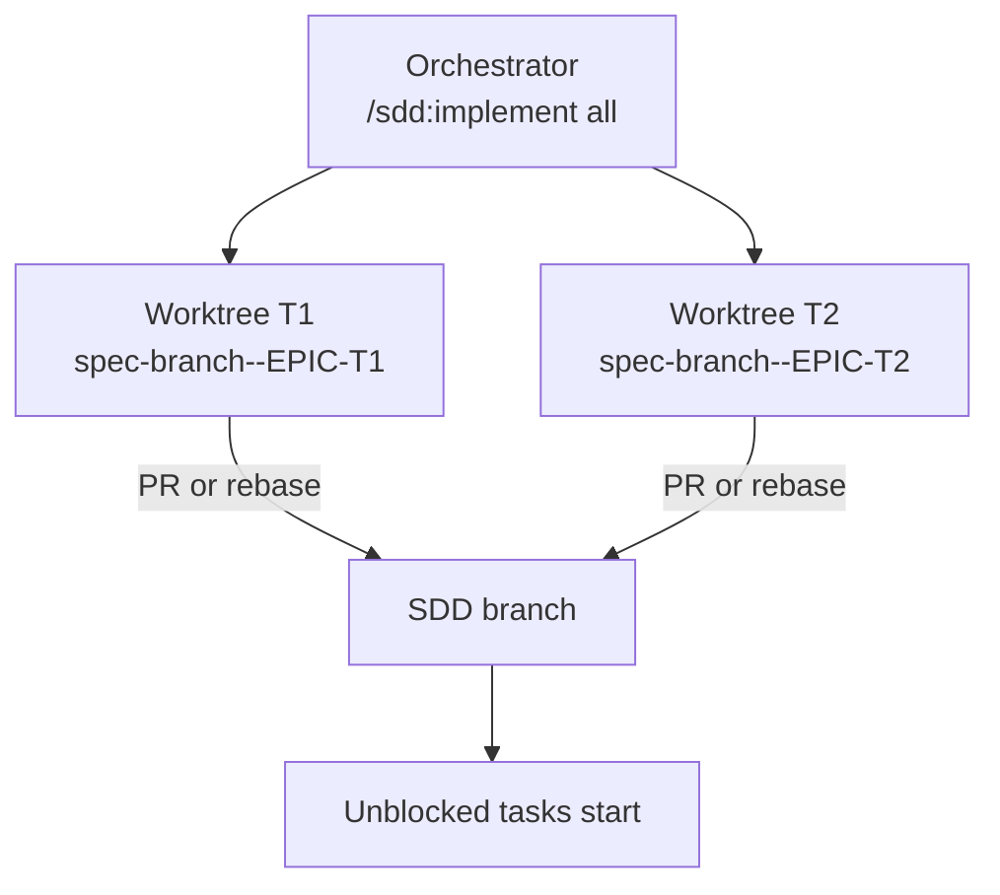

import { Tabs, TabItem, Aside } from '@astrojs/starlight/components';

By default (`isolation: none`) the session implements and commits each task itself. Opt in per project in `capabilities.yml`:

```yaml title="specs/capabilities.yml"
implementation:
  isolation:
    worktree:
      merge: pr       # pr (default) | auto
      parallel: 3
```

`merge` and `parallel` exist only under `worktree`.

With it, the session running `/sdd:implement all` only **orchestrates**. Every ready task runs in its own sub-session (Desktop) or isolated agent, in its own worktree, on branch `<spec-branch>--<EPIC>-T<n>` cut from the SDD branch. Sub-sessions never touch `specs/`; only the orchestrator writes `tasks.md`.



## Merge modes

<Tabs>
  <TabItem label="merge: pr">
    **Human in the loop.** Each task opens a PR into the SDD branch and the orchestrator waits (`status: in-progress`, `pr:` in the task; the board shows "waiting for merge").

    You merge. Running `/sdd:implement all` again checks the PRs and starts the tasks they unblock.
  </TabItem>

  <TabItem label="merge: auto">
    **Hands-off.** The orchestrator rebases the task branch onto the SDD branch and fast-forwards it, then starts the next tasks, without asking again after one up-front confirmation.
  </TabItem>
</Tabs>

<Aside type="note">
  Dependent tasks start only after their dependencies are merged. Projects in sibling repositories run in place.
</Aside>
