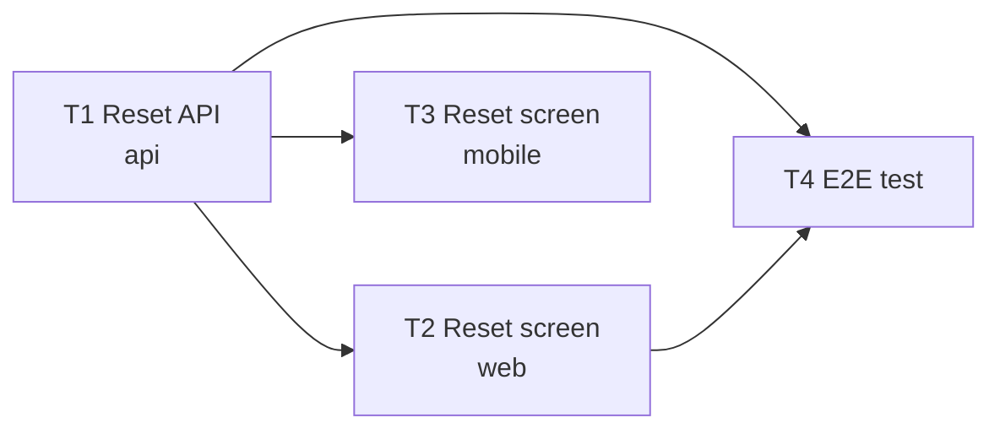

import { Steps, Aside, Tabs, TabItem } from '@astrojs/starlight/components';

`/sdd:tasks` writes one **Epic** (the feature) with **self-contained tasks**: tickets you could give an implementer as they are. A task is a coherent slice of behaviour in one project (a whole screen, a set of endpoints with logic and storage), never a layer or a micro-step.

```markdown title="specs/<slug>/tasks.md"
### T2: Reset password screen
project: web
status: draft
depends_on: [T1]
acceptance: AC1, AC4
plan: Contracts › reset API; File-by-file › web
scope:
- request form and new-password form with inline validation
- generated API client from T1
- states: loading, network error, expired token
files: apps/web/src/features/reset/*
```

Tasks keep **references** (AC ids, plan sections) instead of copies; the brief inlines them at hand-off time.



## What `/sdd:implement T2` does

<Steps>
  1. **Checks dependencies.** They must be `review` or `done`; otherwise it stops and names the blockers.

  2. **Picks the flow** from `implementation` in `specs/capabilities.yml`. The task's project wins over `default`:

     ```yaml
     implementation:
       default: in-session
       projects:
         api: agent:python-developer
         web: skill:my-web-flow
     ```

  3. **Builds the brief:** the task, the text of its acceptance criteria, the plan sections, the project's commands, the constitution rules that apply, and a definition of done.

  4. **Hands it over.** The implementer writes tests and code and runs the project's checks. `in-session` means the session does that itself.

  5. **Tracks status** `draft → in-progress → review` and commits the task's files with the trailer `Task: <EPIC>-T<n>`.
</Steps>

<Aside type="note">
  Verification is a separate step. [`/sdd:review`](/spec-driven-development/2.0/commands/review/) judges the outcome against the spec; the implementer is never its own judge.
</Aside>

### Who can implement

<Tabs>
  <TabItem label="skill:">
    A skill from your session or a plugin. Receives the brief as its argument.

    ```yaml
    web: skill:my-web-flow
    ```
  </TabItem>

  <TabItem label="agent:">
    A sub-agent, started with the Agent tool. Receives the brief as its prompt.

    ```yaml
    api: agent:python-developer
    ```
  </TabItem>

  <TabItem label="command:">
    A shell command. Receives the brief on stdin.

    ```yaml
    mobile: command:./scripts/implement.sh
    ```
  </TabItem>

  <TabItem label="in-session">
    The session itself, using the skills and docs it has for the stack. This is the default.

    ```yaml
    default: in-session
    ```
  </TabItem>
</Tabs>

## Ids

* Every command finds the feature by the `**Branch:**` line of its `spec.md`, so any branch skill may name the branch.
* **Acceptance criteria ids** (`AC1`, `AC2` …) never change once written. Tasks, `spec-verifier` and the board refer to them.
* **Epic id:** `tasks.md` carries `**Epic:** ULOG-7f3a` (slug letters plus 4 hex, assigned once, unique across specs). A task's full id is `<EPIC>-T<n>` (`ULOG-7f3a-T3`); it goes into the `Task:` trailer of every commit and the task branch name.
* Re-running `/sdd:tasks` after the plan changes keeps each task's id and status.

```bash
git log --grep 'Task: ULOG-7f3a-T3'   # finds the work
```
