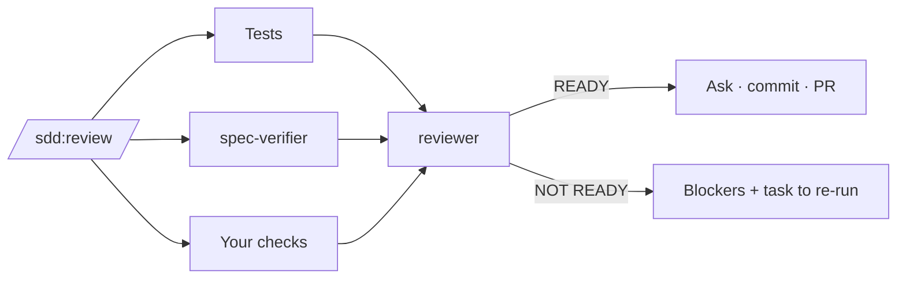

import { Steps, Aside, Tabs, TabItem } from '@astrojs/starlight/components';

The **only verification gate**. It judges the result against the acceptance criteria and the project's rules.



<Steps>

1. **In parallel:** the test suite once (`test` / `coverage` from constitution §2), `spec-verifier` over the whole feature diff (per-task commits, uncommitted and untracked changes, against the merge base), and every extra check you configured.
2. **`reviewer`** gets all results, checks the diff against each **WHAT NOT TO DO** rule, runs the domain audits and writes `specs/<slug>/review.md` with the verdict.
3. **Accepting blockers.** When every blocker is one you may accept (an out-of-scope change, a constitution rule, a non-critical audit finding), you are asked once: fix, or accept with a reason. Accepted items go under `## Accepted` and are not raised again.
4. **Acceptance criteria** are ticked `[x]` or unticked in `spec.md`; tasks with unmet criteria go back to `in-progress`.
5. **Publish.**

</Steps>

<Tabs>
  <TabItem label="READY">
    Shows the commit title, PR title and file list and asks (`publish: ask`). Then commits what is left (statuses, `review.md`) and opens the PR with `actions.commit` / `actions.pr`, or git and `gh` when none is set.
  </TabItem>
  <TabItem label="NOT READY">
    Lists concrete blockers and, for each unmet criterion, the task to re-run, for example `/sdd:implement T3`.
  </TabItem>
</Tabs>

<Aside type="caution" title="Cannot be accepted">
Failing tests, unmet acceptance criteria, non-goal violations and failed checks always block READY.
</Aside>

## Configuration

```yaml title="specs/capabilities.yml"
review:
  tests: run          # run | skip
  publish: ask        # ask | off
  default: auto       # auto | skill:<name> | agent:<name>
  projects:
    api: agent:python-reviewer
  checks: [agent:qa]  # on every review, e.g. QA that starts the app

actions:
  branch: skill:create-branch
  commit: skill:create-commit
  pr: skill:create-pull-request
```

A check returns `PASS`, `FAIL` or `SKIPPED`. `FAIL` blocks READY; `SKIPPED` never does. All keys: [capabilities reference](/spec-driven-development/configuration/capabilities/).
