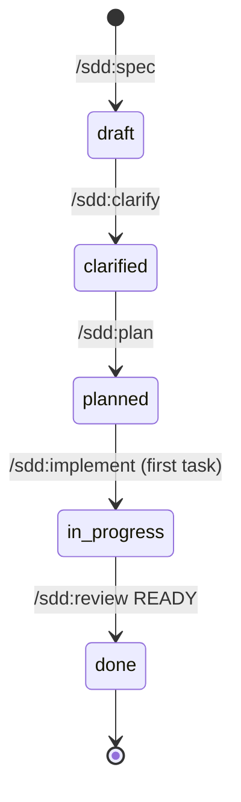
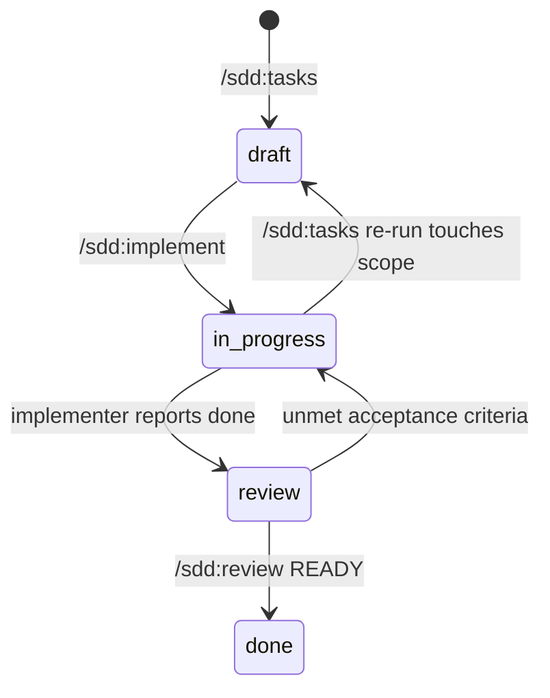

import { Aside } from '@astrojs/starlight/components';

## Spec

## Tasks

## All statuses

| File | Status | Set by |
|---|---|---|
| `spec.md` | `draft` → `clarified` → `planned` → `in-progress` → `done` | `/sdd:spec` → `/sdd:clarify` → `/sdd:plan` → `/sdd:implement` → `/sdd:review` |
| `plan.md` | `draft` → `tasks-ready` → `in-progress` → `done` | `/sdd:plan` → `/sdd:tasks` → `/sdd:implement` → `/sdd:review` |
| task | `draft` → `in-progress` → `review` → `done` | `/sdd:tasks` → `/sdd:implement` → implementer → `/sdd:review` |

<Aside type="note" title="Only two moves go backwards">
`/sdd:review` sets a task with unmet acceptance criteria back to `in-progress`, and a `/sdd:tasks` re-run sets a started task back to `draft` when the change touches its scope. Nothing else moves a status backwards.
</Aside>
