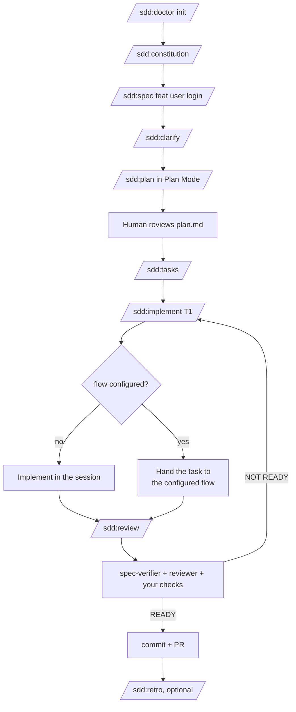

| Phase | Command | What happens |
|---|---|---|
| Constitution | [`/sdd:constitution`](/spec-driven-development/commands/constitution/) | Edit `specs/constitution.md`: tech stack, conventions, **WHAT NOT TO DO** with rationale, testing philosophy, out-of-scope. |
| Specify | [`/sdd:spec`](/spec-driven-development/commands/spec/) | Create the feature branch and `specs/<slug>/spec.md` (business only, no code). |
| Clarify | [`/sdd:clarify`](/spec-driven-development/commands/clarify/) | Finds gaps, asks up to 5 questions with proposed answers, writes answers into the spec. |
| Plan | [`/sdd:plan`](/spec-driven-development/commands/plan/) | Generates `plan.md`: decisions, contracts, file-by-file changes, risks. **Run in Plan Mode.** |
| Tasks | [`/sdd:tasks`](/spec-driven-development/commands/tasks/) | Splits the plan into self-contained, Jira-like tasks under one Epic. |
| Implement | [`/sdd:implement`](/spec-driven-development/commands/implement/) | Builds a brief per task and hands it to the configured flow. Does not verify. |
| Review | [`/sdd:review`](/spec-driven-development/commands/review/) | Tests, `spec-verifier` and extra checks in parallel, then `reviewer`: READY or NOT READY, then commit and PR. |
| Retro | [`/sdd:retro`](/spec-driven-development/commands/retro/) | Optional. Turns repeatable mistakes in `review.md` into constitution rules. |
| Analyze | [`/sdd:analyze`](/spec-driven-development/commands/analyze/) | Read-only drift check between spec, plan, tasks and code. Run anytime. |

## How the pieces fit

```text
┌──────────────────────────────────────────────────────────────┐
│  THE FRAMEWORK (main Claude session)                         │
│  constitution → spec → clarify → plan → tasks → hand-off     │
│  → review                                                    │
└──────────────────────────────────────────────────────────────┘
        ↓ brief per task                    ↓ Agent tool
┌───────────────────────────────┐  ┌───────────────────────────┐
│  IMPLEMENTATION FLOW          │  │  VERIFICATION AGENTS      │
│  your skill / agent / command │  │  • spec-verifier          │
│  or the session itself        │  │  • reviewer               │
│  (writes code and tests,      │  │  • your own checks (QA)   │
│   runs the project's checks)  │  │                           │
└───────────────────────────────┘  └───────────────────────────┘
```

Implementation is deliberately not part of the framework: you point `/sdd:implement` at the flow you already use.
