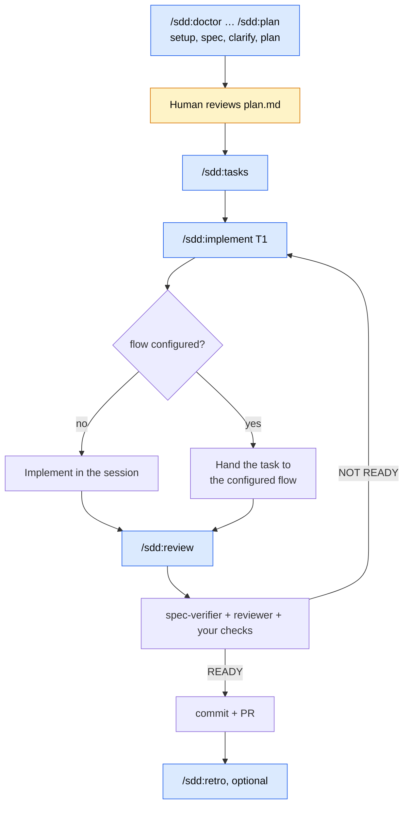
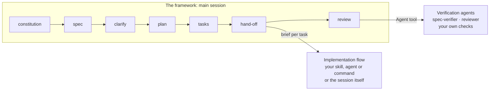

import { Aside, LinkCard, CardGrid } from '@astrojs/starlight/components';
import Pipeline from '../../../components/Pipeline.astro';

<Pipeline />

## Phase by phase

| Phase | Command | What happens | Writes |
|---|---|---|---|
| **Constitution** | [`/sdd:constitution`](/spec-driven-development/commands/constitution/) | Stack, conventions, **WHAT NOT TO DO** with rationale, testing philosophy. | `constitution.md` |
| **Specify** | [`/sdd:spec`](/spec-driven-development/commands/spec/) | Branch plus a business-only spec. | `spec.md` |
| **Clarify** | [`/sdd:clarify`](/spec-driven-development/commands/clarify/) | Finds gaps, asks up to 5 questions with proposed answers. | `spec.md` |
| **Plan** | [`/sdd:plan`](/spec-driven-development/commands/plan/) | Decisions, contracts, file-by-file changes, risks. Plan Mode. | `plan.md` |
| **Tasks** | [`/sdd:tasks`](/spec-driven-development/commands/tasks/) | Self-contained, Jira-like tasks under one Epic. | `tasks.md` + commit |
| **Implement** | [`/sdd:implement`](/spec-driven-development/commands/implement/) | Brief per task, handed to your flow. Does not verify. | task commits |
| **Review** | [`/sdd:review`](/spec-driven-development/commands/review/) | Tests, verifier, checks, then READY or NOT READY. | `review.md` + PR |
| **Retro** | [`/sdd:retro`](/spec-driven-development/commands/retro/) | Mistakes become constitution rules. | constitution §5 |
| **Analyze** | [`/sdd:analyze`](/spec-driven-development/commands/analyze/) | Drift check across spec, plan, tasks and code. | nothing |

<Aside type="tip" title="Three human checkpoints">
You decide at **Clarify** (answers), **Plan** (approving the dialog) and **Review** (confirming commit and PR). Everything between is mechanical.
</Aside>

## How the pieces fit

Implementation is deliberately outside the framework: you point `/sdd:implement` at the flow you already use.
