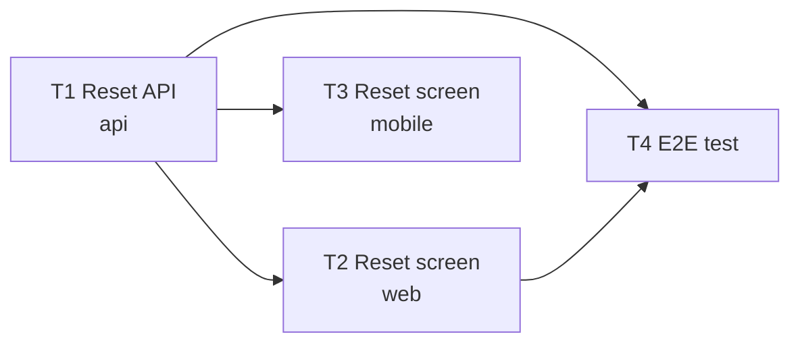

import { Steps, Aside, Tabs, TabItem } from '@astrojs/starlight/components';

`/sdd:tasks` zapisuje jeden **Epic** (funkcję) z **samodzielnymi zadaniami**: ticketami, które można przekazać implementatorowi w takiej postaci. Zadanie to spójny kawałek zachowania w jednym projekcie (cały ekran, zestaw endpointów z logiką i storage), nigdy warstwa ani mikrokrok.

```markdown title="specs/<slug>/tasks.md"
### T2: Reset password screen
project: web
status: draft
depends_on: [T1]
acceptance: AC1, AC4
plan: Contracts › reset API; File-by-file › web
scope:
- request form and new-password form with inline validation
- generated API client from T1
- states: loading, network error, expired token
files: apps/web/src/features/reset/*
```

Zadania trzymają **odwołania** (id AC, sekcje planu) zamiast kopii; brief wstawia je w momencie przekazania.



## Co robi `/sdd:implement T2`

<Steps>
  1. **Sprawdza zależności.** Muszą mieć status `review` lub `done`; w przeciwnym razie zatrzymuje się i wskazuje blokery.

  2. **Wybiera flow** z `implementation` w `specs/capabilities.yml`. Projekt zadania ma pierwszeństwo przed `default`:

     ```yaml
     implementation:
       default: in-session
       projects:
         api: agent:python-developer
         web: skill:my-web-flow
     ```

  3. **Buduje brief:** zadanie, treść jego kryteriów akceptacji, sekcje planu, komendy projektu, obowiązujące reguły konstytucji i definicję „gotowe".

  4. **Przekazuje.** Implementator pisze testy i kod oraz uruchamia sprawdzenia projektu. `in-session` oznacza, że robi to sama sesja.

  5. **Śledzi status** `draft → in-progress → review` i commituje pliki zadania z trailerem `Task: <EPIC>-T<n>`.
</Steps>

<Aside type="note">
  Weryfikacja to osobny krok. [`/sdd:review`](/spec-driven-development/pl/2.0/commands/review/) ocenia wynik względem specu; implementator nigdy nie jest własnym sędzią.
</Aside>

### Kto może implementować

<Tabs>
  <TabItem label="skill:">
    Skill z Twojej sesji lub pluginu. Dostaje brief jako argument.

    ```yaml
    web: skill:my-web-flow
    ```
  </TabItem>

  <TabItem label="agent:">
    Sub-agent uruchamiany narzędziem Agent. Dostaje brief jako prompt.

    ```yaml
    api: agent:python-developer
    ```
  </TabItem>

  <TabItem label="command:">
    Komenda shell. Dostaje brief na stdin.

    ```yaml
    mobile: command:./scripts/implement.sh
    ```
  </TabItem>

  <TabItem label="in-session">
    Sama sesja, z użyciem skilli i dokumentacji, które ma dla danego stacku. To wartość domyślna.

    ```yaml
    default: in-session
    ```
  </TabItem>
</Tabs>

## Identyfikatory

* Każda komenda znajduje funkcję po linii `**Branch:**` w jej `spec.md`, więc dowolny skill do gałęzi może nazwać gałąź.
* **Id kryteriów akceptacji** (`AC1`, `AC2` …) nigdy się nie zmieniają po zapisaniu. Odwołują się do nich zadania, `spec-verifier` i board.
* **Id Epica:** `tasks.md` zawiera `**Epic:** ULOG-7f3a` (litery sluga plus 4 znaki hex, nadawane raz, unikalne w obrębie specyfikacji). Pełne id zadania to `<EPIC>-T<n>` (`ULOG-7f3a-T3`); trafia do trailera `Task:` każdego commita i do nazwy gałęzi zadania.
* Ponowne uruchomienie `/sdd:tasks` po zmianie planu zachowuje id i status każdego zadania.

```bash
git log --grep 'Task: ULOG-7f3a-T3'   # finds the work
```
