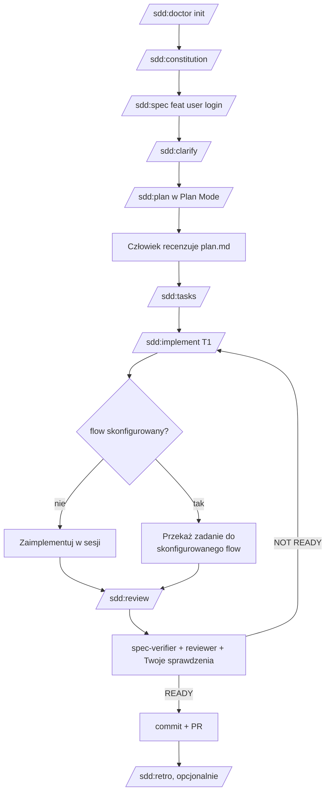
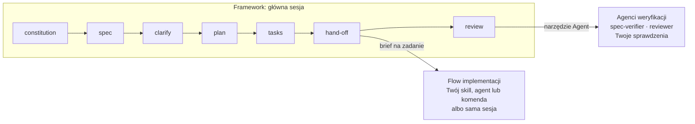

import { Aside, LinkCard, CardGrid } from '@astrojs/starlight/components';
import Pipeline from '../../../../../components/Pipeline.astro';

<Pipeline />

## Faza po fazie

| Faza | Komenda | Co się dzieje | Zapisuje |
|---|---|---|---|
| **Constitution** | [`/sdd:constitution`](/spec-driven-development/pl/2.0/commands/constitution/) | Stack, konwencje, **WHAT NOT TO DO** z uzasadnieniem, filozofia testów. | `constitution.md` |
| **Specify** | [`/sdd:spec`](/spec-driven-development/pl/2.0/commands/spec/) | Gałąź i spec wyłącznie biznesowy. | `spec.md` |
| **Clarify** | [`/sdd:clarify`](/spec-driven-development/pl/2.0/commands/clarify/) | Znajduje luki, zadaje do 5 pytań z proponowanymi odpowiedziami. | `spec.md` |
| **Plan** | [`/sdd:plan`](/spec-driven-development/pl/2.0/commands/plan/) | Decyzje, kontrakty, zmiany plik po pliku, ryzyka. Plan Mode. | `plan.md` |
| **Tasks** | [`/sdd:tasks`](/spec-driven-development/pl/2.0/commands/tasks/) | Samodzielne zadania w stylu Jiry pod jednym Epikiem. | `tasks.md` + commit |
| **Implement** | [`/sdd:implement`](/spec-driven-development/pl/2.0/commands/implement/) | Brief na zadanie, przekazany do Twojego flow. Nie weryfikuje. | commity zadań |
| **Review** | [`/sdd:review`](/spec-driven-development/pl/2.0/commands/review/) | Testy, verifier, sprawdzenia, potem READY lub NOT READY. | `review.md` + PR |
| **Retro** | [`/sdd:retro`](/spec-driven-development/pl/2.0/commands/retro/) | Błędy zamieniają się w reguły konstytucji. | konstytucja §5 |
| **Analyze** | [`/sdd:analyze`](/spec-driven-development/pl/2.0/commands/analyze/) | Kontrola rozjazdu między specem, planem, zadaniami i kodem. | nic |

<Aside type="tip" title="Trzy punkty kontrolne człowieka">
  Decydujesz przy **Clarify** (odpowiedzi), **Plan** (zatwierdzenie dialogu) i **Review** (potwierdzenie commita i PR). Wszystko pomiędzy jest mechaniczne.
</Aside>

## Jak części do siebie pasują

Implementacja celowo leży poza frameworkiem: wskazujesz `/sdd:implement` flow, którego już używasz.
