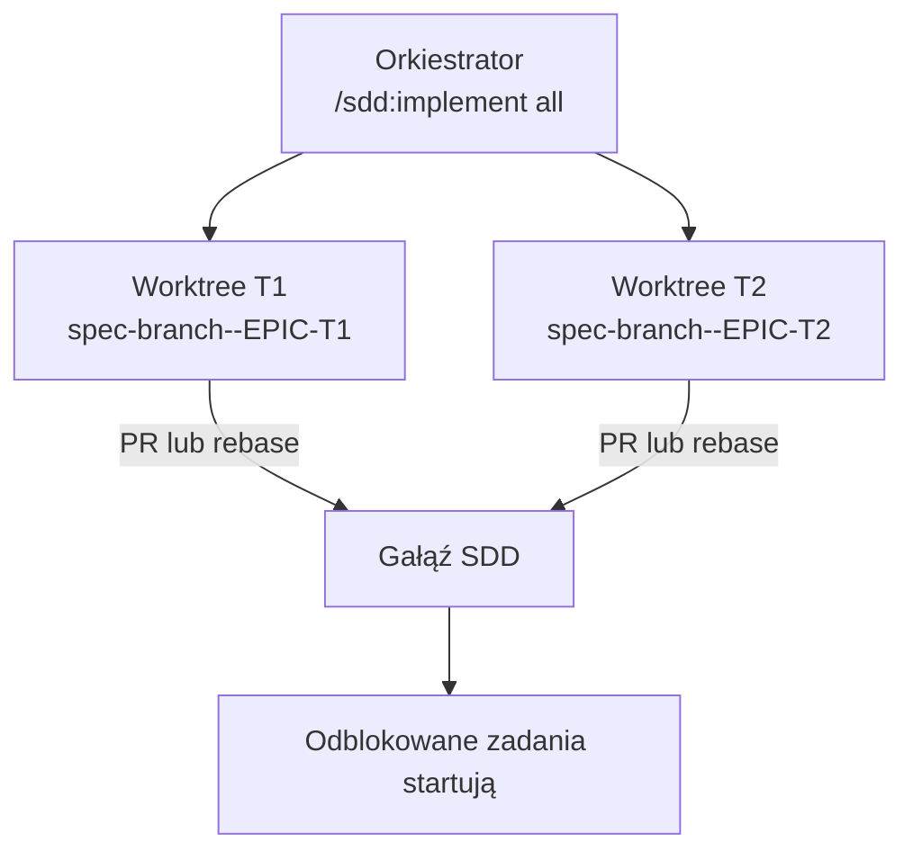

import { Tabs, TabItem, Aside } from '@astrojs/starlight/components';

Domyślnie (`isolation: none`) sesja sama implementuje i commituje każde zadanie. Włączasz izolację per projekt w `capabilities.yml`:

```yaml title="specs/capabilities.yml"
implementation:
  isolation:
    worktree:
      merge: pr       # pr (default) | auto
      parallel: 3
```

`merge` i `parallel` istnieją tylko pod `worktree`.

Wtedy sesja uruchamiająca `/sdd:implement all` tylko **orkiestruje**. Każde gotowe zadanie działa we własnej sub-sesji (Desktop) lub izolowanym agencie, we własnym worktree, na gałęzi `<spec-branch>--<EPIC>-T<n>` odciętej od gałęzi SDD. Sub-sesje nigdy nie dotykają `specs/`; tylko orkiestrator zapisuje `tasks.md`.



## Tryby merge

<Tabs>
  <TabItem label="merge: pr">
    **Człowiek w pętli.** Każde zadanie otwiera PR do gałęzi SDD, a orkiestrator czeka (`status: in-progress`, `pr:` w zadaniu; board pokazuje „czeka na merge").

    Ty robisz merge. Ponowne `/sdd:implement all` sprawdza PR-y i startuje zadania, które odblokowały.
  </TabItem>
  <TabItem label="merge: auto">
    **Bez udziału człowieka.** Orkiestrator robi rebase gałęzi zadania na gałąź SDD i fast-forward, po czym startuje kolejne zadania, bez ponownego pytania po jednym potwierdzeniu na początku.
  </TabItem>
</Tabs>

<Aside type="note">
Zadania zależne startują dopiero po zmergowaniu ich zależności. Projekty w sąsiednich repozytoriach działają w miejscu.
</Aside>
