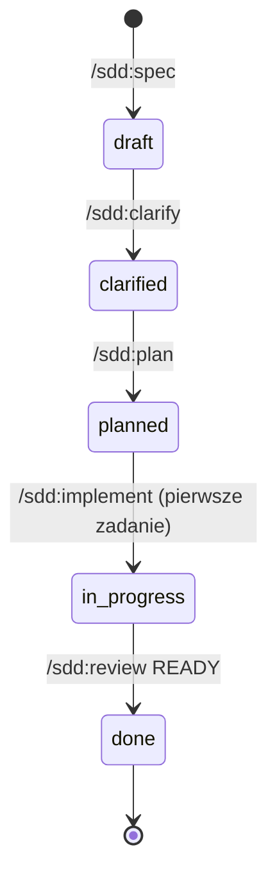
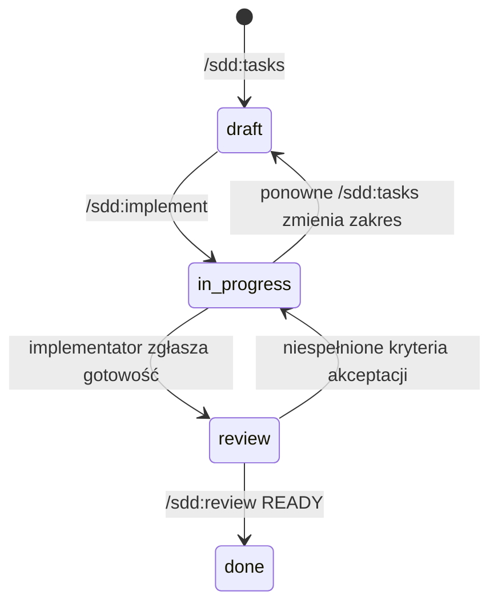

import { Aside } from '@astrojs/starlight/components';

## Spec

## Zadania

## Wszystkie statusy

| Plik | Status | Ustawia |
|---|---|---|
| `spec.md` | `draft` → `clarified` → `planned` → `in-progress` → `done` | `/sdd:spec` → `/sdd:clarify` → `/sdd:plan` → `/sdd:implement` → `/sdd:review` |
| `plan.md` | `draft` → `tasks-ready` → `in-progress` → `done` | `/sdd:plan` → `/sdd:tasks` → `/sdd:implement` → `/sdd:review` |
| zadanie | `draft` → `in-progress` → `review` → `done` | `/sdd:tasks` → `/sdd:implement` → implementator → `/sdd:review` |

<Aside type="note" title="Tylko dwa ruchy wstecz">
`/sdd:review` cofa zadanie z niespełnionymi kryteriami akceptacji do `in-progress`, a ponowne `/sdd:tasks` cofa rozpoczęte zadanie do `draft`, gdy zmiana dotyka jego zakresu. Nic innego nie cofa statusu.
</Aside>
