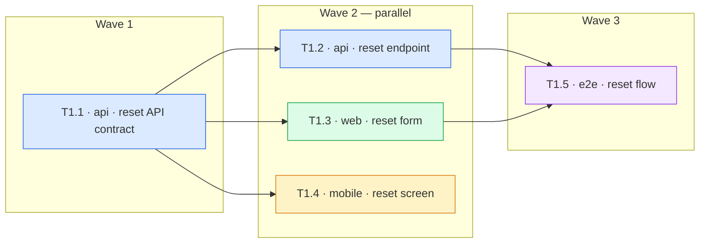

The **Tasks** phase of SDD. Decompose `plan.md` into testable tasks, each tagged with the project
it belongs to, routed to a specialist agent, and linked to the tasks it depends on — so
`/sdd:implement` can run every task that is not blocked **in parallel**.

> 💰 **Recommended session model: Sonnet.** Decomposition is mechanical — reserve Opus for the
> judgement-heavy phases (`/sdd:spec`, `/sdd:clarify`, `/sdd:plan`, `/sdd:review`).

## Steps

### 1. Load context

- `specs/<current>/plan.md` (from the current branch)
- `specs/capabilities.md` — **critical**:
  - `## Projects` (legacy name: `## Stack profile`) — the projects of this codebase: name, kind
    (web / backend / mobile / library / e2e / infra …), path, stack, and the repository for a
    project in a sibling repo. A single-app repo has one project, `root`.
  - `## Task type → routing rules` and `## Custom routing rules` — `type` + `Stack` → agent, skills,
    model (the defaults and any `<!-- user-override -->` customizations).

### 2. Decomposition

From `plan.md` (the "File-by-file change list" section) generate the task list:

- Hierarchy: **Epic** → **Story** → **Task**.
- **Exactly ONE Epic per feature** — a single `/sdd:spec` run produces one feature, which maps to one
  Epic. NEVER emit multiple Epics. If the work feels like several Epics, the feature is too large
  and should have been split into separate `/sdd:spec` runs — flag this to the user rather than
  inventing extra Epics.
- **A Story is a user story** — something a user can do when it ships (the spec's User stories).
  It is NOT one per app: a story like "user resets their password" spans the API, the web app and
  the mobile app. Its tasks carry the `project` they belong to.
- **One task = one unit of behaviour together with its tests**, in one project — something a user
  or another project can observe: an endpoint *with* the service and storage behind it, a screen
  *with* its state and data loading, a migration, a CLI command. The internal layers of one unit
  (router, service, repository, hook, styles) belong to the same task — do not give each layer its
  own task. Size: a few hours of work. Do not split a unit
  into a "tests" task and an "implementation" task: the red→green cycle happens *inside* the task
  (see `tdd` below). Do not merge units from different projects into one task.
- **`tdd` — the TDD shape of the task** (technology-neutral; test-first is the default):
  - `test-first` (default) — write the failing test first, then the implementation. A missing
    symbol does NOT make a unit contract-first: stub it trivially so the test fails on a real
    assertion. Use for anything whose deliverable is behaviour.
  - `contract-first` (narrow exception) — the unit's deliverable *is itself a public
    interface/contract other code references by shape* (a UI component's props, a typed service
    interface, an API/RPC schema): declare the contract, then the failing tests, then the
    implementation — all within the task. When in doubt, choose test-first.
- **A contract shared between projects is its own task.** When one project consumes what another
  provides — an OpenAPI/pydantic/GraphQL/protobuf schema the web or mobile client is generated
  from, types in a shared package, a DB migration — make the contract a separate task (in the
  project that owns it) and let the consuming tasks depend on it. This is what lets the provider
  and the consumers be built in parallel afterwards.
- **Cross-project verification** (an end-to-end or contract test across apps) is its own task in
  the `e2e` project (or the project that hosts those tests), depending on the tasks it exercises.

### 3. Tag every task

```yaml
- id: T<story>.<n>
  title: <one-line description>
  project: <name from capabilities "Projects"; `root` in a single-project repo>
  type: <task type from capabilities.md>
  tdd: test-first            # or contract-first
  agent: <specialist agent from routing rules OR "orchestrator">
  skills: [<skills to load>]
  model: <cost tier from routing rules OR "sonnet">
  depends_on: [<task ids that must be done first>]   # [] when nothing blocks it
  status: draft
  acceptance: <concrete AC from spec.md, measurable>
  tests: [<test files this task writes or extends>]
  files: [<source files to create or modify>]
```

**Routing:**

1. Choose a `type`. **The available types come from the project's `capabilities.md` routing
   table** — match the task to the closest type by the nature of the work (contract, a test-heavy
   unit, an implementation, a migration, …); anything with no dedicated row → `generic`.
2. Find the row matching `type` **and the task's project** (the `Stack` column holds `*`, a project
   name, a kind or a stack word; the most specific match wins: project name, then kind/stack word,
   then `*`). Pull `agent` + `skills` + `model` from it.
   The same `type` can route to different agents per stack — e.g. `implementation` → a Python
   specialist for the API and a Next.js specialist for the web app.
3. Use only agents that can edit files (their `tools` include Write/Edit, or `*`). A row pointing
   at a read-only agent (an architect, a reviewer, an auditor) is a misconfiguration: use
   `orchestrator` for that task and tell the user to fix the row. (An agent that edits but has no
   Bash is fine — `/sdd:implement` runs its tests for it.)
4. No matching row → `agent: orchestrator`, `skills: []`, `model: sonnet`. A legacy routing table
   with no `Stack` column → every row counts as `*`; no `Model` column → `model: sonnet`.

**Dependencies (`depends_on`) — what blocks what:**

- Task B depends on task A when B **needs A's result**: A defines a contract, schema, migration,
  shared type or generated client that B uses, or B's tests exercise A's behaviour.
- Two tasks whose `files` or `tests` overlap must never run together: make the later one depend on
  the earlier one.
- Do NOT add a dependency only because of list order or because both belong to the same Story —
  every extra edge removes parallelism.
- Dependencies may point to a task in an earlier Story, never to a later one.

### 4. Compute the execution waves and draw the flow

For every Story, compute its **waves** — the layers of the dependency graph:
- Wave 1 = the Story's tasks whose `depends_on` are empty or point only to earlier Stories.
- Wave N+1 = the tasks whose dependencies are all in waves ≤ N.
- Tasks in the same wave run **in parallel** in `/sdd:implement`.

Check the graph: a cycle, a dependency on a task that does not exist, a dependency on a later
Story, or two tasks in one wave with overlapping `files`/`tests` → fix it (or STOP and tell the
user when the plan itself is contradictory).

Under each Story write the waves as one line and the **flow diagram** as Mermaid — one subgraph per
wave, one node per task, an arrow per dependency inside the Story, one `classDef` per project so
each project has its colour. Node ids replace the dot with `_` (`T1_2`) and every label is quoted
(`T1_2["T1.2 · api · reset endpoint"]`) — dots in ids and unquoted punctuation break Mermaid:

````markdown
**Waves:** 1: T1.1 · 2: T1.2 ∥ T1.3 ∥ T1.4 · 3: T1.5


````

In a single-project repo with no parallel work the diagram is a simple chain — still write it.

### 5. Write `tasks.md`

`specs/<current>/tasks.md`:

````markdown
# Tasks: <feature_title>

**Spec:** `specs/<slug>/spec.md`
**Plan:** `specs/<slug>/plan.md`

## Epic: <name>

### Story S1: <user story>

<!-- Illustrative example — a full-stack feature in a monorepo (FastAPI `api`, Next.js `web`,
     Flutter `mobile`, Playwright `e2e`). The `project`, `type`, agent and skill names come from
     this project's capabilities.md; another codebase uses its own. -->

```yaml
- id: T1.1
  title: Password reset API contract (request + confirm schemas, OpenAPI)
  project: api
  type: contract
  tdd: contract-first
  agent: orchestrator
  skills: []
  model: sonnet
  depends_on: []
  status: draft
  acceptance: OpenAPI exposes POST /auth/reset and /auth/reset/confirm with the request/response schemas from spec AC1–AC3; schema tests pass
  tests: [apps/api/tests/test_reset_schema.py]
  files: [apps/api/app/auth/schemas.py, apps/api/openapi.json]

- id: T1.2
  title: Password reset endpoints
  project: api
  type: implementation
  tdd: test-first
  agent: python-developer
  skills: [fastapi-rules]
  model: sonnet
  depends_on: [T1.1]
  status: draft
  acceptance: AC1 (email sent for a known address), AC2 (same response for an unknown one), AC3 (token expires after 30 min)
  tests: [apps/api/tests/test_reset.py]
  files: [apps/api/app/auth/reset.py]

- id: T1.3
  title: Reset password form
  project: web
  type: implementation
  tdd: test-first
  agent: orchestrator
  skills: [design-system]
  model: sonnet
  depends_on: [T1.1]
  status: draft
  acceptance: AC1, AC4 (validation errors shown inline) against the generated API client
  tests: [apps/web/src/features/reset/reset-form.test.tsx]
  files: [apps/web/src/features/reset/reset-form.tsx]

- id: T1.4
  title: Reset password screen
  project: mobile
  type: implementation
  tdd: test-first
  agent: orchestrator
  skills: []
  model: sonnet
  depends_on: [T1.1]
  status: draft
  acceptance: AC1, AC4 on the mobile screen
  tests: [../mobile-app/test/reset_screen_test.dart]
  files: [../mobile-app/lib/features/reset/reset_screen.dart]

- id: T1.5
  title: Password reset end-to-end flow
  project: e2e
  type: e2e-test
  tdd: test-first
  agent: orchestrator
  skills: []
  model: sonnet
  depends_on: [T1.2, T1.3]
  status: draft
  acceptance: a user requests a reset on the web, follows the link and sets a new password
  tests: [apps/web-e2e/src/reset.spec.ts]
  files: []
```

**Waves:** 1: T1.1 · 2: T1.2 ∥ T1.3 ∥ T1.4 · 3: T1.5

<the Mermaid flow diagram from Step 4>
````

### 6. Advance status + output

Set `specs/<current>/plan.md` header `**Status:**` → `tasks-ready` (unless already at a later state).

Show the user a summary table, the waves per Story, and the flow diagram:

```markdown
| ID | Title | Project | Agent | Depends on | Model |
|----|-------|---------|-------|------------|-------|
| T1.1 | Password reset API contract | api | orchestrator | — | sonnet |
| T1.2 | Password reset endpoints | api | python-developer | T1.1 | sonnet |
| T1.3 | Reset password form | web | orchestrator | T1.1 | sonnet |
```

Plus the suggestion: `/clear`, then `/sdd:implement S1` to implement the whole first Story —
`/sdd:implement` runs it wave by wave, with the tasks of each wave in parallel. It re-reads
`tasks.md` from disk, so clearing the transcript first keeps the implement session small. A single
task ID (`/sdd:implement T1.2`) still works for surgical re-runs.

## Constraints

- ⛔ DO NOT write actual code
- ✅ One task per unit of behaviour, with its tests — the red→green cycle happens inside the task (`tdd`)
- ✅ Test-first by default; `contract-first` only when the unit's deliverable is itself a public interface/contract other code references by shape
- ✅ A contract shared between projects is its own task; consumers depend on it
- ✅ Every task has `project`, `type`, `tdd`, `agent`, `skills`, `model`, `depends_on` (`model` defaults to `sonnet`, `depends_on` to `[]`)
- ✅ Tasks in one wave never share `files` or `tests`
- ✅ Every Story shows its waves and a Mermaid flow diagram
- ✅ Follow the project's own conventions for where interfaces/types live — the framework imposes no file-layout rule
- ✅ `acceptance` must be measurable (NOT "works correctly")
