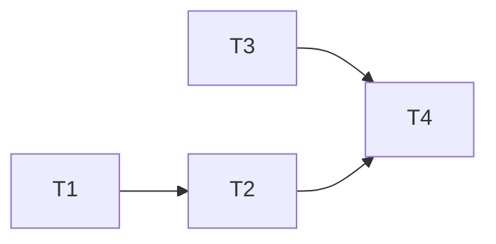

# SDD Tasks

The **Tasks** phase of SDD. Turn `plan.md` into a list of **tasks you could hand to an
implementer as they are**: each says what to build, where, and which acceptance criteria it must
satisfy. You plan and describe; you do not implement and you do not choose agents or models —
`/sdd:implement` hands each task to the project's implementation flow.

## Steps

### 1. Load context

- the feature folder `specs/<current>/`: from `$ARGUMENTS`, else the spec whose `**Branch:**`
  equals `git branch --show-current` (none → list the specs and ask); read its `plan.md` and
  `spec.md` (the AC ids)
- `specs/capabilities.yml`: `projects` and `actions.commit` (step 5). Only the old `specs/capabilities.md` exists → STOP: "Run `/sdd:doctor init` to migrate it."
- `tasks.md`, when it already exists (a re-run after the plan or the spec changed)

### 2. Decompose

Hierarchy: **Epic → Task**. The Epic is the feature, exactly one per `/sdd:spec` run (work that
feels like several Epics should have been separate specs — say so instead of inventing Epics).

A **task is a ticket**: one project, one coherent slice of behaviour, typically a few hours to a
day — a whole screen with its state and data loading, a set of endpoints with their logic and
storage, a migration, a CLI command. Not a layer, not a micro-step: no task for "the form", for "the
tests" or for "the service" of one unit. Tests belong to the task that delivers the behaviour.

- Every spec AC is covered by at least one task; every task serves at least one AC.
- A contract shared between projects (schema, generated client, shared types, migration) is its
  own task in the project that owns it; consumers depend on it. Cross-project verification (e2e) is
  a task that depends on what it exercises.
- `depends_on` only where a task needs another's result or touches the same files. Never because
  of list order.
- **Do not copy the plan or the spec.** Refer to AC ids and plan sections; `/sdd:implement` inlines
  them into the brief when it hands the task over.

### 3. Epic id

The Epic gets an id that never changes: capital letters only, for example `ULOG`. Tasks keep
their `T<n>` headings; the full id of a task is `<EPIC>-T<n>` (`ULOG-T3`). It is what
`/sdd:implement` puts in commit trailers and task branch names.

- `tasks.md` has a `**Epic:**` line → keep it.
- Otherwise build it from the spec slug: the first letter of each word, at most 5 (one word → its
  first 4 letters), uppercased, letters only. At least 2 letters; a shorter result takes the next
  letters of the slug. Another `specs/*/tasks.md` already has that id → append the next letter of
  the slug's last word until it is unique (at most 8 letters; still taken → ask the user for one).

Then name the session after the Epic: the session has a tool that renames it (Claude Code Desktop:
`mcp__ccd_session_mgmt__set_session_title`, load it with ToolSearch when deferred) → set this
session's title (`session_id: "self"`) to `<EPIC> <feature_title>` (`ULOG User Login`), with
`feature_title` from the spec's `# Feature:` heading. No such tool, or the rename is declined → go on
without it.

### 4. Write `specs/<current>/tasks.md`

````markdown
# Tasks: <feature_title>

**Spec:** `specs/<slug>/spec.md`  **Plan:** `specs/<slug>/plan.md`
**Epic:** <EPIC>

## Flow



## Epic: <feature_title>

### T1: <title>
project: <name from `projects`; `root` in a single-app repo>
status: draft
depends_on: []
acceptance: AC1, AC3
plan: <plan sections this task implements>
scope:
- <concrete action>
- <concrete action>
files: <expected paths or globs, relative to the spec repo>
notes: <optional — a constraint or constitution rule that applies here>
````

`scope` is the list of actions, specific enough to start from (behaviours, states, edge cases from
the AC). `acceptance` is measurable via the spec's AC ids. Write `depends_on: []` when the task
waits for nothing; omit `notes` when nothing applies.

**Re-run** (a `tasks.md` exists): update it, do not start over. Keep the `**Epic:**` id (an old
file without one gets one) and each existing task's id, `status`, `branch:` and `pr:` lines; a task that is `in-progress`, `review` or `done` keeps its `scope` unless the change
touches it — then set it back to `draft` and say so. New tasks take the next unused id; a task no
longer needed is removed only while `draft`, otherwise report it and leave it.

Add one line at the end: `Order: T1 → T2 ∥ T3 → T4` (what can run once its dependencies are done).

`## Flow` (above the tasks) is the dependency graph: one node per task, `T<n>["T<n> <title, at most
~5 words>"]`, one edge `A --> B` per `depends_on` entry (B depends on A), a task with no dependencies
and no dependents as a bare node. Rewrite the whole block on every run so it matches `depends_on`.

### 5. Check, advance, commit, report

Fail and fix on: an AC with no task, a task with no AC, a cycle, a dependency on a missing task, two
independent tasks with overlapping `files`.

Set `plan.md` `**Status:**` → `tasks-ready` with Edit (unless already later).

**Commit the documentation.** The spec, plan and tasks are the whole documentation of the feature,
and nothing earlier commits them:

- `git status --short -- specs/<slug>/` is empty → nothing to commit.
- Otherwise stage `specs/<slug>/` only (never `git add -A`, never other paths) and commit it with the
  `actions.commit` (`skill:` / `agent:` / `command:`); unset → `git add -- specs/<slug>/`
  and `git commit`. Message `docs(<slug>): add spec, plan and tasks` (a re-run: `docs(<slug>): update tasks`),
  trailer `Epic: <EPIC>`. Check it landed with `git log -1 --format='%(trailers:key=Epic,valueonly)'`;
  empty (a skill rewrote the message) → `git commit --amend --trailer 'Epic: <EPIC>'`.
- Not on the feature branch (`**Branch:**` of the spec) → do not commit; say so.

Report the task count, projects, the commit and the `Order:` line. Next: `/sdd:implement T1` (one task) or `/sdd:implement all`; best after
`/clear` — it re-reads `tasks.md` from disk. Name the next step; do not start it yourself.

Do not write code.
